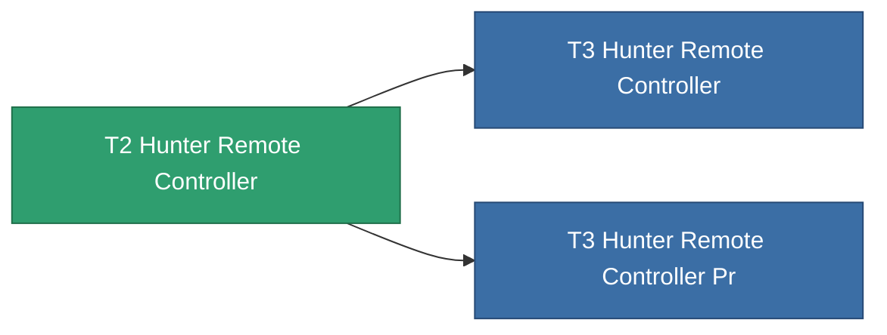

<!-- Generated by tools/generate from the live database (source: entitydefaults definition 8990, aggregatevalues via aggregatefields).
     Do not edit by hand; regenerate instead. -->

# T2 Hunter Remote Controller

|  |  |
|---|---|
| 정의 | `def_named1_hunter_remote_controller` |
| 티어 | T2 |
| 내구도 | 100 |
| 용량 | 100 |
| 질량 | 450 |
| 카테고리 | Modules / Remote control |
| Tier line | [Standard Hunter Remote Controller](/ko/content/items/standard-hunter-remote-controller/) (T1) → **T2 Hunter Remote Controller** (T2) → [T3 Hunter Remote Controller](/ko/content/items/named2-hunter-remote-controller/) (T3) → [T4 Hunter Remote Controller](/ko/content/items/named3-hunter-remote-controller/) (T4) |
| 비고 | Deploys an autonomous hunter drone -- PvE ammo hunts Niani NPCs, PvP ammo hunts hostile-standing players. |

## 통계

| 필드 | 값 |
|---|---|
| core_usage | 155 |
| cpu_usage | 260 |
| cycle_time | 4.5k |
| detection_range | 110 |
| powergrid_usage | 67 |
| remote_control_bandwidth_max | 1 |
| remote_control_lifetime | 1.98M |
| remote_control_operational_range | 165 |

<!-- production:generated -->
## 생산

**구성 요소 5개로 생산** — 구성 요소를 조립하여 제작합니다 (전체 목록은 [레시피](/ko/content/recipes/) 참조):

**제작도:** [T2 Hunter Remote Controller Cprg](/ko/content/items/named1-hunter-remote-controller-cprg/)

<svg class="prod-card-icon" aria-hidden="true"><use href="#mi-grid"/></svg><a class="prod-card-name" href="/ko/content/items/axicol/">Cryoperine</a>

필요: <b>250</b>

<svg class="prod-card-icon" aria-hidden="true"><use href="#mi-grid"/></svg><a class="prod-card-name" href="/ko/content/items/axicoline/">Axicoline</a>

필요: <b>200</b>

<svg class="prod-card-icon" aria-hidden="true"><use href="#mi-grid"/></svg><a class="prod-card-name" href="/ko/content/items/espitium/">Espitium</a>

필요: <b>200</b>

<svg class="prod-card-icon" aria-hidden="true"><use href="#mi-grid"/></svg><a class="prod-card-name" href="/ko/content/items/standard-hunter-remote-controller/">Standard Hunter Remote Controller</a>

필요: <b>1</b>

<svg class="prod-card-icon" aria-hidden="true"><use href="#mi-grid"/></svg><a class="prod-card-name" href="/ko/content/items/titanium/">Titanium</a>

필요: <b>200</b>

## 생산에 사용

**2개 아이템의 구성 요소** — 이를 생산에 사용하는 모든 것:

