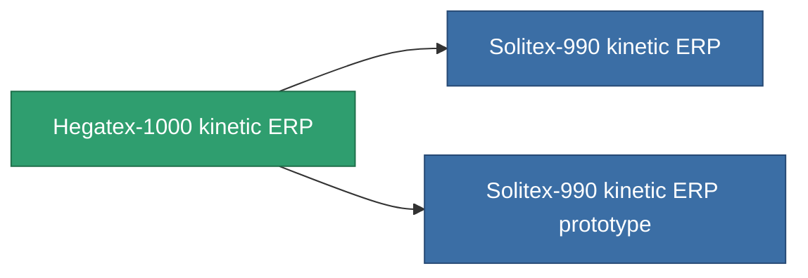

<!-- Generated by tools/generate from the live database (source: entitydefaults definition 3294, aggregatevalues via aggregatefields).
     Do not edit by hand; regenerate instead. -->

# Hegatex-1000 kinetic ERP

|  |  |
|---|---|
| 정의 | `def_named1_kinetic_kers` |
| 티어 | T2 |
| 내구도 | 100 |
| 용량 | 1 |
| 질량 | 450 |
| 카테고리 | Modules / Enhancements |
| Tier line | [Standard kinetic ERP](/ko/content/items/standard-kinetic-kers/) (T1) → **Hegatex-1000 kinetic ERP** (T2) → [Solitex-990 kinetic ERP](/ko/content/items/named2-kinetic-kers/) (T3) → [Emerolyte kinetic ERP](/ko/content/items/named3-kinetic-kers/) (T4) |

## 통계

| 필드 | 값 |
|---|---|
| chemical_damage_to_core_modifier | 0.2 |
| cpu_usage | 45 |
| explosive_damage_to_core_modifier | 0.1 |
| kinetic_damage_to_core_modifier | 0.5 |
| powergrid_usage | 10 |
| thermal_damage_to_core_modifier | 0.1 |

<!-- production:generated -->
## 생산

**구성 요소 6개로 생산 , 연구 레벨 6** — 구성 요소를 조립하여 제작합니다 (전체 목록은 [레시피](/ko/content/recipes/) 참조):

**제작도:** [Hegatex-1000 kinetic ERP CT](/ko/content/items/named1-kinetic-kers-cprg/)

<svg class="prod-card-icon" aria-hidden="true"><use href="#mi-grid"/></svg><a class="prod-card-name" href="/ko/content/items/axicol/">Cryoperine</a>

필요: <b>200</b>

<svg class="prod-card-icon" aria-hidden="true"><use href="#mi-grid"/></svg><a class="prod-card-name" href="/ko/content/items/metachropin/">Metachropin</a>

필요: <b>100</b>

<svg class="prod-card-icon" aria-hidden="true"><use href="#mi-grid"/></svg><a class="prod-card-name" href="/ko/content/items/plasteosine/">Plasteosine</a>

필요: <b>100</b>

<svg class="prod-card-icon" aria-hidden="true"><use href="#mi-grid"/></svg><a class="prod-card-name" href="/ko/content/items/prilumium/">Prilumium</a>

필요: <b>200</b>

<svg class="prod-card-icon" aria-hidden="true"><use href="#mi-grid"/></svg><a class="prod-card-name" href="/ko/content/items/standard-kinetic-kers/">Standard kinetic ERP</a>

필요: <b>1</b>

<svg class="prod-card-icon" aria-hidden="true"><use href="#mi-grid"/></svg><a class="prod-card-name" href="/ko/content/items/titanium/">Titanium</a>

필요: <b>200</b>

## 생산에 사용

**2개 아이템의 구성 요소** — 이를 생산에 사용하는 모든 것:

