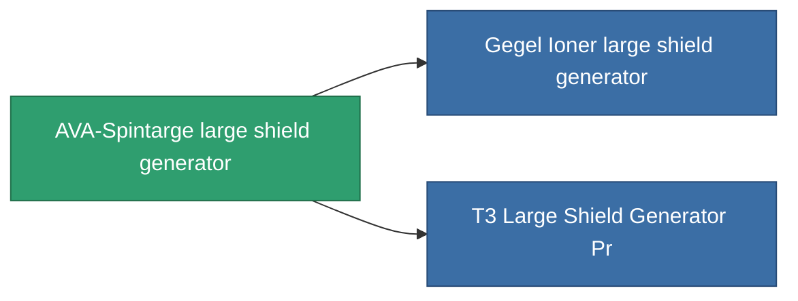

<!-- Generated by tools/generate from the live database (source: entitydefaults definition 729, aggregatevalues via aggregatefields).
     Do not edit by hand; regenerate instead. -->

# AVA-Spintarge large shield generator

|  |  |
|---|---|
| 정의 | `def_named1_large_shield_generator` |
| 티어 | T2 |
| 내구도 | 100 |
| 용량 | 1 |
| 질량 | 720 |
| 카테고리 | Modules / Shield |
| Tier line | [Standard large shield generator](/ko/content/items/standard-large-shield-generator/) (T1) → **AVA-Spintarge large shield generator** (T2) → [Gegel Ioner large shield generator](/ko/content/items/named2-large-shield-generator/) (T3) → [Umbeler large shield generator](/ko/content/items/named3-large-shield-generator/) (T4) |

## 통계

| 필드 | 값 |
|---|---|
| core_usage | 25 |
| cpu_usage | 300 |
| cycle_time | 9.5k |
| powergrid_usage | 1.125k |
| shield_absorbtion | 1.9048 |
| shield_radius | 30 |

<!-- production:generated -->
## 생산

**구성 요소 8개로 생산** — 구성 요소를 조립하여 제작합니다 (전체 목록은 [레시피](/ko/content/recipes/) 참조):

**제작도:** [T2 Large Shield Generator Cprg](/ko/content/items/named1-large-shield-generator-cprg/)

<svg class="prod-card-icon" aria-hidden="true"><use href="#mi-grid"/></svg><a class="prod-card-name" href="/ko/content/items/axicol/">Cryoperine</a>

필요: <b>300</b>

<svg class="prod-card-icon" aria-hidden="true"><use href="#mi-grid"/></svg><a class="prod-card-name" href="/ko/content/items/isopropentol/">Isopropentol</a>

필요: <b>600</b>

<svg class="prod-card-icon" aria-hidden="true"><use href="#mi-grid"/></svg><a class="prod-card-name" href="/ko/content/items/plasteosine/">Plasteosine</a>

필요: <b>600</b>

<svg class="prod-card-icon" aria-hidden="true"><use href="#mi-crystal"/></svg><a class="prod-card-name" href="/ko/content/items/robotshard-common-basic/">Damaged common fragment</a>

필요: <b>90</b>

<svg class="prod-card-icon" aria-hidden="true"><use href="#mi-grid"/></svg><a class="prod-card-name" href="/ko/content/items/specimen-sap-item-flux/">Specimen Sap Item Flux</a>

필요: <b>25</b>

<svg class="prod-card-icon" aria-hidden="true"><use href="#mi-tree"/></svg><a class="prod-card-name" href="/ko/content/items/standard-large-shield-generator/">Standard large shield generator</a>

필요: <b>1</b>

<svg class="prod-card-icon" aria-hidden="true"><use href="#mi-grid"/></svg><a class="prod-card-name" href="/ko/content/items/titanium/">Titanium</a>

필요: <b>300</b>

<svg class="prod-card-icon" aria-hidden="true"><use href="#mi-grid"/></svg><a class="prod-card-name" href="/ko/content/items/vitricyl/">Vitricyl</a>

필요: <b>300</b>

## 생산에 사용

**2개 아이템의 구성 요소** — 이를 생산에 사용하는 모든 것:

