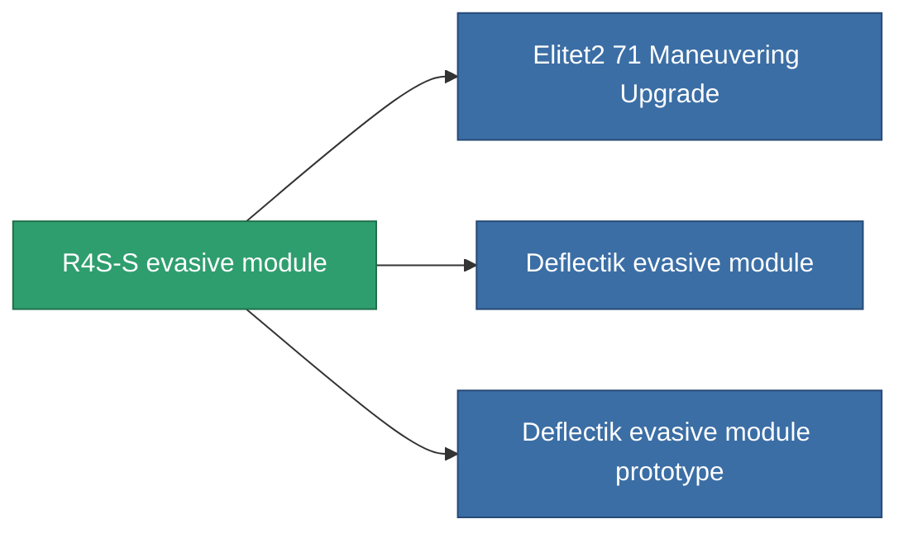

<!-- Generated by tools/generate from the live database (source: entitydefaults definition 2565, aggregatevalues via aggregatefields).
     Do not edit by hand; regenerate instead. -->

# R4S-S evasive module

|  |  |
|---|---|
| 정의 | `def_named1_maneuvering_upgrade` |
| 티어 | T2 |
| 내구도 | 100 |
| 용량 | 0.5 |
| 질량 | 20 |
| 카테고리 | Modules / Enhancements |
| Tier line | [Standard evasive module](/ko/content/items/standard-maneuvering-upgrade/) (T1) → **R4S-S evasive module** (T2) → [Deflectik evasive module](/ko/content/items/named2-maneuvering-upgrade/) (T3) → [Yridan RCD evasive module](/ko/content/items/named3-maneuvering-upgrade/) (T4) |

## 통계

| 필드 | 값 |
|---|---|
| cpu_usage | 21 |
| massiveness | 0.05 |
| powergrid_usage | 22 |
| signature_radius | -0.85 |

<!-- production:generated -->
## 생산

**구성 요소 5개로 생산 , 연구 레벨 6** — 구성 요소를 조립하여 제작합니다 (전체 목록은 [레시피](/ko/content/recipes/) 참조):

**제작도:** [R4S-S evasive module CT](/ko/content/items/named1-maneuvering-upgrade-cprg/)

<svg class="prod-card-icon" aria-hidden="true"><use href="#mi-grid"/></svg><a class="prod-card-name" href="/ko/content/items/axicol/">Cryoperine</a>

필요: <b>150</b>

<svg class="prod-card-icon" aria-hidden="true"><use href="#mi-grid"/></svg><a class="prod-card-name" href="/ko/content/items/plasteosine/">Plasteosine</a>

필요: <b>150</b>

<svg class="prod-card-icon" aria-hidden="true"><use href="#mi-crystal"/></svg><a class="prod-card-name" href="/ko/content/items/robotshard-common-basic/">Damaged common fragment</a>

필요: <b>45</b>

<svg class="prod-card-icon" aria-hidden="true"><use href="#mi-panel"/></svg><a class="prod-card-name" href="/ko/content/items/standard-maneuvering-upgrade/">Standard evasive module</a>

필요: <b>1</b>

<svg class="prod-card-icon" aria-hidden="true"><use href="#mi-grid"/></svg><a class="prod-card-name" href="/ko/content/items/titanium/">Titanium</a>

필요: <b>100</b>

## 생산에 사용

**3개 아이템의 구성 요소** — 이를 생산에 사용하는 모든 것:

