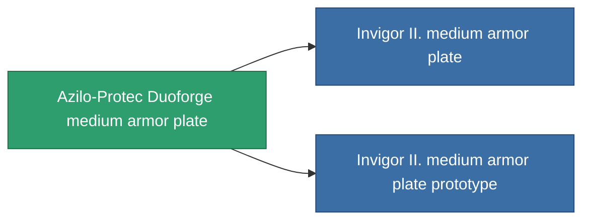

<!-- Generated by tools/generate from the live database (source: entitydefaults definition 687, aggregatevalues via aggregatefields).
     Do not edit by hand; regenerate instead. -->

# Azilo-Protec Duoforge medium armor plate

|  |  |
|---|---|
| 정의 | `def_named1_medium_armor_plate` |
| 티어 | T2 |
| 내구도 | 100 |
| 용량 | 2 |
| 질량 | 2400 |
| 카테고리 | Modules / Armor |
| Tier line | [Standard medium armor plate](/ko/content/items/standard-medium-armor-plate/) (T1) → **Azilo-Protec Duoforge medium armor plate** (T2) → [Invigor II. medium armor plate](/ko/content/items/named2-medium-armor-plate/) (T3) → [THL-Testudo medium armor plate](/ko/content/items/named3-medium-armor-plate/) (T4) |

## 통계

| 필드 | 값 |
|---|---|
| armor_max | 1.35k |
| cpu_usage | 2 |
| massiveness | 0.12 |
| powergrid_usage | 60 |
| signature_radius | 1 |

<!-- production:generated -->
## 생산

**구성 요소 4개로 생산 , 연구 레벨 4** — 구성 요소를 조립하여 제작합니다 (전체 목록은 [레시피](/ko/content/recipes/) 참조):

**제작도:** [Azilo-Protec Duoforge medium armor plate CT](/content/items/named1-medium-armor-plate-cprg/)

<svg class="prod-card-icon" aria-hidden="true"><use href="#mi-grid"/></svg><a class="prod-card-name" href="/ko/content/items/plasteosine/">Plasteosine</a>

필요: <b>700</b>

<svg class="prod-card-icon" aria-hidden="true"><use href="#mi-crystal"/></svg><a class="prod-card-name" href="/ko/content/items/robotshard-common-basic/">Damaged common fragment</a>

필요: <b>60</b>

<svg class="prod-card-icon" aria-hidden="true"><use href="#mi-tree"/></svg><a class="prod-card-name" href="/ko/content/items/standard-medium-armor-plate/">Standard medium armor plate</a>

필요: <b>1</b>

<svg class="prod-card-icon" aria-hidden="true"><use href="#mi-grid"/></svg><a class="prod-card-name" href="/ko/content/items/titanium/">Titanium</a>

필요: <b>500</b>

## 생산에 사용

**2개 아이템의 구성 요소** — 이를 생산에 사용하는 모든 것:

