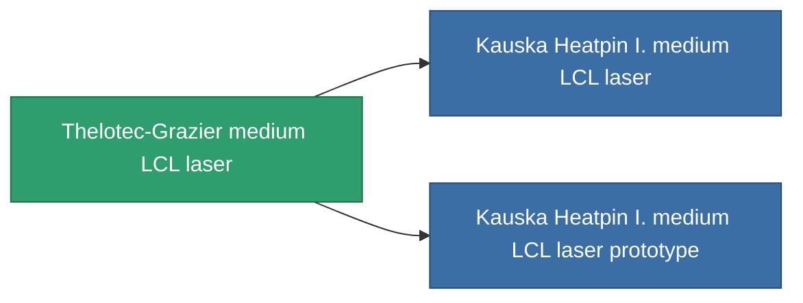

<!-- Generated by tools/generate from the live database (source: entitydefaults definition 834, aggregatevalues via aggregatefields).
     Do not edit by hand; regenerate instead. -->

# Thelotec-Grazier medium LCL laser

|  |  |
|---|---|
| 정의 | `def_named1_medium_laser` |
| 티어 | T2 |
| 내구도 | 100 |
| 용량 | 1 |
| 질량 | 450 |
| 카테고리 | Modules / Weapons |
| Tier line | [Standard medium LCL laser](/ko/content/items/standard-medium-laser/) (T1) → **Thelotec-Grazier medium LCL laser** (T2) → [Kauska Heatpin I. medium LCL laser](/ko/content/items/named2-medium-laser/) (T3) → [Thermodissector medium LCL laser](/ko/content/items/named3-medium-laser/) (T4) |

## 통계

| 필드 | 값 |
|---|---|
| accuracy | 11.5 |
| core_usage | 13.6 |
| cpu_usage | 22 |
| cycle_time | 5k |
| damage_modifier | 1.275 |
| falloff | 10 |
| least_optimal | 5 |
| optimal_range | 17.5 |
| powergrid_usage | 180 |

<!-- production:generated -->
## 생산

**구성 요소 6개로 생산 , 연구 레벨 5** — 구성 요소를 조립하여 제작합니다 (전체 목록은 [레시피](/ko/content/recipes/) 참조):

**제작도:** [Thelotec-Grazier medium LCL laser CT](/ko/content/items/named1-medium-laser-cprg/)

<svg class="prod-card-icon" aria-hidden="true"><use href="#mi-grid"/></svg><a class="prod-card-name" href="/ko/content/items/axicoline/">Axicoline</a>

필요: <b>100</b>

<svg class="prod-card-icon" aria-hidden="true"><use href="#mi-grid"/></svg><a class="prod-card-name" href="/ko/content/items/polynucleit/">Polynucleit</a>

필요: <b>100</b>

<svg class="prod-card-icon" aria-hidden="true"><use href="#mi-crystal"/></svg><a class="prod-card-name" href="/ko/content/items/robotshard-common-basic/">Damaged common fragment</a>

필요: <b>30</b>

<svg class="prod-card-icon" aria-hidden="true"><use href="#mi-crystal"/></svg><a class="prod-card-name" href="/ko/content/items/robotshard-thelodica-basic/">Damaged thelodica fragment</a>

필요: <b>30</b>

<svg class="prod-card-icon" aria-hidden="true"><use href="#mi-robots"/></svg><a class="prod-card-name" href="/ko/content/items/standard-medium-laser/">Standard medium LCL laser</a>

필요: <b>1</b>

<svg class="prod-card-icon" aria-hidden="true"><use href="#mi-grid"/></svg><a class="prod-card-name" href="/ko/content/items/titanium/">Titanium</a>

필요: <b>100</b>

## 생산에 사용

**2개 아이템의 구성 요소** — 이를 생산에 사용하는 모든 것:

