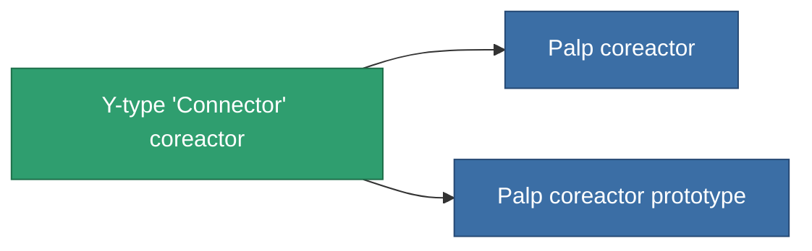

<!-- Generated by tools/generate from the live database (source: entitydefaults definition 765, aggregatevalues via aggregatefields).
     Do not edit by hand; regenerate instead. -->

# Y-type 'Connector' coreactor

|  |  |
|---|---|
| 정의 | `def_named1_powergrid_upgrades` |
| 티어 | T2 |
| 내구도 | 100 |
| 용량 | 0.5 |
| 질량 | 90 |
| 카테고리 | Modules / Power |
| Tier line | [Standard coreactor](/ko/content/items/standard-powergrid-upgrades/) (T1) → **Y-type 'Connector' coreactor** (T2) → [Palp coreactor](/ko/content/items/named2-powergrid-upgrades/) (T3) → [E-set 15VaW coreactor](/ko/content/items/named3-powergrid-upgrades/) (T4) |

## 통계

| 필드 | 값 |
|---|---|
| cpu_usage | 30 |
| powergrid_max_modifier | 1.1 |

<!-- production:generated -->
## 생산

**구성 요소 4개로 생산 , 연구 레벨 4** — 구성 요소를 조립하여 제작합니다 (전체 목록은 [레시피](/ko/content/recipes/) 참조):

**제작도:** [Y-type 'Connector' coreactor CT](/ko/content/items/named1-powergrid-upgrades-cprg/)

<svg class="prod-card-icon" aria-hidden="true"><use href="#mi-grid"/></svg><a class="prod-card-name" href="/ko/content/items/axicol/">Cryoperine</a>

필요: <b>300</b>

<svg class="prod-card-icon" aria-hidden="true"><use href="#mi-crystal"/></svg><a class="prod-card-name" href="/ko/content/items/robotshard-common-basic/">Damaged common fragment</a>

필요: <b>30</b>

<svg class="prod-card-icon" aria-hidden="true"><use href="#mi-crystal"/></svg><a class="prod-card-name" href="/ko/content/items/standard-powergrid-upgrades/">Standard coreactor</a>

필요: <b>1</b>

<svg class="prod-card-icon" aria-hidden="true"><use href="#mi-grid"/></svg><a class="prod-card-name" href="/ko/content/items/titanium/">Titanium</a>

필요: <b>200</b>

## 생산에 사용

**2개 아이템의 구성 요소** — 이를 생산에 사용하는 모든 것:

