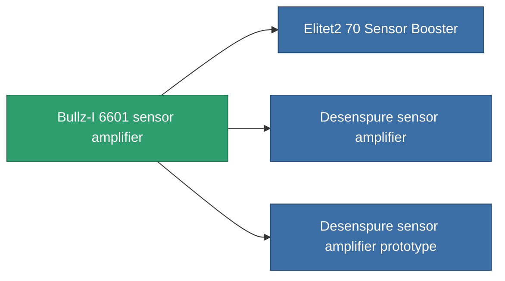

<!-- Generated by tools/generate from the live database (source: entitydefaults definition 768, aggregatevalues via aggregatefields).
     Do not edit by hand; regenerate instead. -->

# Bullz-I 6601 sensor amplifier

|  |  |
|---|---|
| 정의 | `def_named1_sensor_booster` |
| 티어 | T2 |
| 내구도 | 100 |
| 용량 | 0.5 |
| 질량 | 80 |
| 카테고리 | Modules / Sensors & scanning |
| Tier line | [Standard sensor amplifier](/ko/content/items/standard-sensor-booster/) (T1) → **Bullz-I 6601 sensor amplifier** (T2) → [Desenspure sensor amplifier](/ko/content/items/named2-sensor-booster/) (T3) → [Ambassador SU-I sensor amplifier](/ko/content/items/named3-sensor-booster/) (T4) |

## 통계

| 필드 | 값 |
|---|---|
| core_usage | 9 |
| cpu_usage | 13 |
| cycle_time | 10k |
| effect_sensor_booster_locking_range_modifier | 1.35 |
| effect_sensor_booster_locking_time_modifier | 0.8 |
| powergrid_usage | 5 |

<!-- production:generated -->
## 생산

**구성 요소 4개로 생산 , 연구 레벨 4** — 구성 요소를 조립하여 제작합니다 (전체 목록은 [레시피](/ko/content/recipes/) 참조):

**제작도:** [Bullz-I 6601 sensor amplifier CT](/ko/content/items/named1-sensor-booster-cprg/)

<svg class="prod-card-icon" aria-hidden="true"><use href="#mi-grid"/></svg><a class="prod-card-name" href="/ko/content/items/axicol/">Cryoperine</a>

필요: <b>400</b>

<svg class="prod-card-icon" aria-hidden="true"><use href="#mi-crystal"/></svg><a class="prod-card-name" href="/ko/content/items/robotshard-common-basic/">Damaged common fragment</a>

필요: <b>30</b>

<svg class="prod-card-icon" aria-hidden="true"><use href="#mi-grid"/></svg><a class="prod-card-name" href="/ko/content/items/standard-sensor-booster/">Standard sensor amplifier</a>

필요: <b>1</b>

<svg class="prod-card-icon" aria-hidden="true"><use href="#mi-grid"/></svg><a class="prod-card-name" href="/ko/content/items/titanium/">Titanium</a>

필요: <b>50</b>

## 생산에 사용

**3개 아이템의 구성 요소** — 이를 생산에 사용하는 모든 것:

