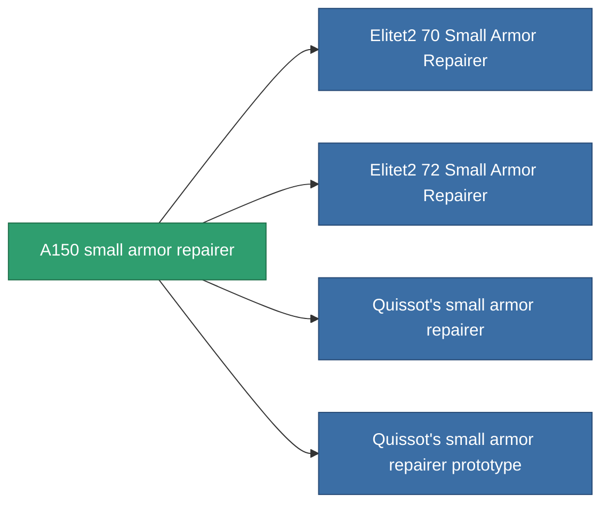

<!-- Generated by tools/generate from the live database (source: entitydefaults definition 693, aggregatevalues via aggregatefields).
     Do not edit by hand; regenerate instead. -->

# A150 small armor repairer

|  |  |
|---|---|
| 정의 | `def_named1_small_armor_repairer` |
| 티어 | T2 |
| 내구도 | 100 |
| 용량 | 1 |
| 질량 | 225 |
| 카테고리 | Modules / Repair |
| Tier line | [Standard small armor repairer](/ko/content/items/standard-small-armor-repairer/) (T1) → **A150 small armor repairer** (T2) → [Quissot's small armor repairer](/ko/content/items/named2-small-armor-repairer/) (T3) → [Microforge Aestolar small armor repairer](/ko/content/items/named3-small-armor-repairer/) (T4) |
| 비고 | armor_hp += repair_amount * armor_repair_amount_modifier  rof = cycle_time * armor_repair_cycle_time_modifier   |

## 통계

| 필드 | 값 |
|---|---|
| armor_repair_amount | 60 |
| core_usage | 60 |
| cpu_usage | 30 |
| cycle_time | 15k |
| powergrid_usage | 18 |

<!-- production:generated -->
## 생산

**구성 요소 7개로 생산 , 연구 레벨 3** — 구성 요소를 조립하여 제작합니다 (전체 목록은 [레시피](/ko/content/recipes/) 참조):

**제작도:** [A150 small armor repairer CT](/ko/content/items/named1-small-armor-repairer-cprg/)

<svg class="prod-card-icon" aria-hidden="true"><use href="#mi-grid"/></svg><a class="prod-card-name" href="/ko/content/items/axicol/">Cryoperine</a>

필요: <b>25</b>

<svg class="prod-card-icon" aria-hidden="true"><use href="#mi-grid"/></svg><a class="prod-card-name" href="/ko/content/items/chollonin/">Chollonin</a>

필요: <b>25</b>

<svg class="prod-card-icon" aria-hidden="true"><use href="#mi-grid"/></svg><a class="prod-card-name" href="/ko/content/items/plasteosine/">Plasteosine</a>

필요: <b>100</b>

<svg class="prod-card-icon" aria-hidden="true"><use href="#mi-crystal"/></svg><a class="prod-card-name" href="/ko/content/items/robotshard-common-basic/">Damaged common fragment</a>

필요: <b>30</b>

<svg class="prod-card-icon" aria-hidden="true"><use href="#mi-tree"/></svg><a class="prod-card-name" href="/ko/content/items/standard-small-armor-repairer/">Standard small armor repairer</a>

필요: <b>1</b>

<svg class="prod-card-icon" aria-hidden="true"><use href="#mi-grid"/></svg><a class="prod-card-name" href="/ko/content/items/statichnol/">Statichnol</a>

필요: <b>100</b>

<svg class="prod-card-icon" aria-hidden="true"><use href="#mi-grid"/></svg><a class="prod-card-name" href="/ko/content/items/titanium/">Titanium</a>

필요: <b>50</b>

## 생산에 사용

**4개 아이템의 구성 요소** — 이를 생산에 사용하는 모든 것:

