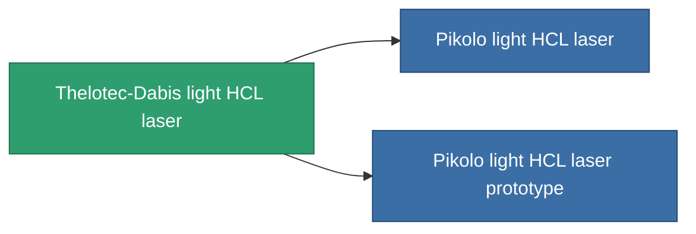

<!-- Generated by tools/generate from the live database (source: entitydefaults definition 831, aggregatevalues via aggregatefields).
     Do not edit by hand; regenerate instead. -->

# Thelotec-Dabis light HCL laser

|  |  |
|---|---|
| 정의 | `def_named1_small_laser` |
| 티어 | T2 |
| 내구도 | 100 |
| 용량 | 0.5 |
| 질량 | 225 |
| 카테고리 | Modules / Weapons |
| Tier line | [Standard light HCL laser](/ko/content/items/standard-small-laser/) (T1) → **Thelotec-Dabis light HCL laser** (T2) → [Pikolo light HCL laser](/ko/content/items/named2-small-laser/) (T3) → [Thelotec-Stroyar light HCL laser](/ko/content/items/named3-small-laser/) (T4) |

## 통계

| 필드 | 값 |
|---|---|
| accuracy | 4 |
| core_usage | 3.2 |
| cpu_usage | 18 |
| cycle_time | 4k |
| damage_modifier | 1 |
| falloff | 10 |
| least_optimal | 5 |
| optimal_range | 15 |
| powergrid_usage | 36 |

<!-- production:generated -->
## 생산

**구성 요소 6개로 생산 , 연구 레벨 3** — 구성 요소를 조립하여 제작합니다 (전체 목록은 [레시피](/ko/content/recipes/) 참조):

**제작도:** [Thelotec-Dabis light HCL laser CT](/content/items/named1-small-laser-cprg/)

<svg class="prod-card-icon" aria-hidden="true"><use href="#mi-grid"/></svg><a class="prod-card-name" href="/ko/content/items/axicoline/">Axicoline</a>

필요: <b>50</b>

<svg class="prod-card-icon" aria-hidden="true"><use href="#mi-grid"/></svg><a class="prod-card-name" href="/ko/content/items/polynucleit/">Polynucleit</a>

필요: <b>50</b>

<svg class="prod-card-icon" aria-hidden="true"><use href="#mi-crystal"/></svg><a class="prod-card-name" href="/ko/content/items/robotshard-common-basic/">Damaged common fragment</a>

필요: <b>15</b>

<svg class="prod-card-icon" aria-hidden="true"><use href="#mi-crystal"/></svg><a class="prod-card-name" href="/ko/content/items/robotshard-thelodica-basic/">Damaged thelodica fragment</a>

필요: <b>15</b>

<svg class="prod-card-icon" aria-hidden="true"><use href="#mi-robots"/></svg><a class="prod-card-name" href="/ko/content/items/standard-small-laser/">Standard light HCL laser</a>

필요: <b>1</b>

<svg class="prod-card-icon" aria-hidden="true"><use href="#mi-grid"/></svg><a class="prod-card-name" href="/ko/content/items/titanium/">Titanium</a>

필요: <b>50</b>

## 생산에 사용

**2개 아이템의 구성 요소** — 이를 생산에 사용하는 모든 것:

