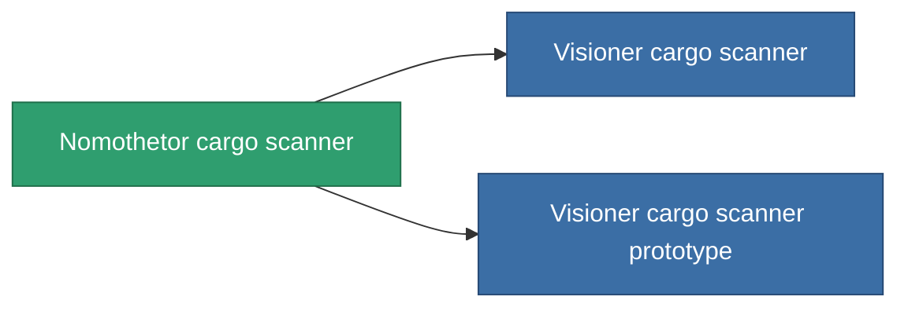

<!-- Generated by tools/generate from the live database (source: entitydefaults definition 775, aggregatevalues via aggregatefields).
     Do not edit by hand; regenerate instead. -->

# Nomothetor cargo scanner

|  |  |
|---|---|
| 정의 | `def_named2_cargo_scanner` |
| 티어 | T3 |
| 내구도 | 100 |
| 용량 | 0.5 |
| 질량 | 100 |
| 카테고리 | Modules / Sensors & scanning |
| Tier line | [Standard cargo scanner](/ko/content/items/standard-cargo-scanner/) (T1) → [Spurt-Singular cargo scanner](/ko/content/items/named1-cargo-scanner/) (T2) → **Nomothetor cargo scanner** (T3) → [Visioner cargo scanner](/ko/content/items/named3-cargo-scanner/) (T4) |

## 통계

| 필드 | 값 |
|---|---|
| core_usage | 55 |
| cpu_usage | 23 |
| cycle_time | 7.5k |
| falloff | 20 |
| optimal_range | 15 |
| powergrid_usage | 10 |

<!-- production:generated -->
## 생산

**구성 요소 6개로 생산 , 연구 레벨 5** — 구성 요소를 조립하여 제작합니다 (전체 목록은 [레시피](/ko/content/recipes/) 참조):

**제작도:** [Nomothetor cargo scanner CT](/ko/content/items/named2-cargo-scanner-cprg/)

<svg class="prod-card-icon" aria-hidden="true"><use href="#mi-grid"/></svg><a class="prod-card-name" href="/ko/content/items/axicol/">Cryoperine</a>

필요: <b>125</b>

<svg class="prod-card-icon" aria-hidden="true"><use href="#mi-grid"/></svg><a class="prod-card-name" href="/ko/content/items/espitium/">Espitium</a>

필요: <b>125</b>

<svg class="prod-card-icon" aria-hidden="true"><use href="#mi-grid"/></svg><a class="prod-card-name" href="/ko/content/items/named1-cargo-scanner/">Spurt-Singular cargo scanner</a>

필요: <b>1</b>

<svg class="prod-card-icon" aria-hidden="true"><use href="#mi-crystal"/></svg><a class="prod-card-name" href="/ko/content/items/robotshard-common-advanced/">Functional common fragment</a>

필요: <b>20</b>

<svg class="prod-card-icon" aria-hidden="true"><use href="#mi-crystal"/></svg><a class="prod-card-name" href="/ko/content/items/robotshard-common-basic/">Damaged common fragment</a>

필요: <b>20</b>

<svg class="prod-card-icon" aria-hidden="true"><use href="#mi-grid"/></svg><a class="prod-card-name" href="/ko/content/items/titanium/">Titanium</a>

필요: <b>50</b>

## 생산에 사용

**2개 아이템의 구성 요소** — 이를 생산에 사용하는 모든 것:

