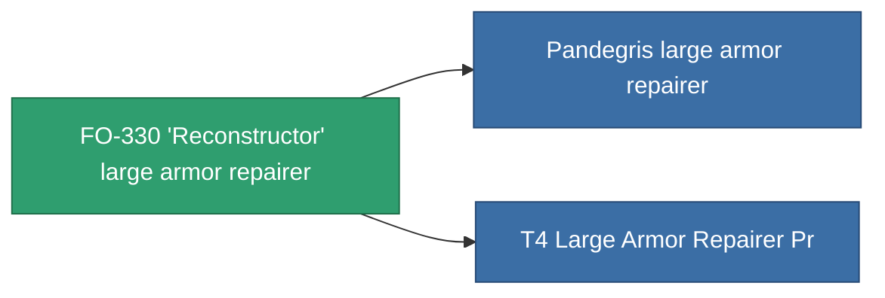

<!-- Generated by tools/generate from the live database (source: entitydefaults definition 700, aggregatevalues via aggregatefields).
     Do not edit by hand; regenerate instead. -->

# FO-330 'Reconstructor' large armor repairer

|  |  |
|---|---|
| 정의 | `def_named2_large_armor_repairer` |
| 티어 | T3 |
| 내구도 | 100 |
| 용량 | 3 |
| 질량 | 1500 |
| 카테고리 | Modules / Repair |
| Tier line | [Standard large armor repairer](/ko/content/items/standard-large-armor-repairer/) (T1) → [Stesodenn large armor repairer](/ko/content/items/named1-large-armor-repairer/) (T2) → **FO-330 'Reconstructor' large armor repairer** (T3) → [Pandegris large armor repairer](/ko/content/items/named3-large-armor-repairer/) (T4) |

## 통계

| 필드 | 값 |
|---|---|
| armor_repair_amount | 410 |
| core_usage | 478.5 |
| cpu_usage | 440 |
| cycle_time | 13.5k |
| powergrid_usage | 1.1k |

<!-- production:generated -->
## 생산

**구성 요소 9개로 생산** — 구성 요소를 조립하여 제작합니다 (전체 목록은 [레시피](/ko/content/recipes/) 참조):

**제작도:** [T3 Large Armor Repairer Cprg](/content/items/named2-large-armor-repairer-cprg/)

<svg class="prod-card-icon" aria-hidden="true"><use href="#mi-grid"/></svg><a class="prod-card-name" href="/ko/content/items/alligior/">Alligior</a>

필요: <b>300</b>

<svg class="prod-card-icon" aria-hidden="true"><use href="#mi-grid"/></svg><a class="prod-card-name" href="/ko/content/items/chollonin/">Chollonin</a>

필요: <b>75</b>

<svg class="prod-card-icon" aria-hidden="true"><use href="#mi-grid"/></svg><a class="prod-card-name" href="/ko/content/items/espitium/">Espitium</a>

필요: <b>75</b>

<svg class="prod-card-icon" aria-hidden="true"><use href="#mi-tree"/></svg><a class="prod-card-name" href="/ko/content/items/named1-large-armor-repairer/">Stesodenn large armor repairer</a>

필요: <b>1</b>

<svg class="prod-card-icon" aria-hidden="true"><use href="#mi-crystal"/></svg><a class="prod-card-name" href="/ko/content/items/robotshard-common-advanced/">Functional common fragment</a>

필요: <b>60</b>

<svg class="prod-card-icon" aria-hidden="true"><use href="#mi-crystal"/></svg><a class="prod-card-name" href="/ko/content/items/robotshard-common-basic/">Damaged common fragment</a>

필요: <b>60</b>

<svg class="prod-card-icon" aria-hidden="true"><use href="#mi-grid"/></svg><a class="prod-card-name" href="/ko/content/items/specimen-sap-item-flux/">Specimen Sap Item Flux</a>

필요: <b>30</b>

<svg class="prod-card-icon" aria-hidden="true"><use href="#mi-grid"/></svg><a class="prod-card-name" href="/ko/content/items/statichnol/">Statichnol</a>

필요: <b>300</b>

<svg class="prod-card-icon" aria-hidden="true"><use href="#mi-grid"/></svg><a class="prod-card-name" href="/ko/content/items/titanium/">Titanium</a>

필요: <b>150</b>

## 생산에 사용

**2개 아이템의 구성 요소** — 이를 생산에 사용하는 모든 것:

