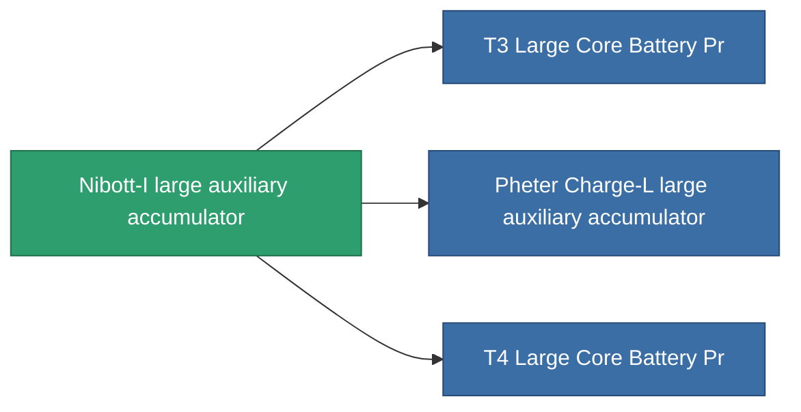

<!-- Generated by tools/generate from the live database (source: entitydefaults definition 820, aggregatevalues via aggregatefields).
     Do not edit by hand; regenerate instead. -->

# Nibott-I large auxiliary accumulator

|  |  |
|---|---|
| 정의 | `def_named2_large_core_battery` |
| 티어 | T3 |
| 내구도 | 100 |
| 용량 | 3 |
| 질량 | 3000 |
| 카테고리 | Modules / Power |
| Tier line | [Standard large auxiliary accumulator](/ko/content/items/standard-large-core-battery/) (T1) → [Ovostec-gxc9000 large auxiliary accumulator](/ko/content/items/named1-large-core-battery/) (T2) → **Nibott-I large auxiliary accumulator** (T3) → [Pheter Charge-L large auxiliary accumulator](/ko/content/items/named3-large-core-battery/) (T4) |

## 통계

| 필드 | 값 |
|---|---|
| core_max | 1.2k |
| cpu_usage | 430 |
| powergrid_usage | 856 |

<!-- production:generated -->
## 생산

**구성 요소 7개로 생산** — 구성 요소를 조립하여 제작합니다 (전체 목록은 [레시피](/ko/content/recipes/) 참조):

**제작도:** [T3 Large Core Battery Cprg](/content/items/named2-large-core-battery-cprg/)

<svg class="prod-card-icon" aria-hidden="true"><use href="#mi-grid"/></svg><a class="prod-card-name" href="/ko/content/items/axicol/">Cryoperine</a>

필요: <b>300</b>

<svg class="prod-card-icon" aria-hidden="true"><use href="#mi-grid"/></svg><a class="prod-card-name" href="/ko/content/items/espitium/">Espitium</a>

필요: <b>300</b>

<svg class="prod-card-icon" aria-hidden="true"><use href="#mi-grid"/></svg><a class="prod-card-name" href="/ko/content/items/named1-large-core-battery/">Ovostec-gxc9000 large auxiliary accumulator</a>

필요: <b>1</b>

<svg class="prod-card-icon" aria-hidden="true"><use href="#mi-crystal"/></svg><a class="prod-card-name" href="/ko/content/items/robotshard-common-advanced/">Functional common fragment</a>

필요: <b>60</b>

<svg class="prod-card-icon" aria-hidden="true"><use href="#mi-crystal"/></svg><a class="prod-card-name" href="/ko/content/items/robotshard-common-basic/">Damaged common fragment</a>

필요: <b>60</b>

<svg class="prod-card-icon" aria-hidden="true"><use href="#mi-grid"/></svg><a class="prod-card-name" href="/ko/content/items/specimen-sap-item-flux/">Specimen Sap Item Flux</a>

필요: <b>25</b>

<svg class="prod-card-icon" aria-hidden="true"><use href="#mi-grid"/></svg><a class="prod-card-name" href="/ko/content/items/titanium/">Titanium</a>

필요: <b>300</b>

## 생산에 사용

**3개 아이템의 구성 요소** — 이를 생산에 사용하는 모든 것:

