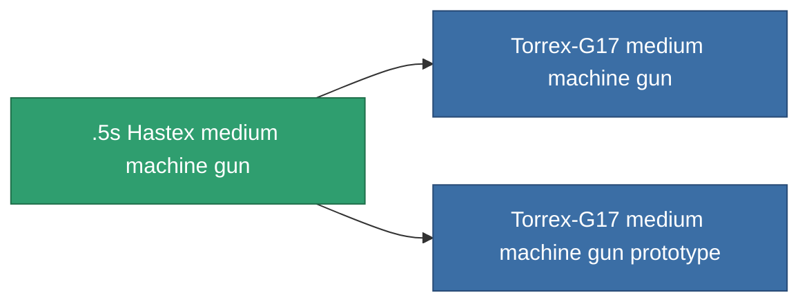

<!-- Generated by tools/generate from the live database (source: entitydefaults definition 844, aggregatevalues via aggregatefields).
     Do not edit by hand; regenerate instead. -->

# .5s Hastex medium machine gun

|  |  |
|---|---|
| 정의 | `def_named2_medium_autocannon` |
| 티어 | T3 |
| 내구도 | 100 |
| 용량 | 1.2 |
| 질량 | 500 |
| 카테고리 | Modules / Weapons |
| Tier line | [Standard medium machine gun](/ko/content/items/standard-medium-autocannon/) (T1) → [Grenber 28d medium machine gun](/ko/content/items/named1-medium-autocannon/) (T2) → **.5s Hastex medium machine gun** (T3) → [Torrex-G17 medium machine gun](/ko/content/items/named3-medium-autocannon/) (T4) |

## 통계

| 필드 | 값 |
|---|---|
| accuracy | 17 |
| core_usage | 2 |
| cpu_usage | 11 |
| cycle_time | 4k |
| damage_modifier | 1.7 |
| falloff | 21.5 |
| least_optimal | 3 |
| optimal_range | 14.5 |
| powergrid_usage | 125 |

<!-- production:generated -->
## 생산

**구성 요소 4개로 생산 , 연구 레벨 5** — 구성 요소를 조립하여 제작합니다 (전체 목록은 [레시피](/ko/content/recipes/) 참조):

**제작도:** [.5s Hastex medium machine gun CT](/ko/content/items/named2-medium-autocannon-cprg/)

<svg class="prod-card-icon" aria-hidden="true"><use href="#mi-grid"/></svg><a class="prod-card-name" href="/ko/content/items/axicoline/">Axicoline</a>

필요: <b>100</b>

<svg class="prod-card-icon" aria-hidden="true"><use href="#mi-grid"/></svg><a class="prod-card-name" href="/ko/content/items/hydrobenol/">Hydrobenol</a>

필요: <b>100</b>

<svg class="prod-card-icon" aria-hidden="true"><use href="#mi-grid"/></svg><a class="prod-card-name" href="/ko/content/items/named1-medium-autocannon/">Grenber 28d medium machine gun</a>

필요: <b>1</b>

<svg class="prod-card-icon" aria-hidden="true"><use href="#mi-grid"/></svg><a class="prod-card-name" href="/ko/content/items/titanium/">Titanium</a>

필요: <b>100</b>

## 생산에 사용

**2개 아이템의 구성 요소** — 이를 생산에 사용하는 모든 것:

