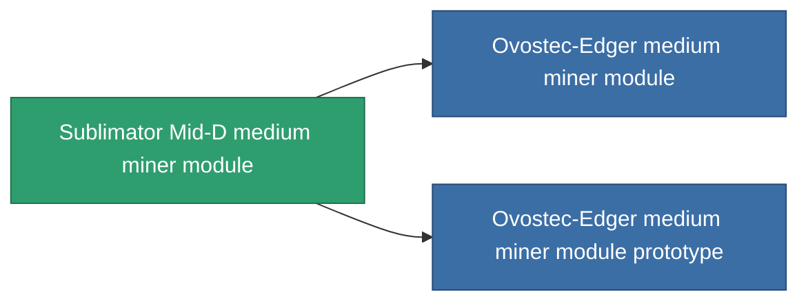

<!-- Generated by tools/generate from the live database (source: entitydefaults definition 802, aggregatevalues via aggregatefields).
     Do not edit by hand; regenerate instead. -->

# Sublimator Mid-D medium miner module

|  |  |
|---|---|
| 정의 | `def_named2_medium_driller` |
| 티어 | T3 |
| 내구도 | 100 |
| 용량 | 1.5 |
| 질량 | 1000 |
| 카테고리 | Modules / Enhancements |
| Tier line | [Standard medium miner module](/ko/content/items/standard-medium-driller/) (T1) → [MMA v12-'Alkhemir' medium miner module](/ko/content/items/named1-medium-driller/) (T2) → **Sublimator Mid-D medium miner module** (T3) → [Ovostec-Edger medium miner module](/ko/content/items/named3-medium-driller/) (T4) |

## 통계

| 필드 | 값 |
|---|---|
| core_usage | 60 |
| cpu_usage | 52 |
| cycle_time | 11k |
| optimal_range | 3 |
| powergrid_usage | 160 |

<!-- production:generated -->
## 생산

**구성 요소 6개로 생산 , 연구 레벨 5** — 구성 요소를 조립하여 제작합니다 (전체 목록은 [레시피](/ko/content/recipes/) 참조):

**제작도:** [Sublimator Mid-D medium miner module CT](/content/items/named2-medium-driller-cprg/)

<svg class="prod-card-icon" aria-hidden="true"><use href="#mi-grid"/></svg><a class="prod-card-name" href="/ko/content/items/axicol/">Cryoperine</a>

필요: <b>50</b>

<svg class="prod-card-icon" aria-hidden="true"><use href="#mi-grid"/></svg><a class="prod-card-name" href="/ko/content/items/espitium/">Espitium</a>

필요: <b>50</b>

<svg class="prod-card-icon" aria-hidden="true"><use href="#mi-panel"/></svg><a class="prod-card-name" href="/ko/content/items/named1-medium-driller/">MMA v12-'Alkhemir' medium miner module</a>

필요: <b>1</b>

<svg class="prod-card-icon" aria-hidden="true"><use href="#mi-crystal"/></svg><a class="prod-card-name" href="/ko/content/items/robotshard-common-advanced/">Functional common fragment</a>

필요: <b>40</b>

<svg class="prod-card-icon" aria-hidden="true"><use href="#mi-crystal"/></svg><a class="prod-card-name" href="/ko/content/items/robotshard-common-basic/">Damaged common fragment</a>

필요: <b>40</b>

<svg class="prod-card-icon" aria-hidden="true"><use href="#mi-grid"/></svg><a class="prod-card-name" href="/ko/content/items/titanium/">Titanium</a>

필요: <b>300</b>

## 생산에 사용

**2개 아이템의 구성 요소** — 이를 생산에 사용하는 모든 것:

