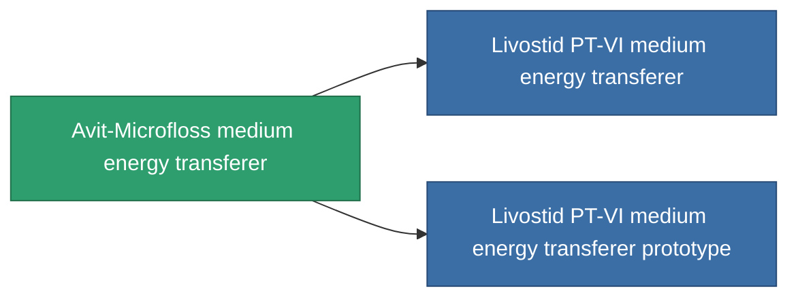

<!-- Generated by tools/generate from the live database (source: entitydefaults definition 739, aggregatevalues via aggregatefields).
     Do not edit by hand; regenerate instead. -->

# Avit-Microfloss medium energy transferer

|  |  |
|---|---|
| 정의 | `def_named2_medium_energy_transfer` |
| 티어 | T3 |
| 내구도 | 100 |
| 용량 | 1 |
| 질량 | 500 |
| 카테고리 | Modules / Enhancements |
| Tier line | [Standard medium energy transferer](/ko/content/items/standard-medium-energy-transfer/) (T1) → [CDC-Yamp medium energy transferer](/ko/content/items/named1-medium-energy-transfer/) (T2) → **Avit-Microfloss medium energy transferer** (T3) → [Livostid PT-VI medium energy transferer](/ko/content/items/named3-medium-energy-transfer/) (T4) |

## 통계

| 필드 | 값 |
|---|---|
| core_usage | 25 |
| cpu_usage | 47 |
| cycle_time | 10k |
| energy_transfer_amount | 225 |
| falloff | 0 |
| optimal_range | 30 |
| powergrid_usage | 160 |

<!-- production:generated -->
## 생산

**구성 요소 6개로 생산 , 연구 레벨 6** — 구성 요소를 조립하여 제작합니다 (전체 목록은 [레시피](/ko/content/recipes/) 참조):

**제작도:** [Avit-Microfloss medium energy transferer CT](/content/items/named2-medium-energy-transfer-cprg/)

<svg class="prod-card-icon" aria-hidden="true"><use href="#mi-grid"/></svg><a class="prod-card-name" href="/ko/content/items/axicol/">Cryoperine</a>

필요: <b>250</b>

<svg class="prod-card-icon" aria-hidden="true"><use href="#mi-grid"/></svg><a class="prod-card-name" href="/ko/content/items/espitium/">Espitium</a>

필요: <b>250</b>

<svg class="prod-card-icon" aria-hidden="true"><use href="#mi-grid"/></svg><a class="prod-card-name" href="/ko/content/items/named1-medium-energy-transfer/">CDC-Yamp medium energy transferer</a>

필요: <b>1</b>

<svg class="prod-card-icon" aria-hidden="true"><use href="#mi-crystal"/></svg><a class="prod-card-name" href="/ko/content/items/robotshard-common-advanced/">Functional common fragment</a>

필요: <b>40</b>

<svg class="prod-card-icon" aria-hidden="true"><use href="#mi-crystal"/></svg><a class="prod-card-name" href="/ko/content/items/robotshard-common-basic/">Damaged common fragment</a>

필요: <b>40</b>

<svg class="prod-card-icon" aria-hidden="true"><use href="#mi-grid"/></svg><a class="prod-card-name" href="/ko/content/items/titanium/">Titanium</a>

필요: <b>200</b>

## 생산에 사용

**2개 아이템의 구성 요소** — 이를 생산에 사용하는 모든 것:

