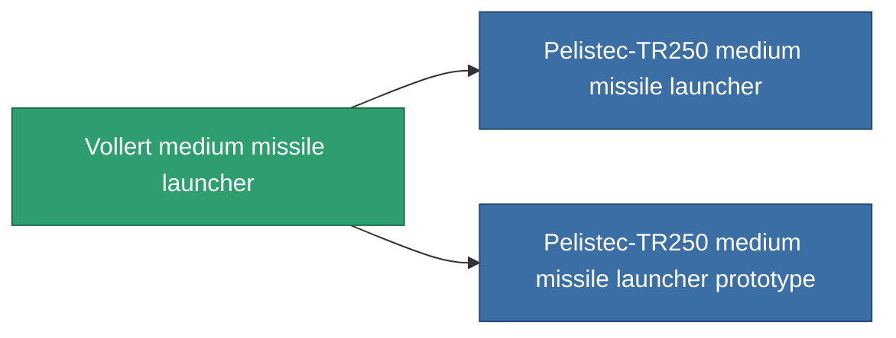

<!-- Generated by tools/generate from the live database (source: entitydefaults definition 853, aggregatevalues via aggregatefields).
     Do not edit by hand; regenerate instead. -->

# Vollert medium missile launcher

|  |  |
|---|---|
| 정의 | `def_named2_missile_launcher` |
| 티어 | T3 |
| 내구도 | 100 |
| 용량 | 2 |
| 질량 | 500 |
| 카테고리 | Modules / Weapons |
| Tier line | [Standard medium missile launcher](/ko/content/items/standard-missile-launcher/) (T1) → [ST-Dupot medium missile launcher](/ko/content/items/named1-missile-launcher/) (T2) → **Vollert medium missile launcher** (T3) → [Pelistec-TR250 medium missile launcher](/ko/content/items/named3-missile-launcher/) (T4) |

## 통계

| 필드 | 값 |
|---|---|
| accuracy | 1 |
| core_usage | 2 |
| cpu_usage | 42 |
| cycle_time | 12k |
| damage_modifier | 1 |
| module_missile_range_modifier | 1.1 |
| powergrid_usage | 160 |

<!-- production:generated -->
## 생산

**구성 요소 8개로 생산 , 연구 레벨 6** — 구성 요소를 조립하여 제작합니다 (전체 목록은 [레시피](/ko/content/recipes/) 참조):

**제작도:** [Vollert medium missile launcher CT](/content/items/named2-missile-launcher-cprg/)

<svg class="prod-card-icon" aria-hidden="true"><use href="#mi-grid"/></svg><a class="prod-card-name" href="/ko/content/items/hydrobenol/">Hydrobenol</a>

필요: <b>100</b>

<svg class="prod-card-icon" aria-hidden="true"><use href="#mi-star"/></svg><a class="prod-card-name" href="/ko/content/items/named1-missile-launcher/">ST-Dupot medium missile launcher</a>

필요: <b>1</b>

<svg class="prod-card-icon" aria-hidden="true"><use href="#mi-grid"/></svg><a class="prod-card-name" href="/ko/content/items/phlobotil/">Phlobotil</a>

필요: <b>100</b>

<svg class="prod-card-icon" aria-hidden="true"><use href="#mi-crystal"/></svg><a class="prod-card-name" href="/ko/content/items/robotshard-common-advanced/">Functional common fragment</a>

필요: <b>20</b>

<svg class="prod-card-icon" aria-hidden="true"><use href="#mi-crystal"/></svg><a class="prod-card-name" href="/ko/content/items/robotshard-common-basic/">Damaged common fragment</a>

필요: <b>20</b>

<svg class="prod-card-icon" aria-hidden="true"><use href="#mi-crystal"/></svg><a class="prod-card-name" href="/ko/content/items/robotshard-pelistal-advanced/">Functional pelistal fragment</a>

필요: <b>20</b>

<svg class="prod-card-icon" aria-hidden="true"><use href="#mi-crystal"/></svg><a class="prod-card-name" href="/ko/content/items/robotshard-pelistal-basic/">Damaged pelistal fragment</a>

필요: <b>20</b>

<svg class="prod-card-icon" aria-hidden="true"><use href="#mi-grid"/></svg><a class="prod-card-name" href="/ko/content/items/titanium/">Titanium</a>

필요: <b>100</b>

## 생산에 사용

**2개 아이템의 구성 요소** — 이를 생산에 사용하는 모든 것:

