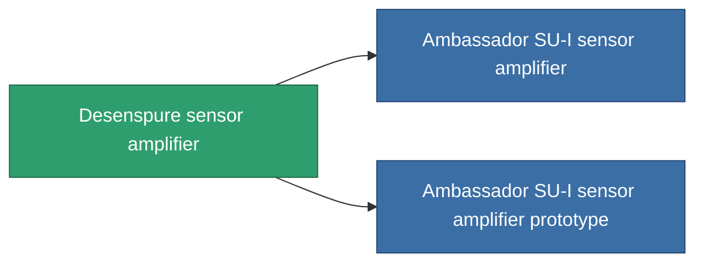

<!-- Generated by tools/generate from the live database (source: entitydefaults definition 769, aggregatevalues via aggregatefields).
     Do not edit by hand; regenerate instead. -->

# Desenspure sensor amplifier

|  |  |
|---|---|
| 정의 | `def_named2_sensor_booster` |
| 티어 | T3 |
| 내구도 | 100 |
| 용량 | 0.5 |
| 질량 | 100 |
| 카테고리 | Modules / Sensors & scanning |
| Tier line | [Standard sensor amplifier](/ko/content/items/standard-sensor-booster/) (T1) → [Bullz-I 6601 sensor amplifier](/ko/content/items/named1-sensor-booster/) (T2) → **Desenspure sensor amplifier** (T3) → [Ambassador SU-I sensor amplifier](/ko/content/items/named3-sensor-booster/) (T4) |

## 통계

| 필드 | 값 |
|---|---|
| core_usage | 11 |
| cpu_usage | 17 |
| cycle_time | 10k |
| effect_sensor_booster_locking_range_modifier | 1.4 |
| effect_sensor_booster_locking_time_modifier | 0.75 |
| powergrid_usage | 5 |

<!-- production:generated -->
## 생산

**구성 요소 6개로 생산 , 연구 레벨 5** — 구성 요소를 조립하여 제작합니다 (전체 목록은 [레시피](/ko/content/recipes/) 참조):

**제작도:** [Desenspure sensor amplifier CT](/content/items/named2-sensor-booster-cprg/)

<svg class="prod-card-icon" aria-hidden="true"><use href="#mi-grid"/></svg><a class="prod-card-name" href="/ko/content/items/axicol/">Cryoperine</a>

필요: <b>200</b>

<svg class="prod-card-icon" aria-hidden="true"><use href="#mi-grid"/></svg><a class="prod-card-name" href="/ko/content/items/espitium/">Espitium</a>

필요: <b>200</b>

<svg class="prod-card-icon" aria-hidden="true"><use href="#mi-grid"/></svg><a class="prod-card-name" href="/ko/content/items/named1-sensor-booster/">Bullz-I 6601 sensor amplifier</a>

필요: <b>1</b>

<svg class="prod-card-icon" aria-hidden="true"><use href="#mi-crystal"/></svg><a class="prod-card-name" href="/ko/content/items/robotshard-common-advanced/">Functional common fragment</a>

필요: <b>20</b>

<svg class="prod-card-icon" aria-hidden="true"><use href="#mi-crystal"/></svg><a class="prod-card-name" href="/ko/content/items/robotshard-common-basic/">Damaged common fragment</a>

필요: <b>20</b>

<svg class="prod-card-icon" aria-hidden="true"><use href="#mi-grid"/></svg><a class="prod-card-name" href="/ko/content/items/titanium/">Titanium</a>

필요: <b>50</b>

## 생산에 사용

**2개 아이템의 구성 요소** — 이를 생산에 사용하는 모든 것:

