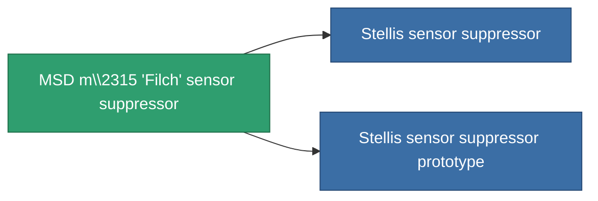

<!-- Generated by tools/generate from the live database (source: entitydefaults definition 793, aggregatevalues via aggregatefields).
     Do not edit by hand; regenerate instead. -->

# MSD m\2315 'Filch' sensor suppressor

|  |  |
|---|---|
| 정의 | `def_named2_sensor_dampener` |
| 티어 | T3 |
| 내구도 | 100 |
| 용량 | 0.5 |
| 질량 | 150 |
| 카테고리 | Modules / Sensors & scanning |
| Tier line | [Standard sensor suppressor](/ko/content/items/standard-sensor-dampener/) (T1) → [Suboster I. sensor suppressor](/ko/content/items/named1-sensor-dampener/) (T2) → **MSD m\2315 'Filch' sensor suppressor** (T3) → [Stellis sensor suppressor](/ko/content/items/named3-sensor-dampener/) (T4) |

## 통계

| 필드 | 값 |
|---|---|
| core_usage | 18 |
| cpu_usage | 36 |
| cycle_time | 5k |
| ecm_strength | 65 |
| effect_sensor_dampener_locking_range_modifier | 0.8 |
| effect_sensor_dampener_locking_time_modifier | 1.35 |
| falloff | 0 |
| optimal_range | 33 |
| powergrid_usage | 21 |

<!-- production:generated -->
## 생산

**구성 요소 10개로 생산 , 연구 레벨 5** — 구성 요소를 조립하여 제작합니다 (전체 목록은 [레시피](/ko/content/recipes/) 참조):

**제작도:** [MSD m\\2315 'Filch' sensor suppressor CT](/content/items/named2-sensor-dampener-cprg/)

<svg class="prod-card-icon" aria-hidden="true"><use href="#mi-grid"/></svg><a class="prod-card-name" href="/ko/content/items/espitium/">Espitium</a>

필요: <b>100</b>

<svg class="prod-card-icon" aria-hidden="true"><use href="#mi-grid"/></svg><a class="prod-card-name" href="/ko/content/items/hydrobenol/">Hydrobenol</a>

필요: <b>50</b>

<svg class="prod-card-icon" aria-hidden="true"><use href="#mi-grid"/></svg><a class="prod-card-name" href="/ko/content/items/named1-sensor-dampener/">Suboster I. sensor suppressor</a>

필요: <b>1</b>

<svg class="prod-card-icon" aria-hidden="true"><use href="#mi-grid"/></svg><a class="prod-card-name" href="/ko/content/items/polynucleit/">Polynucleit</a>

필요: <b>50</b>

<svg class="prod-card-icon" aria-hidden="true"><use href="#mi-grid"/></svg><a class="prod-card-name" href="/ko/content/items/prilumium/">Prilumium</a>

필요: <b>100</b>

<svg class="prod-card-icon" aria-hidden="true"><use href="#mi-crystal"/></svg><a class="prod-card-name" href="/ko/content/items/robotshard-common-advanced/">Functional common fragment</a>

필요: <b>10</b>

<svg class="prod-card-icon" aria-hidden="true"><use href="#mi-crystal"/></svg><a class="prod-card-name" href="/ko/content/items/robotshard-common-basic/">Damaged common fragment</a>

필요: <b>10</b>

<svg class="prod-card-icon" aria-hidden="true"><use href="#mi-crystal"/></svg><a class="prod-card-name" href="/ko/content/items/robotshard-thelodica-advanced/">Functional thelodica fragment</a>

필요: <b>10</b>

<svg class="prod-card-icon" aria-hidden="true"><use href="#mi-crystal"/></svg><a class="prod-card-name" href="/ko/content/items/robotshard-thelodica-basic/">Damaged thelodica fragment</a>

필요: <b>10</b>

<svg class="prod-card-icon" aria-hidden="true"><use href="#mi-grid"/></svg><a class="prod-card-name" href="/ko/content/items/titanium/">Titanium</a>

필요: <b>50</b>

## 생산에 사용

**2개 아이템의 구성 요소** — 이를 생산에 사용하는 모든 것:

