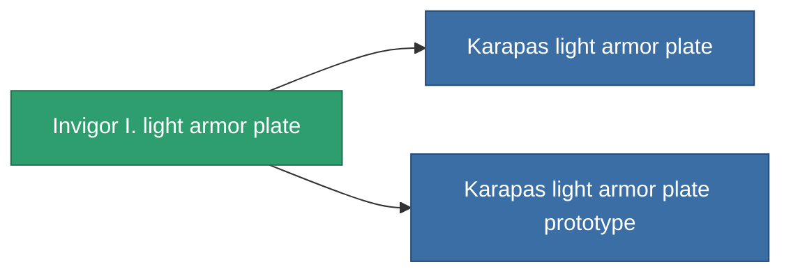

<!-- Generated by tools/generate from the live database (source: entitydefaults definition 685, aggregatevalues via aggregatefields).
     Do not edit by hand; regenerate instead. -->

# Invigor I. light armor plate

|  |  |
|---|---|
| 정의 | `def_named2_small_armor_plate` |
| 티어 | T3 |
| 내구도 | 100 |
| 용량 | 1 |
| 질량 | 450 |
| 카테고리 | Modules / Armor |
| Tier line | [Standard light armor plate](/ko/content/items/standard-small-armor-plate/) (T1) → [Wobost-Titangrip light armor plate](/ko/content/items/named1-small-armor-plate/) (T2) → **Invigor I. light armor plate** (T3) → [Karapas light armor plate](/ko/content/items/named3-small-armor-plate/) (T4) |

## 통계

| 필드 | 값 |
|---|---|
| armor_max | 480 |
| cpu_usage | 1 |
| massiveness | 0.11 |
| powergrid_usage | 15 |
| signature_radius | 0.35 |

<!-- production:generated -->
## 생산

**구성 요소 6개로 생산 , 연구 레벨 3** — 구성 요소를 조립하여 제작합니다 (전체 목록은 [레시피](/ko/content/recipes/) 참조):

**제작도:** [Invigor I. light armor plate CT](/ko/content/items/named2-small-armor-plate-cprg/)

<svg class="prod-card-icon" aria-hidden="true"><use href="#mi-grid"/></svg><a class="prod-card-name" href="/ko/content/items/alligior/">Alligior</a>

필요: <b>175</b>

<svg class="prod-card-icon" aria-hidden="true"><use href="#mi-tree"/></svg><a class="prod-card-name" href="/ko/content/items/named1-small-armor-plate/">Wobost-Titangrip light armor plate</a>

필요: <b>1</b>

<svg class="prod-card-icon" aria-hidden="true"><use href="#mi-grid"/></svg><a class="prod-card-name" href="/ko/content/items/plasteosine/">Plasteosine</a>

필요: <b>175</b>

<svg class="prod-card-icon" aria-hidden="true"><use href="#mi-crystal"/></svg><a class="prod-card-name" href="/ko/content/items/robotshard-common-advanced/">Functional common fragment</a>

필요: <b>20</b>

<svg class="prod-card-icon" aria-hidden="true"><use href="#mi-crystal"/></svg><a class="prod-card-name" href="/ko/content/items/robotshard-common-basic/">Damaged common fragment</a>

필요: <b>20</b>

<svg class="prod-card-icon" aria-hidden="true"><use href="#mi-grid"/></svg><a class="prod-card-name" href="/ko/content/items/titanium/">Titanium</a>

필요: <b>250</b>

## 생산에 사용

**2개 아이템의 구성 요소** — 이를 생산에 사용하는 모든 것:

