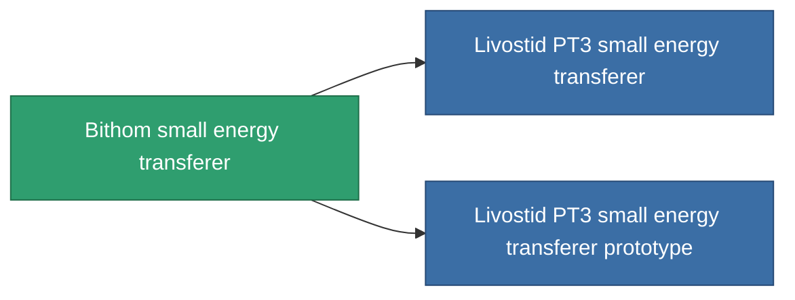

<!-- Generated by tools/generate from the live database (source: entitydefaults definition 736, aggregatevalues via aggregatefields).
     Do not edit by hand; regenerate instead. -->

# Bithom small energy transferer

|  |  |
|---|---|
| 정의 | `def_named2_small_energy_transfer` |
| 티어 | T3 |
| 내구도 | 100 |
| 용량 | 0.5 |
| 질량 | 100 |
| 카테고리 | Modules / Enhancements |
| Tier line | [Standard small energy transferer](/ko/content/items/standard-small-energy-transfer/) (T1) → [Uysta small energy transferer](/ko/content/items/named1-small-energy-transfer/) (T2) → **Bithom small energy transferer** (T3) → [Livostid PT3 small energy transferer](/ko/content/items/named3-small-energy-transfer/) (T4) |
| 비고 | range = optimal_range * 	energy_transferers_optimal_range_modifier    cel core += energy_transfer_amount  sajat core -= energy_transfer_amount - 10% |

## 통계

| 필드 | 값 |
|---|---|
| core_usage | 5 |
| cpu_usage | 37 |
| cycle_time | 10k |
| energy_transfer_amount | 42 |
| falloff | 0 |
| optimal_range | 15 |
| powergrid_usage | 32 |

<!-- production:generated -->
## 생산

**구성 요소 6개로 생산 , 연구 레벨 4** — 구성 요소를 조립하여 제작합니다 (전체 목록은 [레시피](/ko/content/recipes/) 참조):

**제작도:** [Bithom small energy transferer CT](/content/items/named2-small-energy-transfer-cprg/)

<svg class="prod-card-icon" aria-hidden="true"><use href="#mi-grid"/></svg><a class="prod-card-name" href="/ko/content/items/axicol/">Cryoperine</a>

필요: <b>125</b>

<svg class="prod-card-icon" aria-hidden="true"><use href="#mi-grid"/></svg><a class="prod-card-name" href="/ko/content/items/espitium/">Espitium</a>

필요: <b>125</b>

<svg class="prod-card-icon" aria-hidden="true"><use href="#mi-grid"/></svg><a class="prod-card-name" href="/ko/content/items/named1-small-energy-transfer/">Uysta small energy transferer</a>

필요: <b>1</b>

<svg class="prod-card-icon" aria-hidden="true"><use href="#mi-crystal"/></svg><a class="prod-card-name" href="/ko/content/items/robotshard-common-advanced/">Functional common fragment</a>

필요: <b>20</b>

<svg class="prod-card-icon" aria-hidden="true"><use href="#mi-crystal"/></svg><a class="prod-card-name" href="/ko/content/items/robotshard-common-basic/">Damaged common fragment</a>

필요: <b>20</b>

<svg class="prod-card-icon" aria-hidden="true"><use href="#mi-grid"/></svg><a class="prod-card-name" href="/ko/content/items/titanium/">Titanium</a>

필요: <b>100</b>

## 생산에 사용

**2개 아이템의 구성 요소** — 이를 생산에 사용하는 모든 것:

