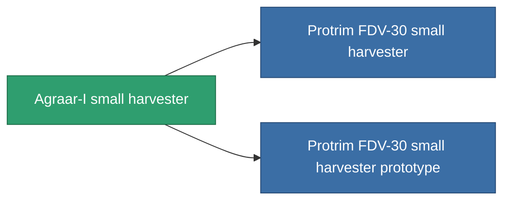

<!-- Generated by tools/generate from the live database (source: entitydefaults definition 808, aggregatevalues via aggregatefields).
     Do not edit by hand; regenerate instead. -->

# Agraar-I small harvester

|  |  |
|---|---|
| 정의 | `def_named2_small_harvester` |
| 티어 | T3 |
| 내구도 | 100 |
| 용량 | 1 |
| 질량 | 400 |
| 카테고리 | Modules / Harvesting |
| Tier line | [Standard small harvester](/ko/content/items/standard-small-harvester/) (T1) → [MHA 400-'Avalon' small harvester](/ko/content/items/named1-small-harvester/) (T2) → **Agraar-I small harvester** (T3) → [Protrim FDV-30 small harvester](/ko/content/items/named3-small-harvester/) (T4) |

## 통계

| 필드 | 값 |
|---|---|
| core_usage | 19 |
| cpu_usage | 42 |
| cycle_time | 14k |
| optimal_range | 3 |
| powergrid_usage | 32 |

<!-- production:generated -->
## 생산

**구성 요소 6개로 생산 , 연구 레벨 3** — 구성 요소를 조립하여 제작합니다 (전체 목록은 [레시피](/ko/content/recipes/) 참조):

**제작도:** [Agraar-I small harvester CT](/ko/content/items/named2-small-harvester-cprg/)

<svg class="prod-card-icon" aria-hidden="true"><use href="#mi-grid"/></svg><a class="prod-card-name" href="/ko/content/items/axicol/">Cryoperine</a>

필요: <b>25</b>

<svg class="prod-card-icon" aria-hidden="true"><use href="#mi-grid"/></svg><a class="prod-card-name" href="/ko/content/items/espitium/">Espitium</a>

필요: <b>25</b>

<svg class="prod-card-icon" aria-hidden="true"><use href="#mi-grid"/></svg><a class="prod-card-name" href="/ko/content/items/named1-small-harvester/">MHA 400-'Avalon' small harvester</a>

필요: <b>1</b>

<svg class="prod-card-icon" aria-hidden="true"><use href="#mi-crystal"/></svg><a class="prod-card-name" href="/ko/content/items/robotshard-common-advanced/">Functional common fragment</a>

필요: <b>20</b>

<svg class="prod-card-icon" aria-hidden="true"><use href="#mi-crystal"/></svg><a class="prod-card-name" href="/ko/content/items/robotshard-common-basic/">Damaged common fragment</a>

필요: <b>20</b>

<svg class="prod-card-icon" aria-hidden="true"><use href="#mi-grid"/></svg><a class="prod-card-name" href="/ko/content/items/titanium/">Titanium</a>

필요: <b>150</b>

## 생산에 사용

**2개 아이템의 구성 요소** — 이를 생산에 사용하는 모든 것:

