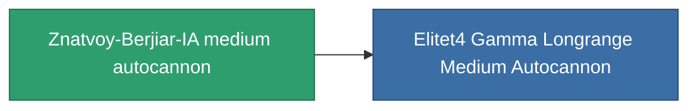

<!-- Generated by tools/generate from the live database (source: entitydefaults definition 1032, aggregatevalues via aggregatefields).
     Do not edit by hand; regenerate instead. -->

# Znatvoy-Berjiar-IA medium autocannon

|  |  |
|---|---|
| 정의 | `def_named3_longrange_medium_autocannon` |
| 티어 | T4 |
| 내구도 | 100 |
| 용량 | 1.2 |
| 질량 | 715 |
| 카테고리 | Modules / Weapons |
| Tier line | [GTRB medium autocannon](/ko/content/items/named1-longrange-medium-autocannon/) (T2) → [Astoc M75 medium autocannon](/ko/content/items/named2-longrange-medium-autocannon/) (T3) → **Znatvoy-Berjiar-IA medium autocannon** (T4) |

## 통계

| 필드 | 값 |
|---|---|
| accuracy | 18 |
| core_usage | 2 |
| cpu_usage | 14 |
| cycle_time | 9k |
| damage_modifier | 2.7 |
| falloff | 32 |
| least_optimal | 5 |
| optimal_range | 24 |
| powergrid_usage | 150 |

<!-- production:generated -->
## 생산

**구성 요소 7개로 생산 , 연구 레벨 6** — 구성 요소를 조립하여 제작합니다 (전체 목록은 [레시피](/ko/content/recipes/) 참조):

**제작도:** [Znatvoy-Berjiar-IA medium autocannon CT](/ko/content/items/named3-longrange-medium-autocannon-cprg/)

<svg class="prod-card-icon" aria-hidden="true"><use href="#mi-grid"/></svg><a class="prod-card-name" href="/ko/content/items/axicol/">Cryoperine</a>

필요: <b>100</b>

<svg class="prod-card-icon" aria-hidden="true"><use href="#mi-grid"/></svg><a class="prod-card-name" href="/ko/content/items/axicoline/">Axicoline</a>

필요: <b>200</b>

<svg class="prod-card-icon" aria-hidden="true"><use href="#mi-grid"/></svg><a class="prod-card-name" href="/ko/content/items/espitium/">Espitium</a>

필요: <b>100</b>

<svg class="prod-card-icon" aria-hidden="true"><use href="#mi-grid"/></svg><a class="prod-card-name" href="/ko/content/items/hydrobenol/">Hydrobenol</a>

필요: <b>200</b>

<svg class="prod-card-icon" aria-hidden="true"><use href="#mi-robots"/></svg><a class="prod-card-name" href="/ko/content/items/named2-longrange-medium-autocannon/">Astoc M75 medium autocannon</a>

필요: <b>1</b>

<svg class="prod-card-icon" aria-hidden="true"><use href="#mi-grid"/></svg><a class="prod-card-name" href="/ko/content/items/titanium/">Titanium</a>

필요: <b>100</b>

<svg class="prod-card-icon" aria-hidden="true"><use href="#mi-grid"/></svg><a class="prod-card-name" href="/ko/content/items/unimetal/">Briochit</a>

필요: <b>200</b>

## 생산에 사용

**1개 아이템의 구성 요소** — 이를 생산에 사용하는 모든 것:

