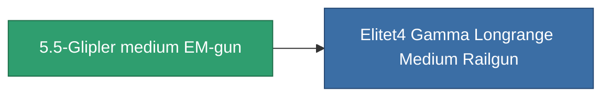

<!-- Generated by tools/generate from the live database (source: entitydefaults definition 1020, aggregatevalues via aggregatefields).
     Do not edit by hand; regenerate instead. -->

# 5.5-Glipler medium EM-gun

|  |  |
|---|---|
| 정의 | `def_named3_longrange_medium_railgun` |
| 티어 | T4 |
| 내구도 | 100 |
| 용량 | 1 |
| 질량 | 715 |
| 카테고리 | Modules / Weapons |
| Tier line | [Condor-SPP medium EM-gun](/ko/content/items/named1-longrange-medium-railgun/) (T2) → [Nuimtec-Accolon LRS medium EM-gun](/ko/content/items/named2-longrange-medium-railgun/) (T3) → **5.5-Glipler medium EM-gun** (T4) |

## 통계

| 필드 | 값 |
|---|---|
| accuracy | 14 |
| core_usage | 29 |
| cpu_usage | 45 |
| cycle_time | 10k |
| damage_modifier | 2.7 |
| falloff | 6 |
| least_optimal | 21 |
| optimal_range | 31 |
| powergrid_usage | 200 |

<!-- production:generated -->
## 생산

**구성 요소 12개로 생산 , 연구 레벨 7** — 구성 요소를 조립하여 제작합니다 (전체 목록은 [레시피](/ko/content/recipes/) 참조):

**제작도:** [5.5-Glipler medium EM-gun CT](/content/items/named3-longrange-medium-railgun-cprg/)

<svg class="prod-card-icon" aria-hidden="true"><use href="#mi-grid"/></svg><a class="prod-card-name" href="/ko/content/items/chollonin/">Chollonin</a>

필요: <b>100</b>

<svg class="prod-card-icon" aria-hidden="true"><use href="#mi-grid"/></svg><a class="prod-card-name" href="/ko/content/items/espitium/">Espitium</a>

필요: <b>100</b>

<svg class="prod-card-icon" aria-hidden="true"><use href="#mi-grid"/></svg><a class="prod-card-name" href="/ko/content/items/hydrobenol/">Hydrobenol</a>

필요: <b>200</b>

<svg class="prod-card-icon" aria-hidden="true"><use href="#mi-grid"/></svg><a class="prod-card-name" href="/ko/content/items/named2-longrange-medium-railgun/">Nuimtec-Accolon LRS medium EM-gun</a>

필요: <b>1</b>

<svg class="prod-card-icon" aria-hidden="true"><use href="#mi-grid"/></svg><a class="prod-card-name" href="/ko/content/items/polynitrocol/">Polynitrocol</a>

필요: <b>200</b>

<svg class="prod-card-icon" aria-hidden="true"><use href="#mi-crystal"/></svg><a class="prod-card-name" href="/ko/content/items/robotshard-common-advanced/">Functional common fragment</a>

필요: <b>30</b>

<svg class="prod-card-icon" aria-hidden="true"><use href="#mi-crystal"/></svg><a class="prod-card-name" href="/ko/content/items/robotshard-common-basic/">Damaged common fragment</a>

필요: <b>15</b>

<svg class="prod-card-icon" aria-hidden="true"><use href="#mi-crystal"/></svg><a class="prod-card-name" href="/ko/content/items/robotshard-common-expert/">Perfect common fragment</a>

필요: <b>45</b>

<svg class="prod-card-icon" aria-hidden="true"><use href="#mi-crystal"/></svg><a class="prod-card-name" href="/ko/content/items/robotshard-nuimqol-advanced/">Functional nuimqol fragment</a>

필요: <b>30</b>

<svg class="prod-card-icon" aria-hidden="true"><use href="#mi-crystal"/></svg><a class="prod-card-name" href="/ko/content/items/robotshard-nuimqol-basic/">Damaged nuimqol fragment</a>

필요: <b>15</b>

<svg class="prod-card-icon" aria-hidden="true"><use href="#mi-crystal"/></svg><a class="prod-card-name" href="/ko/content/items/robotshard-nuimqol-expert/">Perfect nuimqol fragment</a>

필요: <b>45</b>

<svg class="prod-card-icon" aria-hidden="true"><use href="#mi-grid"/></svg><a class="prod-card-name" href="/ko/content/items/unimetal/">Briochit</a>

필요: <b>200</b>

## 생산에 사용

**1개 아이템의 구성 요소** — 이를 생산에 사용하는 모든 것:

