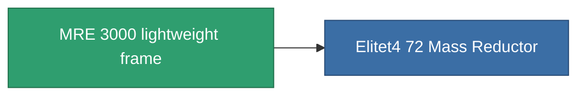

<!-- Generated by tools/generate from the live database (source: entitydefaults definition 1404, aggregatevalues via aggregatefields).
     Do not edit by hand; regenerate instead. -->

# MRE 3000 lightweight frame

|  |  |
|---|---|
| 정의 | `def_named3_mass_reductor` |
| 티어 | T4 |
| 내구도 | 100 |
| 용량 | 0.5 |
| 질량 | 2 |
| 카테고리 | Modules / Enhancements |
| Tier line | [Standard lightweight frame](/ko/content/items/standard-mass-reductor/) (T1) → [MR1000-Boogey lightweight frame](/ko/content/items/named1-mass-reductor/) (T2) → [Eizbiogh-dfg20 lightweight frame](/ko/content/items/named2-mass-reductor/) (T3) → **MRE 3000 lightweight frame** (T4) |

## 통계

| 필드 | 값 |
|---|---|
| armor_max_modifier | 0.725 |
| cpu_usage | 7 |
| massiveness | -0.25 |
| powergrid_usage | 3 |
| speed_max_modifier | 1.25 |

<!-- production:generated -->
## 생산

**구성 요소 10개로 생산 , 연구 레벨 6** — 구성 요소를 조립하여 제작합니다 (전체 목록은 [레시피](/ko/content/recipes/) 참조):

**제작도:** [MRE 3000 lightweight frame CT](/content/items/named3-mass-reductor-cprg/)

<svg class="prod-card-icon" aria-hidden="true"><use href="#mi-grid"/></svg><a class="prod-card-name" href="/ko/content/items/alligior/">Alligior</a>

필요: <b>350</b>

<svg class="prod-card-icon" aria-hidden="true"><use href="#mi-grid"/></svg><a class="prod-card-name" href="/ko/content/items/axicol/">Cryoperine</a>

필요: <b>50</b>

<svg class="prod-card-icon" aria-hidden="true"><use href="#mi-grid"/></svg><a class="prod-card-name" href="/ko/content/items/espitium/">Espitium</a>

필요: <b>50</b>

<svg class="prod-card-icon" aria-hidden="true"><use href="#mi-grid"/></svg><a class="prod-card-name" href="/ko/content/items/named2-mass-reductor/">Eizbiogh-dfg20 lightweight frame</a>

필요: <b>1</b>

<svg class="prod-card-icon" aria-hidden="true"><use href="#mi-grid"/></svg><a class="prod-card-name" href="/ko/content/items/plasteosine/">Plasteosine</a>

필요: <b>350</b>

<svg class="prod-card-icon" aria-hidden="true"><use href="#mi-crystal"/></svg><a class="prod-card-name" href="/ko/content/items/robotshard-common-advanced/">Functional common fragment</a>

필요: <b>30</b>

<svg class="prod-card-icon" aria-hidden="true"><use href="#mi-crystal"/></svg><a class="prod-card-name" href="/ko/content/items/robotshard-common-basic/">Damaged common fragment</a>

필요: <b>15</b>

<svg class="prod-card-icon" aria-hidden="true"><use href="#mi-crystal"/></svg><a class="prod-card-name" href="/ko/content/items/robotshard-common-expert/">Perfect common fragment</a>

필요: <b>45</b>

<svg class="prod-card-icon" aria-hidden="true"><use href="#mi-grid"/></svg><a class="prod-card-name" href="/ko/content/items/titanium/">Titanium</a>

필요: <b>200</b>

<svg class="prod-card-icon" aria-hidden="true"><use href="#mi-grid"/></svg><a class="prod-card-name" href="/ko/content/items/unimetal/">Briochit</a>

필요: <b>200</b>

## 생산에 사용

**1개 아이템의 구성 요소** — 이를 생산에 사용하는 모든 것:

