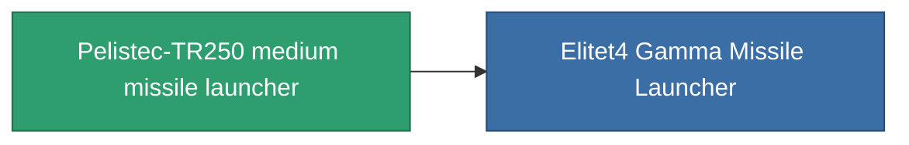

<!-- Generated by tools/generate from the live database (source: entitydefaults definition 854, aggregatevalues via aggregatefields).
     Do not edit by hand; regenerate instead. -->

# Pelistec-TR250 medium missile launcher

|  |  |
|---|---|
| 정의 | `def_named3_missile_launcher` |
| 티어 | T4 |
| 내구도 | 100 |
| 용량 | 2 |
| 질량 | 550 |
| 카테고리 | Modules / Weapons |
| Tier line | [Standard medium missile launcher](/ko/content/items/standard-missile-launcher/) (T1) → [ST-Dupot medium missile launcher](/ko/content/items/named1-missile-launcher/) (T2) → [Vollert medium missile launcher](/ko/content/items/named2-missile-launcher/) (T3) → **Pelistec-TR250 medium missile launcher** (T4) |

## 통계

| 필드 | 값 |
|---|---|
| accuracy | 1 |
| core_usage | 2 |
| cpu_usage | 45 |
| cycle_time | 10.5k |
| damage_modifier | 1 |
| module_missile_range_modifier | 1.2 |
| powergrid_usage | 170 |

<!-- production:generated -->
## 생산

**구성 요소 10개로 생산 , 연구 레벨 7** — 구성 요소를 조립하여 제작합니다 (전체 목록은 [레시피](/ko/content/recipes/) 참조):

**제작도:** [Pelistec-TR250 medium missile launcher CT](/ko/content/items/named3-missile-launcher-cprg/)

<svg class="prod-card-icon" aria-hidden="true"><use href="#mi-grid"/></svg><a class="prod-card-name" href="/ko/content/items/hydrobenol/">Hydrobenol</a>

필요: <b>200</b>

<svg class="prod-card-icon" aria-hidden="true"><use href="#mi-star"/></svg><a class="prod-card-name" href="/ko/content/items/named2-missile-launcher/">Vollert medium missile launcher</a>

필요: <b>1</b>

<svg class="prod-card-icon" aria-hidden="true"><use href="#mi-grid"/></svg><a class="prod-card-name" href="/ko/content/items/phlobotil/">Phlobotil</a>

필요: <b>200</b>

<svg class="prod-card-icon" aria-hidden="true"><use href="#mi-crystal"/></svg><a class="prod-card-name" href="/ko/content/items/robotshard-common-advanced/">Functional common fragment</a>

필요: <b>30</b>

<svg class="prod-card-icon" aria-hidden="true"><use href="#mi-crystal"/></svg><a class="prod-card-name" href="/ko/content/items/robotshard-common-basic/">Damaged common fragment</a>

필요: <b>15</b>

<svg class="prod-card-icon" aria-hidden="true"><use href="#mi-crystal"/></svg><a class="prod-card-name" href="/ko/content/items/robotshard-common-expert/">Perfect common fragment</a>

필요: <b>45</b>

<svg class="prod-card-icon" aria-hidden="true"><use href="#mi-crystal"/></svg><a class="prod-card-name" href="/ko/content/items/robotshard-pelistal-advanced/">Functional pelistal fragment</a>

필요: <b>30</b>

<svg class="prod-card-icon" aria-hidden="true"><use href="#mi-crystal"/></svg><a class="prod-card-name" href="/ko/content/items/robotshard-pelistal-basic/">Damaged pelistal fragment</a>

필요: <b>15</b>

<svg class="prod-card-icon" aria-hidden="true"><use href="#mi-crystal"/></svg><a class="prod-card-name" href="/ko/content/items/robotshard-pelistal-expert/">Perfect pelistal fragment</a>

필요: <b>45</b>

<svg class="prod-card-icon" aria-hidden="true"><use href="#mi-grid"/></svg><a class="prod-card-name" href="/ko/content/items/unimetal/">Briochit</a>

필요: <b>200</b>

## 생산에 사용

**1개 아이템의 구성 요소** — 이를 생산에 사용하는 모든 것:

