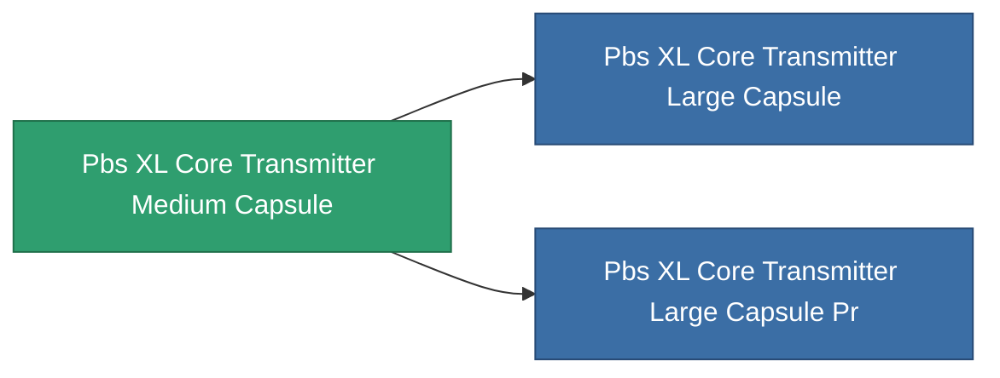

<!-- Generated by tools/generate from the live database (source: entitydefaults definition 4683, aggregatevalues via aggregatefields).
     Do not edit by hand; regenerate instead. -->

# Pbs XL Core Transmitter Medium Capsule

|  |  |
|---|---|
| 정의 | `def_pbs_XL_core_transmitter_medium_capsule` |
| 티어 | T2 |
| 내구도 | 100 |
| 용량 | 50 |
| 질량 | 50000 |
| 카테고리 | Special & other / Miscellaneous |

## 통계

| 필드 | 값 |
|---|---|
| armor_max | 37.5k |
| core_max | 105k |
| resist_chemical | 75 |
| resist_explosive | 75 |
| resist_kinetic | 75 |
| resist_thermal | 75 |
| signature_radius | 25 |
| stealth_strength | 50 |

<!-- production:generated -->
## 생산

**구성 요소 7개로 생산** — 구성 요소를 조립하여 제작합니다 (전체 목록은 [레시피](/ko/content/recipes/) 참조):

**제작도:** [Advanced energy backbone node foundation CT](/content/items/pbs-xl-core-transmitter-medium-capsule-cprg/)

<svg class="prod-card-icon" aria-hidden="true"><use href="#mi-grid"/></svg><a class="prod-card-name" href="/ko/content/items/axicol/">Cryoperine</a>

필요: <b>200</b>

<svg class="prod-card-icon" aria-hidden="true"><use href="#mi-grid"/></svg><a class="prod-card-name" href="/ko/content/items/espitium/">Espitium</a>

필요: <b>400</b>

<svg class="prod-card-icon" aria-hidden="true"><use href="#mi-grid"/></svg><a class="prod-card-name" href="/ko/content/items/gamma-buildblock/">Coalimin</a>

필요: <b>100</b>

<svg class="prod-card-icon" aria-hidden="true"><use href="#mi-grid"/></svg><a class="prod-card-name" href="/ko/content/items/gamma-energyblock/">Tiraizin</a>

필요: <b>200</b>

<svg class="prod-card-icon" aria-hidden="true"><use href="#mi-crystal"/></svg><a class="prod-card-name" href="/ko/content/items/pbs-xl-core-transmitter-small-capsule/">Pbs XL Core Transmitter Small Capsule</a>

필요: <b>1</b>

<svg class="prod-card-icon" aria-hidden="true"><use href="#mi-grid"/></svg><a class="prod-card-name" href="/ko/content/items/titanium/">Titanium</a>

필요: <b>100</b>

<svg class="prod-card-icon" aria-hidden="true"><use href="#mi-grid"/></svg><a class="prod-card-name" href="/ko/content/items/unimetal/">Briochit</a>

필요: <b>200</b>

## 생산에 사용

**2개 아이템의 구성 요소** — 이를 생산에 사용하는 모든 것:

