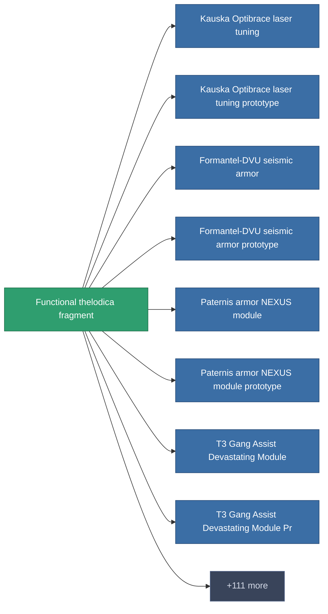

<!-- Generated by tools/generate from the live database (source: entitydefaults definition 1984, aggregatevalues via aggregatefields).
     Do not edit by hand; regenerate instead. -->

# Functional thelodica fragment

|  |  |
|---|---|
| 정의 | `def_robotshard_thelodica_advanced` |
| 티어 | – |
| 내구도 | 100 |
| 용량 | 0.01 |
| 질량 | 1 |
| 카테고리 | Materials |

_통계 없음 — 이 아이템에는 집계 값이 없습니다._

<!-- production:generated -->
## 생산

**구성 요소 3개로 생산** — 구성 요소를 조립하여 제작합니다 (전체 목록은 [레시피](/ko/content/recipes/) 참조):

<svg class="prod-card-icon" aria-hidden="true"><use href="#mi-grid"/></svg><a class="prod-card-name" href="/ko/content/items/metachropin/">Metachropin</a>

필요: <b>2</b>

<svg class="prod-card-icon" aria-hidden="true"><use href="#mi-grid"/></svg><a class="prod-card-name" href="/ko/content/items/polynucleit/">Polynucleit</a>

필요: <b>2</b>

<svg class="prod-card-icon" aria-hidden="true"><use href="#mi-grid"/></svg><a class="prod-card-name" href="/ko/content/items/prilumium/">Prilumium</a>

필요: <b>2</b>

## 생산에 사용

**119개 아이템의 구성 요소** — 이를 이용해 생산할 수 있는 것의 예시 (전체 목록은 [레시피](/ko/content/recipes/) 참조).

