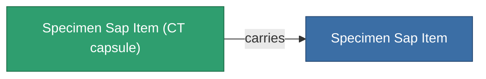

<!-- Generated by tools/generate from the live database (source: entitydefaults definition 5691, aggregatevalues via aggregatefields).
     Do not edit by hand; regenerate instead. -->

# Specimen Sap Item

|  |  |
|---|---|
| 정의 | `def_specimen_sap_item` |
| 티어 | T1 |
| 내구도 | 100 |
| 용량 | 16 |
| 질량 | 16 |
| 카테고리 | Materials |
| 비고 | Specimen Item |

_통계 없음 — 이 아이템에는 집계 값이 없습니다._

## 운송 캡슐

A transport capsule (CT) exists for this item — it is how the item moves between players and zones.

<!-- production:generated -->
## 생산

**구성 요소 10개로 생산** — 구성 요소를 조립하여 제작합니다 (전체 목록은 [레시피](/ko/content/recipes/) 참조):

<svg class="prod-card-icon" aria-hidden="true"><use href="#mi-grid"/></svg><a class="prod-card-name" href="/ko/content/items/crude/">HDT</a>

필요: <b>40.0k</b>

<svg class="prod-card-icon" aria-hidden="true"><use href="#mi-grid"/></svg><a class="prod-card-name" href="/ko/content/items/helioptris/">Helioptris</a>

필요: <b>10.0k</b>

<svg class="prod-card-icon" aria-hidden="true"><use href="#mi-grid"/></svg><a class="prod-card-name" href="/ko/content/ores/imentium/">Imentium</a>

필요: <b>10.0k</b>

<svg class="prod-card-icon" aria-hidden="true"><use href="#mi-grid"/></svg><a class="prod-card-name" href="/ko/content/items/liquizit/">Liquizit</a>

필요: <b>20.0k</b>

<svg class="prod-card-icon" aria-hidden="true"><use href="#mi-grid"/></svg><a class="prod-card-name" href="/ko/content/items/prismocitae/">Prismocitae</a>

필요: <b>10.0k</b>

<svg class="prod-card-icon" aria-hidden="true"><use href="#mi-grid"/></svg><a class="prod-card-name" href="/ko/content/ores/silgium/">Silgium</a>

필요: <b>10.0k</b>

<svg class="prod-card-icon" aria-hidden="true"><use href="#mi-grid"/></svg><a class="prod-card-name" href="/ko/content/items/specimen-sap-item-flux/">Specimen Sap Item Flux</a>

필요: <b>1</b>

<svg class="prod-card-icon" aria-hidden="true"><use href="#mi-grid"/></svg><a class="prod-card-name" href="/ko/content/ores/stermonit/">Stermonit</a>

필요: <b>10.0k</b>

<svg class="prod-card-icon" aria-hidden="true"><use href="#mi-grid"/></svg><a class="prod-card-name" href="/ko/content/ores/titan/">Titan</a>

필요: <b>10.0k</b>

<svg class="prod-card-icon" aria-hidden="true"><use href="#mi-grid"/></svg><a class="prod-card-name" href="/ko/content/items/triandlus/">Triandlus</a>

필요: <b>10.0k</b>

