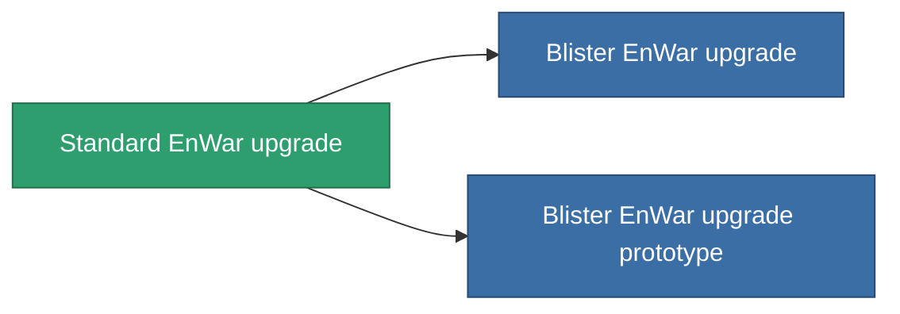

<!-- Generated by tools/generate from the live database (source: entitydefaults definition 4577, aggregatevalues via aggregatefields).
     Do not edit by hand; regenerate instead. -->

# Standard EnWar upgrade

|  |  |
|---|---|
| 정의 | `def_standard_energy_warfare_upgrade` |
| 티어 | T1 |
| 내구도 | 100 |
| 용량 | 1 |
| 질량 | 250 |
| 카테고리 | Modules / Enhancements |
| Tier line | **Standard EnWar upgrade** (T1) → [Blister EnWar upgrade](/ko/content/items/named1-energy-warfare-upgrade/) (T2) → [OM-Shock EnWar upgrade](/ko/content/items/named2-energy-warfare-upgrade/) (T3) → [XT-Shock EnWar upgrade](/ko/content/items/named3-energy-warfare-upgrade/) (T4) |

## 통계

| 필드 | 값 |
|---|---|
| core_usage_energy_neutralizers_modifier | 1.1 |
| cpu_usage | 25 |
| energy_neutralized_amount_modifier | 1.2 |
| energy_vampired_amount_modifier | 1.1 |
| powergrid_usage | 45 |

<!-- production:generated -->
## 생산

**구성 요소 5개로 생산 , 연구 레벨 5** — 구성 요소를 조립하여 제작합니다 (전체 목록은 [레시피](/ko/content/recipes/) 참조):

**제작도:** [Standard EnWar upgrade CT](/content/items/standard-energy-warfare-upgrade-cprg/)

<svg class="prod-card-icon" aria-hidden="true"><use href="#mi-grid"/></svg><a class="prod-card-name" href="/ko/content/items/axicol/">Cryoperine</a>

필요: <b>150</b>

<svg class="prod-card-icon" aria-hidden="true"><use href="#mi-grid"/></svg><a class="prod-card-name" href="/ko/content/items/axicoline/">Axicoline</a>

필요: <b>50</b>

<svg class="prod-card-icon" aria-hidden="true"><use href="#mi-grid"/></svg><a class="prod-card-name" href="/ko/content/items/phlobotil/">Phlobotil</a>

필요: <b>50</b>

<svg class="prod-card-icon" aria-hidden="true"><use href="#mi-grid"/></svg><a class="prod-card-name" href="/ko/content/items/titanium/">Titanium</a>

필요: <b>50</b>

<svg class="prod-card-icon" aria-hidden="true"><use href="#mi-grid"/></svg><a class="prod-card-name" href="/ko/content/items/vitricyl/">Vitricyl</a>

필요: <b>150</b>

## 생산에 사용

**2개 아이템의 구성 요소** — 이를 생산에 사용하는 모든 것:

