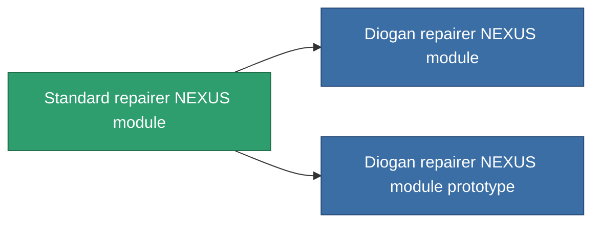

<!-- Generated by tools/generate from the live database (source: entitydefaults definition 2554, aggregatevalues via aggregatefields).
     Do not edit by hand; regenerate instead. -->

# Standard repairer NEXUS module

|  |  |
|---|---|
| 정의 | `def_standard_gang_assist_maintance_module` |
| 티어 | T1 |
| 내구도 | 100 |
| 용량 | 0.2 |
| 질량 | 50 |
| 카테고리 | Modules / Enhancements |
| Tier line | **Standard repairer NEXUS module** (T1) → [Diogan repairer NEXUS module](/ko/content/items/named1-gang-assist-maintance-module/) (T2) → [Pawish repairer NEXUS module](/ko/content/items/named2-gang-assist-maintance-module/) (T3) → [ACF-9900 repairer NEXUS module](/ko/content/items/named3-gang-assist-maintance-module/) (T4) |
| 비고 | repaired ammountot novel |

## 통계

| 필드 | 값 |
|---|---|
| core_usage | 35 |
| cpu_usage | 85 |
| cycle_time | 10k |
| default_effect_range | 100 |
| effect_repair_amount_modifier | 1.02 |
| powergrid_usage | 35 |

<!-- production:generated -->
## 생산

**구성 요소 5개로 생산 , 연구 레벨 4** — 구성 요소를 조립하여 제작합니다 (전체 목록은 [레시피](/ko/content/recipes/) 참조):

**제작도:** [Standard repairer NEXUS module CT](/ko/content/items/standard-gang-assist-maintance-module-cprg/)

<svg class="prod-card-icon" aria-hidden="true"><use href="#mi-grid"/></svg><a class="prod-card-name" href="/ko/content/items/axicol/">Cryoperine</a>

필요: <b>150</b>

<svg class="prod-card-icon" aria-hidden="true"><use href="#mi-grid"/></svg><a class="prod-card-name" href="/ko/content/items/chollonin/">Chollonin</a>

필요: <b>150</b>

<svg class="prod-card-icon" aria-hidden="true"><use href="#mi-grid"/></svg><a class="prod-card-name" href="/ko/content/items/plasteosine/">Plasteosine</a>

필요: <b>150</b>

<svg class="prod-card-icon" aria-hidden="true"><use href="#mi-grid"/></svg><a class="prod-card-name" href="/ko/content/items/statichnol/">Statichnol</a>

필요: <b>150</b>

<svg class="prod-card-icon" aria-hidden="true"><use href="#mi-grid"/></svg><a class="prod-card-name" href="/ko/content/items/titanium/">Titanium</a>

필요: <b>50</b>

## 생산에 사용

**2개 아이템의 구성 요소** — 이를 생산에 사용하는 모든 것:

