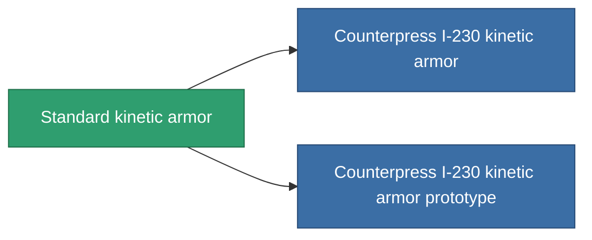

<!-- Generated by tools/generate from the live database (source: entitydefaults definition 26, aggregatevalues via aggregatefields).
     Do not edit by hand; regenerate instead. -->

# Standard kinetic armor

|  |  |
|---|---|
| 정의 | `def_standard_kin_armor_hardener` |
| 티어 | T1 |
| 내구도 | 100 |
| 용량 | 1 |
| 질량 | 100 |
| 카테고리 | Modules / Armor |
| Tier line | **Standard kinetic armor** (T1) → [Counterpress I-230 kinetic armor](/ko/content/items/named1-kin-armor-hardener/) (T2) → [Apparod Defragger kinetic armor](/ko/content/items/named2-kin-armor-hardener/) (T3) → [Grampier-VK kinetic armor](/ko/content/items/named3-kin-armor-hardener/) (T4) |

## 통계

| 필드 | 값 |
|---|---|
| core_usage | 13 |
| cpu_usage | 25 |
| cycle_time | 10k |
| effect_resist_kinetic | 100 |
| powergrid_usage | 5 |
| resist_kinetic | 25 |

<!-- production:generated -->
## 생산

**구성 요소 5개로 생산 , 연구 레벨 3** — 구성 요소를 조립하여 제작합니다 (전체 목록은 [레시피](/ko/content/recipes/) 참조):

**제작도:** [Standard kinetic armor CT](/content/items/standard-kin-armor-hardener-cprg/)

<svg class="prod-card-icon" aria-hidden="true"><use href="#mi-grid"/></svg><a class="prod-card-name" href="/ko/content/items/axicol/">Cryoperine</a>

필요: <b>50</b>

<svg class="prod-card-icon" aria-hidden="true"><use href="#mi-grid"/></svg><a class="prod-card-name" href="/ko/content/items/metachropin/">Metachropin</a>

필요: <b>125</b>

<svg class="prod-card-icon" aria-hidden="true"><use href="#mi-grid"/></svg><a class="prod-card-name" href="/ko/content/items/plasteosine/">Plasteosine</a>

필요: <b>125</b>

<svg class="prod-card-icon" aria-hidden="true"><use href="#mi-grid"/></svg><a class="prod-card-name" href="/ko/content/items/prilumium/">Prilumium</a>

필요: <b>50</b>

<svg class="prod-card-icon" aria-hidden="true"><use href="#mi-grid"/></svg><a class="prod-card-name" href="/ko/content/items/titanium/">Titanium</a>

필요: <b>100</b>

## 생산에 사용

**2개 아이템의 구성 요소** — 이를 생산에 사용하는 모든 것:

