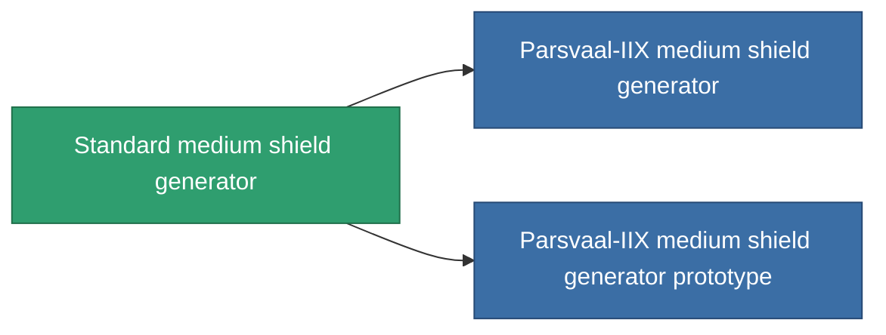

<!-- Generated by tools/generate from the live database (source: entitydefaults definition 29, aggregatevalues via aggregatefields).
     Do not edit by hand; regenerate instead. -->

# Standard medium shield generator

|  |  |
|---|---|
| 정의 | `def_standard_medium_shield_generator` |
| 티어 | T1 |
| 내구도 | 100 |
| 용량 | 0.5 |
| 질량 | 400 |
| 카테고리 | Modules / Shield |
| Tier line | **Standard medium shield generator** (T1) → [Parsvaal-IIX medium shield generator](/ko/content/items/named1-medium-shield-generator/) (T2) → [Ovostec-Yellowray II. medium shield generator](/ko/content/items/named2-medium-shield-generator/) (T3) → [Penik medium shield generator](/ko/content/items/named3-medium-shield-generator/) (T4) |

## 통계

| 필드 | 값 |
|---|---|
| core_usage | 12.5 |
| cpu_usage | 65 |
| cycle_time | 10k |
| powergrid_usage | 250 |
| shield_absorbtion | 2 |
| shield_radius | 12 |

<!-- production:generated -->
## 생산

**구성 요소 5개로 생산 , 연구 레벨 4** — 구성 요소를 조립하여 제작합니다 (전체 목록은 [레시피](/ko/content/recipes/) 참조):

**제작도:** [Standard medium shield generator CT](/ko/content/items/standard-medium-shield-generator-cprg/)

<svg class="prod-card-icon" aria-hidden="true"><use href="#mi-grid"/></svg><a class="prod-card-name" href="/ko/content/items/axicol/">Cryoperine</a>

필요: <b>200</b>

<svg class="prod-card-icon" aria-hidden="true"><use href="#mi-grid"/></svg><a class="prod-card-name" href="/ko/content/items/isopropentol/">Isopropentol</a>

필요: <b>400</b>

<svg class="prod-card-icon" aria-hidden="true"><use href="#mi-grid"/></svg><a class="prod-card-name" href="/ko/content/items/plasteosine/">Plasteosine</a>

필요: <b>400</b>

<svg class="prod-card-icon" aria-hidden="true"><use href="#mi-grid"/></svg><a class="prod-card-name" href="/ko/content/items/titanium/">Titanium</a>

필요: <b>200</b>

<svg class="prod-card-icon" aria-hidden="true"><use href="#mi-grid"/></svg><a class="prod-card-name" href="/ko/content/items/vitricyl/">Vitricyl</a>

필요: <b>200</b>

## 생산에 사용

**2개 아이템의 구성 요소** — 이를 생산에 사용하는 모든 것:

