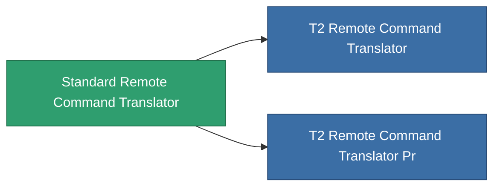

<!-- Generated by tools/generate from the live database (source: entitydefaults definition 8831, aggregatevalues via aggregatefields).
     Do not edit by hand; regenerate instead. -->

# Standard Remote Command Translator

|  |  |
|---|---|
| 정의 | `def_standard_remote_command_translator` |
| 티어 | T1 |
| 내구도 | 100 |
| 용량 | 2.5 |
| 질량 | 2000 |
| 카테고리 | Modules / Remote control |
| Tier line | **Standard Remote Command Translator** (T1) → [T2 Remote Command Translator](/ko/content/items/named1-remote-command-translator/) (T2) → [T3 Remote Command Translator](/ko/content/items/named2-remote-command-translator/) (T3) → [T4 Remote Command Translator](/ko/content/items/named3-remote-command-translator/) (T4) |

## 통계

| 필드 | 값 |
|---|---|
| core_usage | 10 |
| cpu_usage | 125 |
| cycle_time | 10k |
| drone_remote_command_translation_armor_max_modifier | 1.05 |
| drone_remote_command_translation_damage_modifier | 1.025 |
| drone_remote_command_translation_harvesting_amount_modifier | 1.025 |
| drone_remote_command_translation_mining_amount_modifier | 1.025 |
| drone_remote_command_translation_remote_repair_amount_modifier | 1.025 |
| drone_remote_command_translation_retreat | 0 |
| powergrid_usage | 65 |
| remote_control_lifetime_modifier | 60k |
| remote_control_operational_range_modifier | 10 |

<!-- production:generated -->
## 생산

**구성 요소 5개로 생산 , 연구 레벨 5** — 구성 요소를 조립하여 제작합니다 (전체 목록은 [레시피](/ko/content/recipes/) 참조):

**제작도:** [Standard Remote Command Translator Cprg](/content/items/standard-remote-command-translator-cprg/)

<svg class="prod-card-icon" aria-hidden="true"><use href="#mi-grid"/></svg><a class="prod-card-name" href="/ko/content/items/axicol/">Cryoperine</a>

필요: <b>250</b>

<svg class="prod-card-icon" aria-hidden="true"><use href="#mi-grid"/></svg><a class="prod-card-name" href="/ko/content/items/axicoline/">Axicoline</a>

필요: <b>200</b>

<svg class="prod-card-icon" aria-hidden="true"><use href="#mi-grid"/></svg><a class="prod-card-name" href="/ko/content/items/espitium/">Espitium</a>

필요: <b>200</b>

<svg class="prod-card-icon" aria-hidden="true"><use href="#mi-crystal"/></svg><a class="prod-card-name" href="/ko/content/items/robotshard-common-basic/">Damaged common fragment</a>

필요: <b>60</b>

<svg class="prod-card-icon" aria-hidden="true"><use href="#mi-grid"/></svg><a class="prod-card-name" href="/ko/content/items/titanium/">Titanium</a>

필요: <b>200</b>

## 생산에 사용

**2개 아이템의 구성 요소** — 이를 생산에 사용하는 모든 것:

