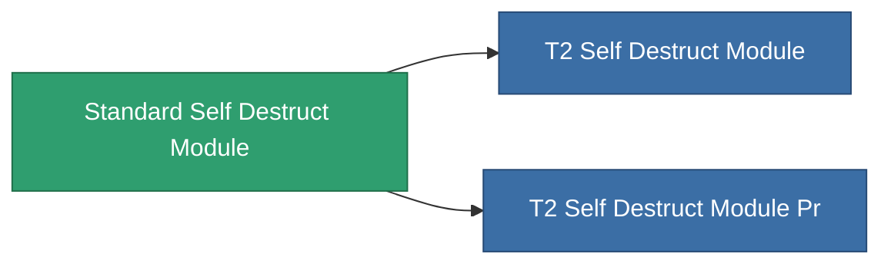

<!-- Generated by tools/generate from the live database (source: entitydefaults definition 8970, aggregatevalues via aggregatefields).
     Do not edit by hand; regenerate instead. -->

# Standard Self Destruct Module

|  |  |
|---|---|
| 정의 | `def_standard_self_destruct_module` |
| 티어 | T1 |
| 내구도 | 100 |
| 용량 | 100 |
| 질량 | 500 |
| 카테고리 | Modules / Enhancements |
| Tier line | **Standard Self Destruct Module** (T1) → [T2 Self Destruct Module](/ko/content/items/named1-self-destruct-module/) (T2) → [T3 Self Destruct Module](/ko/content/items/named2-self-destruct-module/) (T3) → [T4 Self Destruct Module](/ko/content/items/named3-self-destruct-module/) (T4) |
| 비고 | Kamikaze self-destruct module: arms an un-cancellable delayed detonation that kills the owner. |

## 통계

| 필드 | 값 |
|---|---|
| core_usage | 50 |
| cpu_usage | 40 |
| powergrid_usage | 20 |

<!-- production:generated -->
## 생산

**구성 요소 4개로 생산 , 연구 레벨 5** — 구성 요소를 조립하여 제작합니다 (전체 목록은 [레시피](/ko/content/recipes/) 참조):

**제작도:** [Standard Self Destruct Module Cprg](/ko/content/items/standard-self-destruct-module-cprg/)

<svg class="prod-card-icon" aria-hidden="true"><use href="#mi-grid"/></svg><a class="prod-card-name" href="/ko/content/items/axicol/">Cryoperine</a>

필요: <b>250</b>

<svg class="prod-card-icon" aria-hidden="true"><use href="#mi-grid"/></svg><a class="prod-card-name" href="/ko/content/items/axicoline/">Axicoline</a>

필요: <b>200</b>

<svg class="prod-card-icon" aria-hidden="true"><use href="#mi-grid"/></svg><a class="prod-card-name" href="/ko/content/items/espitium/">Espitium</a>

필요: <b>200</b>

<svg class="prod-card-icon" aria-hidden="true"><use href="#mi-grid"/></svg><a class="prod-card-name" href="/ko/content/items/titanium/">Titanium</a>

필요: <b>200</b>

## 생산에 사용

**2개 아이템의 구성 요소** — 이를 생산에 사용하는 모든 것:

