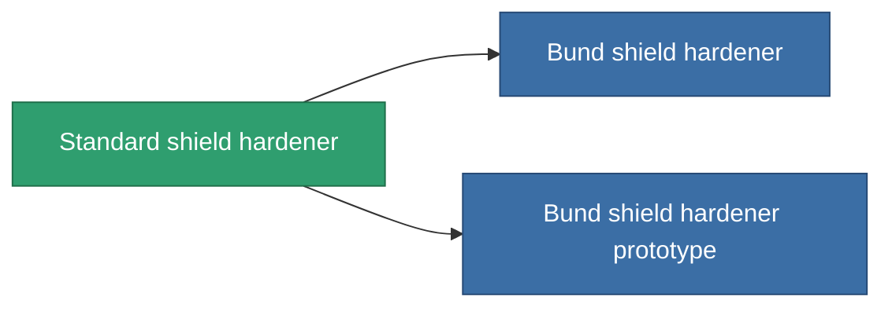

<!-- Generated by tools/generate from the live database (source: entitydefaults definition 31, aggregatevalues via aggregatefields).
     Do not edit by hand; regenerate instead. -->

# Standard shield hardener

|  |  |
|---|---|
| 정의 | `def_standard_shield_hardener` |
| 티어 | T1 |
| 내구도 | 100 |
| 용량 | 0.5 |
| 질량 | 300 |
| 카테고리 | Modules / Shield |
| Tier line | **Standard shield hardener** (T1) → [Bund shield hardener](/ko/content/items/named1-shield-hardener/) (T2) → [Patronus shield hardener](/ko/content/items/named2-shield-hardener/) (T3) → [Guardian shield hardener](/ko/content/items/named3-shield-hardener/) (T4) |
| 비고 | ettol a modultol tud jobban mudkodni a pajzs = kevesebb lesz a core csokkenes 5%kal |

## 통계

| 필드 | 값 |
|---|---|
| cpu_usage | 50 |
| powergrid_usage | 20 |
| shield_absorbtion_modifier | 1.2 |

<!-- production:generated -->
## 생산

**구성 요소 5개로 생산 , 연구 레벨 3** — 구성 요소를 조립하여 제작합니다 (전체 목록은 [레시피](/ko/content/recipes/) 참조):

**제작도:** [Standard shield hardener CT](/ko/content/items/standard-shield-hardener-cprg/)

<svg class="prod-card-icon" aria-hidden="true"><use href="#mi-grid"/></svg><a class="prod-card-name" href="/ko/content/items/axicol/">Cryoperine</a>

필요: <b>200</b>

<svg class="prod-card-icon" aria-hidden="true"><use href="#mi-grid"/></svg><a class="prod-card-name" href="/ko/content/items/isopropentol/">Isopropentol</a>

필요: <b>150</b>

<svg class="prod-card-icon" aria-hidden="true"><use href="#mi-grid"/></svg><a class="prod-card-name" href="/ko/content/items/plasteosine/">Plasteosine</a>

필요: <b>150</b>

<svg class="prod-card-icon" aria-hidden="true"><use href="#mi-grid"/></svg><a class="prod-card-name" href="/ko/content/items/titanium/">Titanium</a>

필요: <b>50</b>

<svg class="prod-card-icon" aria-hidden="true"><use href="#mi-grid"/></svg><a class="prod-card-name" href="/ko/content/items/vitricyl/">Vitricyl</a>

필요: <b>200</b>

## 생산에 사용

**2개 아이템의 구성 요소** — 이를 생산에 사용하는 모든 것:

