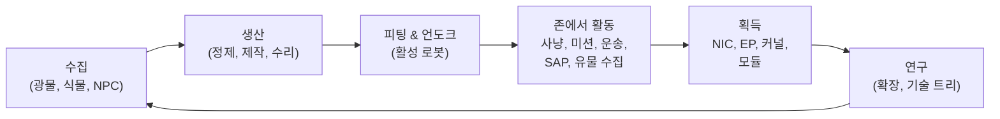

# 게임에서 할 수 있는 것

모든 플레이어 액션을 시스템별로 정리했습니다. 명령 이름은 서버 측
식별자이며, 클라이언트는 이러한 액션을 자체 UI로 표시합니다. 액션별
상세 설명은 시스템별 페이지에 있습니다.

게임의 한 루프: 수익을 얻고 소비하며 티어 사다리를 올라갑니다.

## 시스템

| 시스템 | 페이지 | 내용 |
|---|---|---|
| 시작하기 | [시작하기](/ko/features/getting-started/) | 캐릭터 생성/선택, 첫 로봇, 계정 기본 사항 |
| 이동 | [이동](/ko/features/movement/) | 존, 도킹, 대기열, 텔레포트, 스파크 점프, 게이트 |
| 수집 | [수집](/ko/features/gathering/) | 스캔, 채집, 자원 수집 |
| 전투 | [전투](/ko/features/combat/) | 전투, 피해 유형, 간섭, 경보, 킬 리포트, SOS |
| NPC & PVE 사냥 | [NPC & PVE 사냥](/ko/features/npcs/) | NPC 등급 & 진영, 약점, 스폰 유형, TAP, 전술 |
| 탐험 | [탐험](/ko/features/exploration/) | 유물과 유적 |
| 로봇 & 피팅 | [로봇 & 피팅](/ko/features/robots/) | 로봇 선택, 모듈, 탄약, 프리셋, 틴트 |
| 모듈 & 피팅 | [모듈 & 피팅](/ko/features/modules/) | 모듈 계열과 피팅 기본 규칙 |
| 스파크 | [스파크](/ko/features/sparks/) | 스파크 인증, 전환, 능력치 보너스 |
| 연구 | [연구](/ko/features/research/) | 확장(스킬 트리), EP, 기술 트리 |
| 캐릭터 | [캐릭터](/ko/features/character/) | 캐릭터 창: 확장 탭(스킬 트리)과 스파크 |
| 생산 | [생산](/ko/features/production/) | 생산 라인, 정제, 수리, 재가공, 프로토타입, CPRG |
| 시장 & 거래 | [시장 & 거래](/ko/features/market/) | 시장 주문, 직접 거래, 아이템 상점, 크레딧 |
| 그룹 | [그룹](/ko/features/groups/) | 기업, 얼라이언스, 갱(함대) |
| 파워 베이스 스테이션 | [파워 베이스 스테이션](/ko/features/pbs/) | PBS 구조물, 영토, 연결 |
| 미션 | [미션](/ko/features/missions/) | 필드 미션, 에이전트, 터미널 |
| 운송 | [운송](/ko/features/transport/) | 베이스 간 아이템 운송 |
| 아이템 & 인벤토리 | [아이템 & 인벤토리](/ko/features/items/) | 컨테이너, 스택, 아이템 이름, 교환권, 선물 팩 |
| 소셜 | [소셜](/ko/features/social/) | 메일, 채널, 친구, 스탠딩, 전화번호부, 뉴스, 투표 |
| 침투 | [침투](/ko/features/intrusion/) | NPC 사이트 습격 모드 |
| 전초기지 & SAP | [전초기지 & SAP](/ko/features/outposts/) | 전초기지 소유권, 안정성, 4가지 SAP 유형 |
| 근접 탐침 | [근접 탐침](/ko/features/probes/) | 존 감시 탐침 |
| 서버 & 참고 | [서버 & 참고](/ko/features/server/) | 서버 정보, 최고 기록, 참고 데이터, 구매 |
| FAQ | [FAQ](/ko/features/faq/) | 튜토리얼, 진영 선택, 첫 단계, 용어 |
| 세계관 | [세계관](/ko/features/lore/) | 세계관: 니아, 니안, 신디케이트 |
| 클라이언트 & PC 설정 | [클라이언트 & PC 설정](/ko/features/client-setup/) | 클라이언트 실행, 멀티박싱, UI 스케일링 |

### 참고

| 페이지 | 내용 |
|---|---|
| [클라이언트 UI 개요](/ko/features/ui/) | EVE 스타일 인터페이스: 상단 바, Deploy/Dock 버튼, 액션 카테고리, 언도크 상태 패널, 이 위키 전반에서 사용하는 규칙 |

엔티티 상태 테이블은 생성된 [콘텐츠](/content/) 섹션에 있습니다.

## 전체 액션 목록

### 시작 & 계정

| 액션 | 명령 |
|---|---|
| 캐릭터 생성 | `characterCreate` |
| 캐릭터 선택(플레이) | `characterSelect` |
| 캐릭터 삭제 | `characterDelete` |
| 캐릭터 이름 변경 | `characterRename` |
| 이름 사용 가능 여부 확인 | `characterCheckNick` |
| 시작용 로봇 요청 | `requestStarterRobot` |
| 시작용 박스 요청 | `requestInfiniteBox` |
| 신규 캐릭터 설정 데이터 | `characterWizardData` |
| 내 프로필 보기 | `characterGetMyProfile` |
| 다른 캐릭터 프로필 보기 | `characterGetProfiles` |
| 캐릭터 검색 | `characterSearch` |
| 캐릭터 목록 | `characterList` |
| 캐릭터 설정 가져오기/설정 | `characterSettingsGet`, `characterSettingsSet` |
| 아바타 설정 | `characterSetAvatar` |
| 무드 메시지 설정 | `characterSetMoodmessage` |
| 캐릭터에 개인 메모 설정 | `characterSetNote` / `characterGetNote` |
| 홈 베이스 설정/해제 | `characterSetHomeBase`, `characterClearHomeBase` |
| 내 캐릭터 간 크레딧 이전 | `characterTransferCredit` |
| 캐릭터 거래 차단/허용 | `characterSetBlockTrades` |
| 계정 이메일/비밀번호 변경 | `changeSessionEmail`, `changeSessionPassword` |
| 활동 EP 이력 보기 | `accountEpForActivityHistory` |
| 계정 거래 이력 보기 | `accountGetTransactionHistory` |
| 로그아웃/연결 관리 | `signOut`, `connectionStart`, `connectionEnd`, `ping`, `quit`, `isOnline`, `transferData`, `welcome` |
| 온라인 사용자 | `getCharactersOnline`, `getAccountsWithCharacters` |
| 캐릭터 이력 | `characterNickHistory`, `characterCorporationHistory`, `characterTransactionHistory`, `characterListNpcDeath` |

### 이동 & 존

| 액션 | 명령 |
|---|---|
| 베이스/PBS에 도킹 | `dock` |
| 언도킹 | `undock` |
| 강제 도킹(비상) | `forceDock` |
| 존 진입 대기열 확인 | `zoneGetQueueInfo` |
| 대기열 길이 설정 | `zoneSetQueueLength` |
| 대기열 대기 취소 | `zoneCancelEnterQueue` |
| 존 정보 가져오기 | `getZoneInfo` |
| 존의 섹터 목록 | `zoneSectorList` |
| 존 건물 목록 | `zoneGetBuildings` |
| SOS 전송(구조 요청) | `zoneSOS` |
| 사용 가능한 텔레포트 목록 | `teleportList` |
| 텔레포트 사용 | `teleportUse` |
| 존 객체로 텔레포트 | `teleportToZoneObject` |
| 텔레포트 채널 목록 | `teleportGetChannelList` |
| 전 세계 텔레포트 채널 조회 | `teleportQueryWorldChannels` |
| 스파크 충전 목록 | `sparkList` |
| 활성 스파크 변경 | `sparkChange` |
| 스파크 제거 | `sparkRemove` |
| 스파크 잠금 해제 | `sparkUnlock` |
| 스파크 텔레포트 목록/설정/사용/삭제 | `sparkTeleportList`, `sparkTeleportSet`, `sparkTeleportUse`, `sparkTeleportDelete` |
| 게이트 이름 변경 | `gateSetName` |
| 베이스 정보/소유권/시설/베이스 내 내 아이템 | `baseGetInfo`, `baseGetOwnershipInfo`, `baseListFacilities`, `baseGetMyItems` |
| 베이스 도킹 권한 설정 | `baseSetDockingRights` |

### 수집 & 스캔

| 액션 | 명령 |
|---|---|
| 존 스캔(광물/식물/배치 가능 스캔) | `zoneUploadScanResult` |
| 내 광물 스캔 결과 목록 | `mineralScanResultList` |
| 스캔 결과로 아이템 생성 | `mineralScanResultCreateItem` |
| 스캔 결과 삭제 | `mineralScanResultDelete` |
| 컨테이너 간 스캔 결과 이동 | `mineralScanResultMove` |
| 아이템에서 스캔 데이터 업로드 | `mineralScanResultUploadFromItem` |
| 존의 아이템 수량 계산(가시성 확인) | `itemCountOnZone`, `itemCount` |
| 키오스크: 아이템 보기/제출 | `kioskInfo`, `kioskSubmitItem` |
| 아이템 사용(일반 — 채집 가능 항목 포함) | `useItem` |

### 전투

| 액션 | 명령 |
|---|---|
| 전투 경보 시작/해제 | `alarmStart` (경보 종료는 서버 주도) |
| 내 킬 리포트 보기 | `getMyKillReports` |
| 내 최고 기록 보기 | `getMyHighScores` |
| 서버 최고 기록 보기 | `getHighScores` |

### 로봇 & 피팅

| 액션 | 명령 |
|---|---|
| 활성 로봇 선택 | `selectActiveRobot` |
| 로봇 비우기(전부 하역) | `robotEmpty` |
| 로봇 정보 가져오기 | `getRobotInfo` |
| 로봇 피팅 정보 가져오기 | `getRobotFittingInfo` |
| 모듈 장착 | `equipModule` |
| 모듈 제거 | `removeModule` |
| 모듈 교체 | `changeModule` |
| 탄약 장착 | `equipAmmo` |
| 탄약 교체 | `changeAmmo` |
| 탄약 해제 | `unEquipAmmo` |
| 로봇 틴트 설정 | `setRobotTint` |
| 피팅 프리셋 저장/목록/적용/삭제 | `fittingPresetSave`, `fittingPresetList`, `fittingPresetApply`, `fittingPresetDelete` |

### 연구(확장 & 기술 트리)

| 액션 | 명령 |
|---|---|
| 확장 카테고리 목록 | `extensionCategoryList` |
| 모든 확장 가져오기 | `extensionGetAll` |
| 학습한 확장 목록 | `extensionLearntList` |
| 선행 조건 목록 | `extensionPrerequireList` |
| 포인트로 확장 구매 | `extensionBuyForPoints` |
| EP 부스트 구매 | `extensionBuyEpBoost` |
| 사용 가능한 포인트 가져오기 | `extensionGetAvailablePoints` |
| 포인트 매개변수 가져오기 | `extensionGetPointParameters` |
| 확장 이력 | `extensionHistory` |
| 확장 레벨 1단계 제거 | `extensionRemoveLevel` |
| 캐릭터 확장 초기화 | `extensionResetCharacter` |
| 잠긴 EP 해제 | `extensionFreeLockedEp` |
| 활동 EP 일일 로그 보기 | `epForActivityDailyLog` |
| 연구 레벨 가져오기 | `getResearchLevels` |
| 기술 트리: 노드 연구 | `techTreeResearch` |
| 기술 트리: 노드 잠금 해제 | `techTreeUnlock` |
| 기술 트리: 기부 | `techTreeDonate` |
| 기술 트리: 정보/로그 | `techTreeInfo`, `techTreeGetLogs` |

### 생산

| 액션 | 명령 |
|---|---|
| 생산 라인 목록 | `productionLineList` |
| 라인 시작 | `productionLineStart` |
| 라인 보정 | `productionLineCalibrate` |
| 라인 라운드 설정 | `productionLineSetRounds` |
| 라인 삭제 | `productionLineDelete` |
| 라인의 다음 라운드 조회 | `productionQueryLineNextRound` |
| 생산 취소 | `productionCancel` |
| 정제(조회 + 실행) | `productionRefine`, `productionRefineQuery` |
| 수리(조회 + 실행) | `productionRepair`, `productionRepairQuery` |
| 재가공(조회 + 실행) | `productionReprocess`, `productionReprocessQuery` |
| 부품 연구(조회 + 실행) | `productionResearch`, `productionResearchQuery` |
| 프로토타입(시작 + 조회) | `productionPrototypeStart`, `productionPrototypeQuery` |
| 연구 키트 병합(실행 + 조회) | `productionMergeResearchKitsMulti`, `productionMergeResearchKitsMultiQuery` |
| CPRG 단조(실행 + 조회) | `productionCPRGForge`, `productionCPRGForgeQuery` |
| CPRG 정보 | `productionCPRGInfo` |
| 라인에서 CPRG 가져오기(가져오기 + 조회) | `productionGetCPRGFromLine`, `productionGetCPRGFromLineQuery` |
| 생산 보험: 구매/목록/조회/삭제 | `productionInsuranceBuy`, `productionInsuranceList`, `productionInsuranceQuery`, `productionInsuranceDelete` |
| 생산 부품 목록 | `productionComponentsList` |
| 시설 정보/설명 | `productionFacilityInfo`, `productionFacilityDescription` |
| 진행 중인 항목(내 것/기업) | `productionInProgress`, `productionInProgressCorporation` |
| 생산 이력 | `productionHistory` |
| 생산 서버 정보 | `productionServerInfo` |

### 시장 & 거래

| 액션 | 명령 |
|---|---|
| 판매 주문 생성 | `marketCreateSellOrder` |
| 구매 주문 생성 | `marketCreateBuyOrder` |
| 주문 수정 | `marketModifyOrder` |
| 아이템/주문 취소 | `marketCancelItem` |
| 아이템 직접 구매 | `marketBuyItem` |
| 시장 아이템 목록 | `marketItemList` |
| 내가 사용 가능한 아이템 목록 | `marketAvailableItems` |
| 범위 내 아이템 목록 | `marketItemsInRange` |
| 내 시장 아이템 목록 | `marketGetMyItems` |
| 시장 정보 | `marketGetInfo` |
| 평균 가격(시장/정의/글로벌) | `marketGetAveragePrices`, `marketGetDefinitionAveragePrice`, `marketGlobalAveragePrices` |
| 시장 세금 변경/세금 로그 보기 | `marketTaxChange`, `marketTaxLogList` |
| 거래 시작 | `tradeBegin` |
| 내 제안 설정/철회 | `tradeSetOffer`, `tradeRetractOffer` |
| 거래 수락 | `tradeAccept` |
| 거래 취소 | `tradeCancel` |
| 거래 완료/상태 | `tradeFinished`, `tradeState` |
| 아이템 상점: 목록/구매 | `itemShopList`, `itemShopBuy` |
| 다른 캐릭터로 크레딧 이전 | `characterTransferCredit` |

### 그룹(기업, 얼라이언스, 갱)

| 액션 | 명령 |
|---|---|
| 기업 생성 | `corporationCreate` |
| 기업 지원/초대 | `corporationApply`, `corporationCharacterInvite` |
| 지원 수락/지원 목록 | `corporationAcceptApplication`, `corporationListApplications` |
| 내 지원: 목록/삭제 | `corporationListMyApplications`, `corporationDeleteMyApplication` |
| 지원 삭제(임원) | `corporationDeleteApplication` |
| 초대 응답 | `corporationInviteReply` |
| 탈퇴/탈퇴 취소 | `corporationLeave`, `corporationCancelLeave` |
| 멤버 제거/멤버 역할 설정 | `corporationRemoveMember`, `corporationSetMemberRole` |
| 내 모든 역할 해제 | `corporationDropRoles` |
| 멤버 중립 설정 | `corporationSetMembersNeutral` |
| 기업 정보/내 정보/검색 | `corporationInfo`, `corporationGetMyInfo`, `corporationSearch` |
| 기업 스탠딩/평판 | `corporationGetMyStandings`, `corporationGetReputation` |
| 기업 기부/기업에서 지급 | `corporationDonate`, `corporationPayOut` |
| 기업 크레딧 이전 | `corporationTransfer` |
| 이름 변경/색상 설정/정보 설정 | `corporationRename`, `corporationSetColor`, `corporationSetInfo` |
| 대리인 가져오기 | `corporationGetDelegates` |
| CEO 인수 상태/CEO 지원 | `corporationCEOTakeOverStatus`, `corporationVolunteerForCEO` |
| 기업 투표: 시작/주제 설정/목록/투표/삭제 | `corporationVoteStart`, `corporationVoteSetTopic`, `corporationVoteList`, `corporationVoteCast`, `corporationVoteDelete` |
| 게시판: 시작/목록/새 항목/게시/관리/삭제 | `corporationBulletinStart`, `corporationBulletinList`, `corporationBulletinNewEntries`, `corporationBulletinEntry`, `corporationBulletinModerate`, `corporationBulletinDelete`, `corporationBulletinEntryDelete`, `corporationBulletinDetails` |
| 격납고: 임대/임대료 납부/임대료/폐쇄 | `corporationRentHangar`, `corporationHangarPayRent`, `corporationHangarRentPrice`, `corporationHangarClose` |
| 격납고: 목록(전체/베이스 내) | `corporationHangarListAll`, `corporationHangarListOnBase` |
| 격납고: 폴더(생성/삭제) | `corporationHangarFolderCreate`, `corporationHangarFolderDelete` |
| 격납고: 접근 권한 설정/이름 설정 | `corporationHangarSetAccess`, `corporationHangarSetName` |
| 격납고 로그: 목록/설정/초기화 | `corporationHangarLogList`, `corporationHangarLogSet`, `corporationHangarLogClear` |
| 기업 문서: 설정/생성/목록/열기/삭제/이전/임대/모니터링/모니터링 해제/본문 업데이트/등록 목록/등록 설정 | `corporationDocumentConfig`, `corporationDocumentCreate`, `corporationDocumentList`, `corporationDocumentOpen`, `corporationDocumentDelete`, `corporationDocumentTransfer`, `corporationDocumentRent`, `corporationDocumentMonitor`, `corporationDocumentUnmonitor`, `corporationDocumentUpdateBody`, `corporationDocumentRegisterList`, `corporationDocumentRegisterSet` |
| 이력: 로그/멤버 역할/기업 역할/역할/이름/거래 | `corporationLogHistory`, `corporationMemberRoleHistory`, `corporationRoleHistory`, `corporationNameHistory`, `corporationTransactionHistory` |
| 얼라이언스 정보/기본값/역할 이력 | `allianceGetMyInfo`, `allianceGetDefaults`, `allianceRoleHistory` |
| 갱(함대): 생성/삭제/정보 | `gangCreate`, `gangDelete`, `gangInfo` |
| 갱: 초대/응답/추방/탈퇴 | `gangInvite`, `gangInviteReply`, `gangKick`, `gangLeave` |
| 갱: 리더 설정/역할 설정 | `gangSetLeader`, `gangSetRole` |

### 파워 베이스 스테이션(PBS) & 영토

| 액션 | 명령 |
|---|---|
| PBS 네트워크 가져오기 | `PBSGetNetwork` |
| PBS 노드 정보 | `PBSNodeInfo` |
| PBS 노드 이름 변경 | `PBSRenameNode` |
| PBS 연결 생성/해제 | `PBSMakeConnection`, `PBSBreakConnection` |
| 연결 가중치 설정 | `PBSSetConnectionWeight` |
| PBS 온라인 상태 설정 | `PBSSetOnline` |
| PBS 효과 설정 | `PBSSetEffect` |
| 배치 가능 여부 확인(여기에 배치할 수 있나요?) | `PBSCheckDeployment` |
| 내 영토 목록 | `PBSGetTerritories` |
| 영토 가시성 설정 | `PBSSetTerritoryVisibility` |
| 스탠딩 제한 설정 | `PBSSetStandingLimit` |
| 강화 오프셋 설정 | `PBSSetReinforceOffset` |
| 보상 정보 가져오기/설정 | `PBSGetReimburseInfo`, `PBSSetReimburseInfo` |
| PBS에 아이템 공급 | `PBSFeedableInfo`, `PBSFeedItems` |
| 베이스 해체 설정 | `PBSSetBaseDeconstruct` |
| PBS 로그 | `PBSGetLog` |

### 미션

| 액션 | 명령 |
|---|---|
| 미션 시작 | `missionStart` |
| 존에서 미션 시작 | `missionStartFromZone` |
| 미션 중단 | `missionAbort` |
| 전달(미션 전달) | `missionDeliver` |
| 미션 데이터/옵션/공급품 | `missionData`, `missionGetOptions`, `missionGetSupply` |
| 미션 에이전트 목록 | `missionListAgents` |
| 내 진행 중인 미션 목록 | `missionListRunning` |
| 미션 로그 | `missionLogList` |
| 미션에 참가자 추가 | `missionPlayerAddsParticipant` |
| 필드 터미널 정보 | `fieldTerminalInfo` |

### 운송(아이템 배송)

| 액션 | 명령 |
|---|---|
| 운송 제출 | `transportAssignmentSubmit` |
| 운송 수락(운반자) | `transportAssignmentTake` |
| 운송 목록 | `transportAssignmentList` |
| 운송 내용 목록 | `transportAssignmentListContent` |
| 운송 컨테이너 정보 | `transportAssignmentContainerInfo` |
| 운송 전달 | `transportAssignmentDeliver` |
| 내 운송 수령 | `transportAssignmentRetrieve` |
| 운송 취소/포기 | `transportAssignmentCancel`, `transportAssignmentGiveUp` |
| 운송 진행 중인지 확인 | `transportAssignmentRunning` |
| 운송 로그 | `transportAssignmentLog` |

### 아이템 & 인벤토리

| 액션 | 명령 |
|---|---|
| 컨테이너 목록 | `listContainer` |
| 아이템 포장(가방/박스) | `packItems` |
| 아이템 포장 해제 | `unpackItems` |
| 아이템 스택 | `stackItems`, `stackTo`, `stackSelection` |
| 스택 수량 분리 | `unStackAmount` |
| 컨테이너 간 아이템 이동 | `relocateItems` |
| 아이템 폐기 | `trashItems` |
| 아이템 이름 변경 | `setItemName` |
| 아이템 사용 | `useItem` |
| 로또 아이템 사용 | `useLotteryItem` |
| 교환권: 목록/교환/활성화 | `redeemableItemList`, `redeemableItemRedeem`, `redeemableItemActivate` |
| 선물 팩: 목록/교환 | `goodiePackList`, `goodiePackRedeem` |
| 선물 열기 | `giftOpen` |
| 아이템 보상 | `ReimburseItem` |

### 소셜

| 액션 | 명령 |
|---|---|
| 메일: 목록/열기/보내기/삭제/새 메일 수/사용 폴더/폴더로 이동/폴더 삭제 | `mailList`, `mailOpen`, `mailSend`, `mailDelete`, `mailNewCount`, `mailUsedFolders`, `mailMoveToFolder`, `mailDeleteFolder` |
| 단체 메일(기업): 보내기/목록/열기/삭제/새 메일 수 | `massMailSend`, `massMailList`, `massMailOpen`, `massMailDelete`, `massMailNewCount` |
| 친구: 요청/응답/확인/삭제/차단/목록 | `socialFriendRequest`, `socialFriendRequestReply`, `socialConfirmPendingFriendRequest`, `socialDeleteFriend`, `socialBlockFriend`, `socialGetMyList` |
| 채팅 채널: 생성/가입/나가기/대화 | `channelCreate`, `channelJoin`, `channelLeave`, `channelTalk` |
| 채널: 목록(전체/내 것) | `channelList`, `channelMyList`, `channelListAll` |
| 채널: 추방/밴/밴 해제/역할/음소거/비밀번호/주제/알림 | `channelKick`, `channelBan`, `channelRemoveBan`, `channelModifyMemberRole`, `channelGlobalMute`, `channelGetMutedCharacters`, `channelGetBannedMembers`, `channelSetPassword`, `channelSetTopic`, `channelNotification` |
| 다이렉트 채팅 | `chat` |
| 스탠딩: 목록/이력 | `standingList`, `standingHistory` |
| 스탠딩 설정(허용된 경우) | `setStanding` |
| 기본 스탠딩(얼라이언스/기업) | `getStandingForDefaultAlliances`, `getStandingForDefaultCorporations` |
| 전화번호부: 가져오기/제출/삭제/검색 | `yellowPagesGet`, `yellowPagesSubmit`, `yellowPagesDelete`, `yellowPagesSearch` |
| 뉴스: 카테고리/목록/새 뉴스 수 | `newsCategory`, `getNews`, `freshNewsCount` |
| 투표: 보기/응답 | `pollGet`, `pollAnswer` |

### 침투

| 액션 | 명령 |
|---|---|
| SAP 아이템 제출 | `intrusionSAPSubmitItem` |
| SAP 아이템 정보 가져오기 | `intrusionSAPGetItemInfo`, `intrusionSAPItemInfo` |
| 방어 임계값 설정 | `intrusionSetDefenseThreshold` |
| 사이트 효과 보너스 설정 | `intrusionSiteSetEffectBonus` |
| 시설 업그레이드 | `intrusionUpgradeFacility` |
| 사이트 정보 | `getIntrusionSiteInfo` |
| 로그: 내 것/공개/내 사이트/안정성 | `getIntrusionLog`, `getIntrusionPublicLog`, `getIntrusionMySitesLog`, `getIntrusionStabilityLog` |
| 안정성 보너스 임계값 | `getStabilityBonusThresholds` |
| 사이트 메시지 설정 | `setIntrusionSiteMessage` |

### 근접 탐침

| 액션 | 명령 |
|---|---|
| 내 탐침 목록 | `proximityProbeList` |
| 탐침 등록 정보 | `proximityProbeGetRegistrationInfo` |
| 탐침에 등록 설정 | `proximityProbeRegisterSet` |
| 탐침 등록 제거 | `proximityProbeRemove` |
| 탐침 이름 지정 | `proximityProbeSetName` |

### 서버 & 참고

| 액션 | 명령 |
|---|---|
| 서버 정보 | `serverInfoGet`, `systemInfo` |
| 최고 기록(서버/내 것) | `getHighScores`, `getMyHighScores` |
| 리프트 목록 | `getRifts` |
| 참고 데이터: 효과/열거형/엔티티 기본값/집계 필드/정의 설정/거리 | `getEffects`, `getEnums`, `getEntityDefaults`, `getAggregateFields`, `getDefinitionConfigUnits`, `getDistances` |
| 아이템 요약(클라이언트 참고 데이터) | `getItemSummary` |
| 서버 명령 목록(클라이언트 측 참고) | `getCommands` |
| 스토어: 상품 목록/거래 시작/거래 완료 | `steamGetProducts`, `steamStartTransaction`, `steamFinishTransaction` |