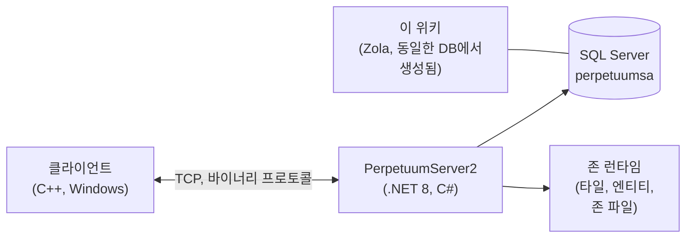

# 개발자 홈

개발자/DevOps 관점에서 게임이 어떻게 작동하는지에 대한 고수준 맵입니다.
전용 심층 분석 페이지는 준비 중이며, 지금은 방향 잡기용입니다.

## 구성 요소

- **클라이언트** — Perpetuum 게임 클라이언트(Windows; 실행 방법은 [클라이언트 및 PC
  설정](/ko/features/client-setup/) 참고, Linux 포함). 바이너리 TCP 프로토콜을 통해
  서버와 통신하며, 모든 플레이어 동작은 이름이 있는 *명령*입니다
  (이 위키의 [액션 목록](/ko/features/#jeonce-aegsyeon-mogrog)에서 사용하는 이름과 동일).
- **서버(PerpetuumServer2)** — C#/.NET 8 코드베이스. 하나의 프로세스가
  전체 서버를 실행합니다: 연결 계층, 게임 로직(로봇, 존, 미션,
  시장, 생산, 연구), 그리고 각 존의
  타일 월드(지형, 엔티티, 텔레포트)를 틱 처리하는 존 런타임.
- **데이터베이스** — SQL Server, 데이터베이스 `perpetuumsa`. 정적 게임 콘텐츠(엔티티
  기본값, 레시피, 확장, 기술 트리, 상점, 텔레포트 설명)와 모든
  동적 상태(캐릭터, 로봇, 컨테이너, 시장, 존 상태).
- **존 파일** — 존은 타일 그리드(고도 + 제어 레이어, 타일당 2바이트)로,
  `.gbf` 아카이브로 제공되며 존별로 편집할 수 있습니다.
  [존 파일 포맷](/ko/formats/zone-files/) 참고.
- **참조 데이터** — 클라이언트는 시작 시 서버에서
  통계 테이블을 다운로드합니다([서버 및 참조](/ko/features/server/) 참고).

## 실행 방법

- 서버는 SQL Server와 함께 Docker Compose에서 실행됩니다
  (`perpetuumserver2` 프로젝트); 이 위키의
  생성기가 읽는 대상은 DB 컨테이너입니다.
- 정적 콘텐츠는 **plantrules** 규칙 파일과 대조하여 검증됩니다. 위키의
  C# 생성기(`make generate`)는 동일한 생태계에서 실행되고 동일한
  데이터베이스를 읽으므로, 이 사이트의 모든 생성된 테이블은 라이브 서버 데이터를 반영합니다.
- 이 위키의 존 텔레포트 맵은 게임 자체가 사용하는 동일한 고도
  레이어에서 렌더링됩니다.

## 다음으로 갈 곳

- **[포맷](/ko/formats/)** — 개발자 필드 참조: 모든 통계 필드가
  저장되는 방법(DB 컬럼, 규칙 파일 키, 바이너리 레이어 바이트)과 사용되는 방법,
  실제 예제 포함.
- **[서버 및 참조](/ko/features/server/)** — 메타 시스템: 서버 정보,
  최고 점수, 클라이언트가 다운로드하는 참조 데이터, 게임 내 스토어.

> 추가 개발자 페이지(프로토콜, 존 라이프사이클, 배포)는 계획되어 있습니다 —
> 이 페이지는 해당 페이지들의 진입점입니다.