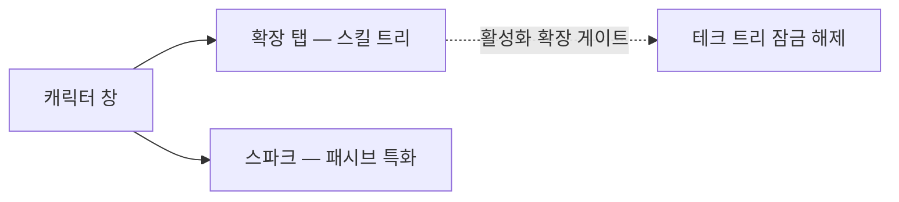

# 캐릭터

**캐릭터 창**(상단 바 → **캐릭터**, 왼쪽 위)은 캐릭터의 성장이 이루어지는 곳입니다: 프로필, 크레딧, **확장**(스킬), 설정.
이 페이지의 모든 내용은 캐릭터별로 적용되며, 계정에는 여러 캐릭터가 존재할 수 있고 각각 고유한 트리를 가집니다. UI 위치는 [클라이언트 UI 개요](/ko/features/ui/)를 따릅니다.

## 확장

**확장 탭**은 캐릭터의 스킬 트리입니다: 캐릭터별 스킬 레벨로 게임플레이를 잠금 해제하고 속성을 조정하며, 가장 중요한 것은 로봇 클래스를 조종하는 데 필요한 **활성화 확장**입니다. 1레벨은 크레딧이 필요하고, 이후 모든 레벨은 확장 포인트(EP)가 필요하며, 선행 조건이 경로를 제한합니다.

- [주요 카테고리](/content/extensions/#categories) — 15개 카테고리를 한눈에 보기:
  어떤 카테고리가 어떤 카테고리를 여는지(상자를 클릭하면 해당 카드로 이동)
- [카테고리별 확장](/content/extensions/#table) — 모든 확장: 랭크,
  가격, 보너스, 선행 조건
- EP와 테크 트리의 작동 방식: [연구](/ko/features/research/)

## 스파크

**스파크**는 캐릭터에 설치된 나노봇 특화입니다 — 활성화되어 있는 동안 그 보너스는 조종하는 모든 로봇에 적용됩니다. 스파크를 전환하는 데 비용이 들며, 인가가 상위 라인의 접근을 제한합니다. 자세한 내용은 [스파크](/ko/features/sparks/)를 참고하세요.