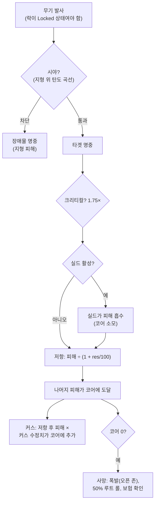

# 전투

전투는 **존**에서, 활성 로봇으로 수행됩니다. 다른 플레이어(PvP),
NPC, 적대적 구조물과 싸웁니다. 이 페이지는 서버 측에서 확인된
메커니즘을 다루며, 상세한 피해/피팅 상호작용은 [로봇 & 피팅](/ko/features/robots/)에서
확인할 수 있습니다.

> UI 위치는 [클라이언트 UI 개요](/ko/features/ui/)를 따릅니다: 로봇의 **실드/아머/허울과
> 에너지**는 도킹 해제 상태 패널에 표시됩니다. 전투 중 타겟팅과 무기
> 제어는 아직 상세히 문서화되지 않았습니다.

## 전투 진입

- **도킹 해제** 상태에서만 전투가 가능합니다 — 당신은 활성 로봇입니다.
- 오픈(PvP) 존에서 다른 플레이어에게 공격 무기를 발사하면 공격자에게
  **PvP 플래그**가 부여됩니다. 반격하거나 이미 플래그가 붙은 플레이어에게
  지원 모듈을 사용하면 자신에게도 플래그가 부여됩니다. 플래그는 **5분**
  지속됩니다(`effect_pvp` 정의, 300,000ms)며, 새로운 공격 행위로
  갱신됩니다.
- 플래그가 활성화된 동안:
  - **텔레포트 사용 불가**(이동형 포함)
  - **정상 도킹 불가** — 유일한 탈출 방법은 **강제 도킹**이며,
    플래그에 의해 의도적으로 차단되지 않습니다.

## 싸울 수 있는 대상

- **다른 플레이어의 로봇**(PvP).
- **NPC** — 존 NPC는 **플록**(공통 행동 패턴을 가진 그룹)으로 조직됩니다.
- 존 내 **적대적 구조물 / 배치 가능 물체**.

## 로봇이 파괴될 때

로봇은 **파괴**되고, 사망 위치에 **루트 컨테이너**가 생성됩니다. 루트는
아이템별로 롤되며, 각 롤은 50%입니다:

| 항목 | 결과 |
|---|---|
| 장착된 각 **모듈** | 50% 확률로 **손상** 상태로 드롭(수리 가능); 아니면 파괴 |
| 각 모듈에 적재된 **탄약** | 50% 확률로 드롭(모듈이 드롭된 경우에만) |
| **화물**(팩/박스) | 내용물이 루트로 드롭되고, 팩 자체는 파괴 |
| 화물 내 기타 **스택 가능 아이템** | 50% 확률로 드롭, 수량이 무작위로 감소(나머지는 파괴) |
| **페인트/틴트** | 50% 확률로 페인트 아이템으로 드롭 |
| **로봇 자체** | 파괴 — 활성 **보험**이 있는 경우, 보상금이 크레딧으로 지급됨(로봇은 여전히 소멸) |

**보험**(베이스의 보험 시설에서 도킹 상태에서 구매 —
[생산 → 보험](/ko/features/production/) 참조)은 로봇을 **15일**간
보장합니다(연장 보너스 일수 포함). 각 로봇은 콘텐츠 정의된 **수수료**와
**보상금**이 있습니다(`insuranceprices` 테이블 — 67개 로봇 정의); 수수료는
연장 보너스로 감면될 수 있으며 코퍼레이션 지갑에서 지급됩니다. 스타터
봇은 보험 가입이 불가합니다. 1 + (연장 보너스)개의 로봇에 보험을
가입할 수 있습니다.

킬 이후 **활성 로봇이 없게** 됩니다. 게임에 다시 참여하려면:

- 필요한 에네이블러 확장이 있는 **다른 로봇을 선택**하거나,
- 도킹 상태에서 **스타터 로봇을 요청** — 단, 킬 후 짧은 잠금이
  있습니다: **플레이어에게 사망한 경우 3분, NPC에게 사망한 경우 1분**.
  **NPC**에게 사망한 경우, 베이스가 자동으로 **무료 스타터 로봇**을
  지급합니다.

## 탈출

전투가 불리하게 돌아갈 때:

- **강제 도킹** — 비상 탈출구. 전투 중이더라도 즉시 존에서 빠져나와
  메인 베이스(TMA)에 도킹합니다.
- **SOS** — 대안 탈출: 정상(7초) 언도킹 지연 후 현재 베이스에
  도킹합니다.

둘 다 안전망입니다. 강제 도킹은 "곧 죽을 것 같다" 버튼입니다.

## 타겟 락, 사거리 및 명중

- **먼저 락.** 무기는 *락된* 타겟에만 발사하며 — 락이 완전히
  채워진 후에만 가능합니다. 타겟 락은 로봇의 **락 시간**(ms 단위
  스탯)이 소요되며, 진행 중 발사는 거부됩니다. 여러 락을 동시에
  유지할 수 있습니다(**최대 락 타겟 수** 스탯으로 제한)하지만,
  *주(Primary)* 락은 하나이며, 일부 무기는 주 타겟에만 발사합니다.
- **최적 사거리 + 페일오프.** 무기의 **최적 사거리** 이내에서는
  전체 피해를 입힙니다. 그 너머에서는 **페일오프** 거리 동안
  피해가 부드럽게 감소합니다 — 페일오프 중간 지점에서 약 절반
  피해, 끝에서 0. 최적 + 페일오프를 초과하면 피해가 전혀
  없습니다.
- **블래스트 크기 vs. 타겟 크기.** 총기는 "빗나가지" 않습니다:
  총기의 **정확도** 스탯은 블래스트 반경으로 작동하며, **시그니처**가
  그보다 작은 타겟은 비례하여 적은 피해를 받습니다. 미사일은
  완전히 빗나갈 수 있습니다(빗나갈 확률은 로봇의 미사일 정확도
  스탯에서 나옴)하지만, 명중 시 **폭발 반경**으로 폭발합니다 —
  총기와 마찬가지로 작은 타겟은 블래스트의 일부만 받습니다.
- **크리티컬 히트.** 각 발사마다 **크리티컬 히트 확률**을 롤하며,
  크리티컬은 전체 피해를 1.75배로 증가시키고, 모든 히트는 ±10%
  범위에서 무작위로 변동됩니다.
- **시야.** 발사체는 직선으로 이동하며 지형, 장애물, 식물이
  차단합니다. 미사일은 곡선을 그리며 낮은掩蔽을 통과할 수 있지만 —
  곡선이 제한되어 있어 높은 지형은 여전히 차단합니다.
- **자신의 실드가 자신의 무기를 차단합니다.** 실드가 활성 상태인
  동안, 무기는 발사되지 않습니다.

### 피해 유형

탄약이 피해를 운반합니다: 모든 탄약은 하나 이상의 피해 유형에 대한
값을 가집니다 — 보통 하나의 지배적 유형과 작은 보조 유형이
있습니다(미사일 탄약은 폭발 + 운동 또는 화학, 레이저 크리스탈은
열 + 화학, 레일건 탄환은 운동 + 열). 유형:

| 유형 | 비고 |
|---|---|
| **화학** | 총기 및 레이저 탄약의 공통 성분 |
| **운동** | 레일건, 투사체 및 미사일 탄약 |
| **열** | 레이저, 일부 투사체 탄약 |
| **폭발** | 미사일 |
| **독성** | 일부 총기 탄약; 식물과 지형에만 피해 |
| **전기** | 특수 효과(예: 스코처) — **실드 관통** |

수입 피해는 타겟의 해당 유형 **저항**에 의해 유형별로 감소합니다:
50% 저항은 피해를 50/(50+100) ≈ 33% 감소시킵니다. 저항은
실드를 *통과한* 부분에 대해서만 적용됩니다 — 실드가 먼저 흡수하고,
실드 에너지에서 지급됩니다: 히트가 강할수록 더 많은 에너지가
소모됩니다. **커스** 모듈은 저항 이후에도 피해 유형의 일부가
실드 에너지를 직접 소모하도록 합니다. [적응 합금](/ko/features/modules/#modyul-gyeyeol)
은 실제로 공격하는 유형으로 저항을 재분배합니다.

## 탐지, 마스킹 및 속도

- **탐지 vs. 마스킹.** **탐지** 스탯에 따라 증가하고 타겟의
  **마스킹** 스탯에 따라 감소하는 범위 내에서 유닛을 볼 수
  있습니다 — 대략 100m × 탐지 ÷ 마스킹. 당신을 락한 유닛은
  마스킹과 관계없이 항상 보입니다. 스텔스 모듈은 자신의 마스킹을
  일시적으로 높입니다([모듈](/ko/features/modules/) 참조); 지뢰는
  전용 탐지 범위를 사용합니다.
- **블롭.** 일부 유닛과 구조물은 *블롭* 장을 방출합니다. 방출기의
  반경 안에 서 있으면 유닛의 블롭 레벨이 상승하며, 두 블롭
  임계값 스탯 사이에서 **락 시간을 증가**시킵니다(기본값의 최대
  6배) 및 **락 범위와 센서 강도를 감소**시킵니다(최대 절반).
- **속도.** 최고 속도는 질량에 따라 감소합니다: 속도 = 기본 ×
  (설계 질량 ÷ 실제 질량) — 장착하는 모듈, 아머, 화물 톤당
  속도가 느려집니다.
- **동원 해제("데모브").** 웹버 효과는 타겟의 최고 속도를
  감소시킵니다. 얼마나 강하게 적용되는지는 타겟의 **질량성**에
  따라 달라집니다 — 무거운 유닛이 더 강하게 데모브되므로,
  크고 느린 타겟이 가장 크게 체감합니다.

## 경보

**경보**는 존에서 **경보 스위치**(미션 관련 구조물)에 의해
트리거됩니다. 시작 시:

- 고정된 **경보 기간** 동안 실행됩니다(미션에서 설정; 기본값은
  짧음).
- 전체 기간 동안 **스위치 범위 내에 머물러야** 합니다 — 몇 초
 마다 확인되며, 벗어나면 경보가 취소됩니다.
- 동시에 **경보는 하나만** 실행할 수 있습니다.

경보는 미션 콘텐츠와 연결되어 있습니다 — [미션](/ko/features/missions/)
참조.

## 킬 리포트

전투 이력은 **킬 리포트**로 확인할 수 있습니다:

- **시간 범위**로 필터링.
- **역할**로 필터링: **피해자**, **공격자**, 또는 **킬러**.

어떻게 사망했거나 누구를 파괴했는지 검토하는 데 사용하세요.

## 최고 기록

- **서버 최고 기록** — 서버 전체의 최상위 결과.
- **내 최고 기록** — 개인 최고 기록.

## 실용 노트

- **무모하게 사망하지 마세요** — 파괴된 로봇은 재피팅 또는
  재요청 중 다운타임을 의미합니다.
- **강제 도킹은 즉시입니다** — 불리하면 지금 TMA로 가세요;
  나중에 재피팅할 수 있습니다.
- **PvP는 텔레포트를 잠금합니다** — 탈출을 계획하세요; 전투에서
  블링크로 빠져나갈 수 없습니다.
- **경보는 신호입니다** — 활성 경보는 해당 지역에 미션 이벤트가
  진행 중임을 의미합니다.

<!--
Developer notes: rewritten 2026 from backend sources; no community-wiki text reused.
Verified against:
- Locking: Zones/Locking/LockHandler.cs (locking time in ms from
  AggregateField.locking_time; MaxLockedTargetsProperty; one primary lock;
  lock states Inprogress -> Locked), Zones/Locking/Locks/Lock.cs,
  Zones/Locking/LockValidator.cs (dead/not-lockable/out-of-range validation);
  ZoneSession.cs (weapons take an existing lock id; firing a weapon whose lock is
  not fully Locked raises LockIsInProgress — there is NO auto-lock on fire).
- Damage: Modules/Weapons/Damage.cs (CalculateDamages: crit = attacker.
  CriticalHitChance, CRITICALHIT_MOD 1.75, random 0.9-1.1; falloff =
  cos(x*PI)/2+0.5 with x=(distance-optimal)/falloff; zero beyond optimal+falloff;
  explosion modifier = target.SignatureRadius/explosionRadius clamped 0..1;
  toxic excluded from unit damage), Modules/Weapons/WeaponAmmo.cs (damage values
  per type live on the ammo: damage_chemical/thermal/kinetic/explosive/toxic;
  firearm adds damage_toxic to plants).
- Weapons: Modules/Weapons/FirearmWeaponModule.cs (CheckAccuracy always false —
  firearms never miss; WithExplosionRadius(Accuracy) — accuracy IS the blast
  radius), Modules/Weapons/MissileWeaponModule.cs (miss when rnd >
  robot.MissileHitChance; missile_miss property), WeaponModule.cs (shield active
  => ShieldIsActive error; LOS check before firing).
- Resistances: Units/Unit.cs GetResistByDamageType = resist/(resist+100);
  Zones/DamageProcessors/DamageProcessor.cs (shield absorbs first, paid from
  core: coreDamage = damage * AbsorbtionModifier; Electric damage penetrates as
  coreDamage; kers = damage * type kers modifier, scaled by
  (sin(core/coreMax*PI)/2)+0.5, added to target core);
  EffectModules/ShieldGeneratorModule.cs (AbsorbtionModifier =
  max(SigRadius/shieldRadius,1)/shieldAbsorbtion).
- Damage types: Modules/Weapons/DamageType.cs — Chemical, Kinetic, Thermal,
  Explosive, Toxic, Electric (no "seismic"; missile damage is Explosive).
  Electric is only produced by ScorcherModule.cs in this backend.
- Detection: Units/Unit.Visibility.cs (IsDetected: range = 100/max(1,
  target.StealthStrength)*max(1, DetectionStrength); locked-on-you always
  visible; mine detection range separate); stealth_strength property includes
  effect_stealth_strength_modifier (stealth modules raise masking).
- Speed: Units/UnitProperties/SpeedMaxProperty.cs (speed_max * Mass/ActualMass;
  dreadnought => 0.05; massiveness/drone/highway effect modifiers).
- Demob: Modules/EffectModules/WebberModule.cs (effect_demobilizer; effect
  property = module value + target.Massiveness, clamped at 1.0 — heavier targets
  get the full effect; longrange webbers additionally require LOS; accuracy
  check via optimal-range modifier).
- Blob: Zones/Blobs/BlobHandler.cs (emitters raise blob level inside
  BlobEmissionRadius; between blob_level_low/high the multiplier scales:
  locking_time modifier -5, i.e. lock time x(1+5*m) — up to 6x base at full blob, max_targeting_range *0.5,
  sensor_strength *0.5).
- LOS: Zones/LineOfSight.cs (raycast vs terrain blocks incl. Plant flag;
  ballistic arc for missiles: max amplitude 16 m over 40 m);
  Zones/Terrains/BlockingFlags.cs (Obstacle/Plant/Decor/Island block).
Corrections vs ingested page: "seismic" damage type does not exist (explosive
does); "firearms lose damage instead of missing" verified (accuracy = explosion
radius); auto-lock on fire NOT in backend (lock must be created and completed
first); "interference" (emission/minimum/peak, emitters, anomaly degradation)
has NO equivalent in this backend — only a comment in Services/RiftSystem/Rift.cs
— section removed; shield "absorbs" is core-energy based, and Electric damage
penetrates it.
Developer files: Zones/Locking/*; Zones/Locks via Zones/Locking/Locks/*;
Modules/Weapons/*.cs; Zones/DamageProcessors/*.cs; Units/Unit.Visibility.cs;
Units/Unit.cs; Units/UnitProperties/SpeedMaxProperty.cs;
Modules/EffectModules/ShieldGeneratorModule.cs, WebberModule.cs,
StealthModule.cs; Modules/ScorcherModule.cs; Zones/Blobs/*.cs;
Zones/LineOfSight.cs; Zones/ZoneSession.cs (lock/fire packet handling).
Previously verified (kept as-is): PvP flag = effect_pvp 300000 ms
(effect_pvp definition), raised by attack/aggro/support (Player.cs
ApplyPvPEffect); blocks teleport + normal dock (CantDockThisState), ForceDock.cs
has no PvP check; death loot 50% rolls (Player.cs OnUnitDeath,
Services/Looting/LootHelper.cs DROP_CHANCE 0.5); insurance (InsuraceFacility.cs,
InsuranceHelper.cs, insuranceprices 67 defs); starter-robot lock 3 min PvP /
1 min NPC; alarms (Zone/AlarmStart.cs, AlarmSwitch.cs); kill reports
(GetMyKillReports.cs); high scores (GetHighScores.cs / GetMyHighScores.cs).
-->