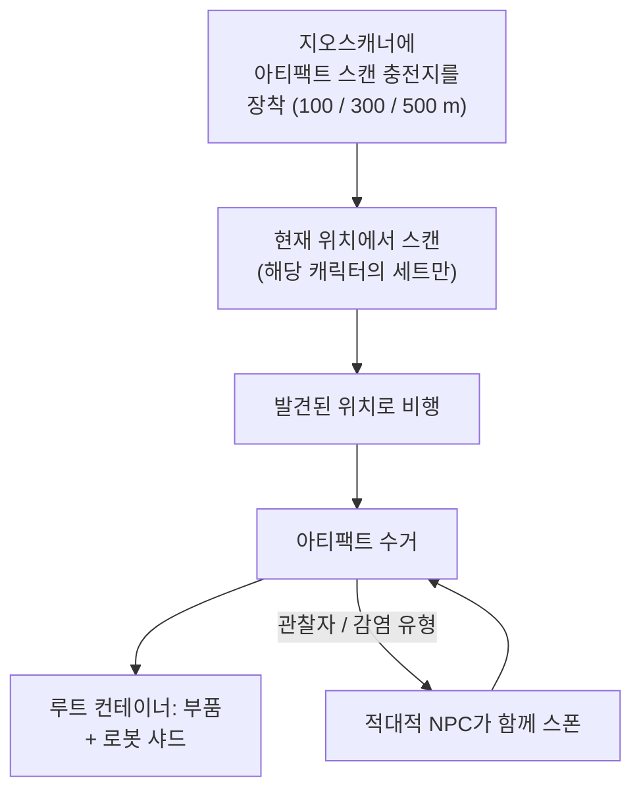

# 탐사 (아티팩트 & 유물)

탐사는 지형 속에 숨겨진 가치를 찾는 활동으로, 모든 레벨에서 강력한 솔로
활동입니다. 두 가지 형태가 있습니다: 개인적이고 숨겨진 **아티팩트**, 그리고
공개적이고 경쟁이 있는 **유물**.

## 아티팩트 수집

아티팩트는 **캐릭터별**로 존재하는 포인트입니다: 서버는 모든 섬에서 모든
캐릭터마다 별도의 아티팩트 세트를 유지하므로, 발견한 것은 오직 나만의 것입니다.
스캔하기 전에는 보이지 않습니다.

1. 지오스캐너 모듈에 **아티팩트 스캔 충전지**를 장착합니다. 서로 다른 스캔
   범위를 가진 세 가지 충전지 등급이 있습니다(100 / 300 / 500 m).
2. 로봇의 위치에서 스캔합니다 — 스캐너는 범위 내 아티팩트 위치를 반환합니다
   (지오스캐너의 정확도 스탯은 보고된 위치를 좁혀 줍니다).
3. 발견된 위치로 비행하여 아티팩트를 수거합니다; 해당 위치에 **루트
   컨테이너**가 스폰됩니다.

아티팩트 수집을 채집 활동이자 전투 활동으로 만드는 두 가지 요소가 있습니다:

- 일부 아티팩트 유형은 **NPC를 함께 스폰**합니다 — "관찰자"와
  "감염" 변형은 아티팩트가 발견되는 순간 적대적 NPC를 끌어들입니다, 따라서
  전투가 가능한 기체를 조종하세요.
- 루트는 아티팩트 유형별로 무작위입니다: 모듈 부품(방어판, 하드너,
  발전기, 수리기…)과 **로봇 샤드** — 팩션 전용
  연구/생산 재료로, 이것이 아티팩트 수집을 핵심 산업 커리어로 만드는 이유입니다.

아티팩트 유형은 등급으로 나뉘며(레벨 1–3, 레벨이 높을수록 루트가 더 많습니다)
중립 및 팩션별 변형으로 존재합니다.

## 유물 사냥

유물은 **오픈 월드** 방식입니다: 존이 무작위 위치에 스폰하며(대략 90분
리스폰 주기와 무작위 분산), 빔이 있는 가시적 오브젝트이며, 가장 먼저 수거한
쪽이 루트를 얻습니다. 루트는 NIC과 **로봇 샤드**의 무작위 보상이며, 유물
레벨과 섬 가치 등급에 따라 조정됩니다 — 아티팩트 수집에서 나오는 샤드와
동일합니다.

유물 유형은 섬별로 등급이 나뉘며(레벨 1–3, 레벨별 EP 값이 다름) 중립,
팩션별, 산업 변형으로 제공됩니다. 일부 유물은 [아웃포스트](/ko/features/outposts/)와
연결되어 있습니다 — SAP 활동은 자체 유물을 스폰하며, 최대 12시간까지
유지됩니다 — 그리고 오픈 PvP 섬에서는 스폰 지점이 분쟁 지역에 위치하므로
다른 사냥꾼을 만날 수 있습니다.

## 미션도 보상을 줍니다

[미션](/ko/features/missions/)도 아티팩트 작업을 제시할 수 있으며, 이때는 직접
보상을 받고 물품은 인벤토리가 아닌 고용인에게 전달됩니다.

<!--
서버 백엔드를 기준으로 처음부터 작성, 2026-09-27:
Zones/Artifacts/Repositories/ZoneArtifactRepository.cs (캐릭터별 아티팩트
행), Zones/Scanning/Scanners/Scanner.Artifact.cs (스캔 범위 + 정확도),
Zones/Artifacts/Generators/Loot/ (유형별 무작위 루트),
Services/Relics/RelicManagers/ZoneRelicManager.cs (약 1.5시간 리스폰 + 무작위
창) 및 SAPRelic.cs (12시간 수명),
artifacttypes/artifactloot/relictypes/relicloot 테이블,
ammo_artifact_scan_a/b/c (스캔 범위 100/300/500).
이 페이지의 이전 버전은 Open Perpetuum
커뮤니티 위키(perpetuum.miraheze.org)에서 가져와 백엔드 소스 기준으로 완전히
재작성되었습니다; 텍스트는 재사용하지 않았습니다.
-->