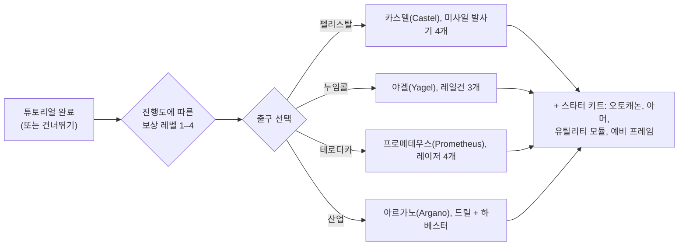

# FAQ

## 튜토리얼을 건너뛸 수 있나요?

훈련 구역을 조기에 떠날 수는 있지만, 완료 시 얻을 수 있는 보상을 포기하게 됩니다.
캐릭터가 튜토리얼을 종료할 때 서버는 다음 작업을 수행합니다:

- **초기 NIC** 및 튜토리얼에서 달성한 **보상 레벨당 보너스** 지급(보상 레벨은 총 4단계가 있습니다).
- 선택한 종족 및 스쿨에 해당하는 **기본 코퍼레이션**으로 배속.
- **시작 익스텐션(스킬)** 및 **스파크** 부여.
- **스타터 로봇**을 생성하고, 뉴 버지니아(New Virginia) 도킹 기지에 도킹시키며 해당 기지를 **홈 기지(home base)**로 설정 — 로봇이 파괴되었을 때 부활하는 장소입니다.
- 해당 도킹 기지의 공용 컨테이너에 **보상 아이템**을 지급하고 환영 우편을 발송.

## 튜토리얼은 어떻게 완료하나요?

목표를 순서대로 진행하십시오. 클라이언트의 **초보자 체크리스트(Rookie Checklist)**(상단 바의 도움말 메뉴)에서 진행 상황을 추적할 수 있으며 하단 바에 고정할 수도 있습니다. 얼마나 멀리 진행했는지가 보상 레벨을 결정하며, 종료 시 받을 수 있는 보상 티어가 결정됩니다 — 레벨 1 종료는 첫 번째 티어만 받지만, 완전히 완료하면 4개 티어를 모두 받습니다.

## 각 출구는 무엇을 제공하나요?

선택에 따라 세 가지가 결정됩니다: 조종하게 될 **스타터 로봇**, 받게 되는 **보상 아이템**, 그리고 배속되는 **기본 코퍼레이션 및 시작 스킬**입니다. 그 외의 모든 것 — 어떤 스킬, 어떤 로봇, 어떤 팩션의 장비든 — 나중에 EP와 NIC로 배우고 구매할 수 있으므로, 이 선택은 초기 지급 키트일 뿐이며 영구적으로 구속되지 않습니다.

| 출구 | 스타터 로봇 (피팅 완료) | 보상 테마 |
|---|---|---|
| **펠리스탈(Pelistal)** | 카스텔(Castel) — 미사일 발사기 4개 | 미사일 + 오토캐논 |
| **누임콜(Nuimqol)** | 야겔(Yagel) — 레일건 3개 | 레일건 탄약 + 오토캐논 |
| **테로디카(Thelodica)** | 프로메테우스(Prometheus) — 레이저 4개 | 레이저 크리스탈 + 오토캐논 |
| **산업(Industrial)** | 아르가노(Argano) — 드릴 2개, 하베스터, 채굴 프로브 | 채굴, 수확 및 유물 스캔 탄약 |

모든 출구에는 탄약이 포함된 소형 오토캐논 세트, 장갑 및 유틸리티 모듈(아머 수리기, 센서 부스터 또는 질량 감속기, 코어 리차저, 데미지 모디파이어), 두 번째 (비어 있는) 프레임, 그리고 최고 보상 레벨에서는 벽 폭탄(wall-bomb) 캡슐이 포함됩니다.

## 훈련을 마치면 무엇을 해야 하나요?

거의 모든 활동을 통해 스킬을 위한 EP와 장비를 위한 NIC를 획득할 수 있습니다:

- 채굴, 수확, 유물 탐사를 진행하고 그 수확물을 [마켓](/ko/features/market/)에 판매합니다.
- NPC를 사냥하고 [전리품](/ko/features/npcs/)을 판매합니다.
- 재료를 모으거나 구매하여 다양한 품목을 [제작](/ko/features/production/)합니다.
- [임무](/ko/features/missions/)를 수행합니다 — 터미널이나 전초기지에서 제공하는 모든 임무는 혼자서도 완수할 수 있습니다.

오픈 월드 PvP가 처음이신가요? 먼저 [시작하기의 생존 가이드](/ko/features/getting-started/#survival)를 확인하십시오.

## 훈련 구역에 다시 갈 수 있나요?

아니요. 훈련 구역은 신규 캐릭터 전용이며 한 번 떠나면 다시 입장할 수 없습니다. 목표를 다시 확인하고 싶다면 도움말 메뉴의 초보자 체크리스트를 계속 열어볼 수 있으며, 언제든지 새 캐릭터를 생성하여 튜토리얼에 테스트 샌드박스로 남겨둘 수도 있습니다.

## 약어 정리

채팅, 마켓 목록 및 피팅에서 자주 사용되는 줄임말입니다. 대부분의 용어는 고유한 페이지가 있습니다(유용한 곳에 링크됨) — 아이템 이름은 사이트 검색에서 찾을 수 있습니다.

| 용어 | 의미 |
|---|---|
| **EP** | [익스텐션 포인트(Extension Points)](/ko/features/research/#ep-sources) — [익스텐션](/ko/features/character/#extensions)을 업그레이드하는 데 사용되는 계정 단위의 스킬 화폐(획득 규칙은 [연구 페이지](/ko/features/research/#ep-sources) 참고). |
| **NIC** | 니안 크레딧(Nian Credit) — 게임 내 화폐(캐릭터의 `credit` 잔액). |
| **CT** | [CPRG — 캘리브레이션 프로그램](/ko/features/production/#cprg-calibration-programs) — 밀(mill) 생산 라인이 작동하기 전 캘리브레이션되는 프로그램(아이템당 1개, 재료/시간 효율 포함). |
| **Proto** | 프로토타입(Prototype) 아이템 — [프로토타입 시설](/ko/features/production/#the-item-lifecycle-the-circular-process)에서 제작되는 모듈/로봇의 상위 티어 변형(이전 티어 시제품을 소모함; [티어 진행도](/ko/features/production/#tier-progression) 참고). |
| **LWF** | 경량화 프레임(Lightweight frame) — 질량을 줄여주는 아머 모듈(클라이언트 이름은 "… 경량화 프레임", 예: *Niani 경량화 프레임*). 아머를 희생하여 로봇의 무게를 줄입니다. |
| **TP / tele** | [텔레포트](/ko/features/movement/) — 고정된 지점 간 또는 배치된 모바일 텔레포트 장치로의 빠른 이동. |
| **SAP** | 서비스 액세스 포인트(Service Access Point) — 전초기지 [안정도](/ko/features/outposts/) 활동. |
| **Stab** | 무기 안정기(Weapon Stabilizer) — 무기의 명중률을 높여줍니다. |
| **Demob** | 이동 저하기(Demobilizer) — 상대 로봇(및 모듈)의 속도를 늦추는 모듈. |
| **EWar** | 전자전(Electronic Warfare) 모듈 (재밍, 센서 억제, 스텔스). |
| **EnWar** | 에너지 전쟁(Energy Warfare) 모듈 (코어 인젝터, 드레인, 뉴트럴라이저, 트랜스퍼). |
| **Tuning** | 튜닝 — 다른 모듈을 강화하는 업그레이드 모듈의 클라이언트 명칭 — 무기 데미지 모디파이어, 채굴기/하베스터용 *산업 튜닝*, 아머 수리기 튜닝 등. |
| **MK2** | 로봇의 개량형 변형(`_mk2` 프레임) — 더 높은 용량과 고유한 연구 라인을 가집니다. |

로봇 등급은 클라이언트 내 그룹 분류를 따릅니다 — [로봇 등급](/content/robots/#robot-classes)의 노트를 참조하십시오.

<!--
Written from scratch against the server backend, 2026-09-27:
Zones/Teleporting/Strategies/TrainingExitStrategy.cs (exit rewards, NIC,
corporation, extensions, spark, starter robot, home base, reward items),
Zones/Training/Reward/TrainingReward*.cs + trainingrewards/robottemplates
(reward levels 1-4, per-race starter packs and items),
Robots/Robot.Properties.cs (race ids 1=Pelistal, 2=Nuimqol, 3=Thelodica, 5=industrial).
An earlier version of this page was adapted from the Open Perpetuum
community wiki (perpetuum.miraheze.org) and has been fully rewritten from
backend sources; no text was reused.
-->
