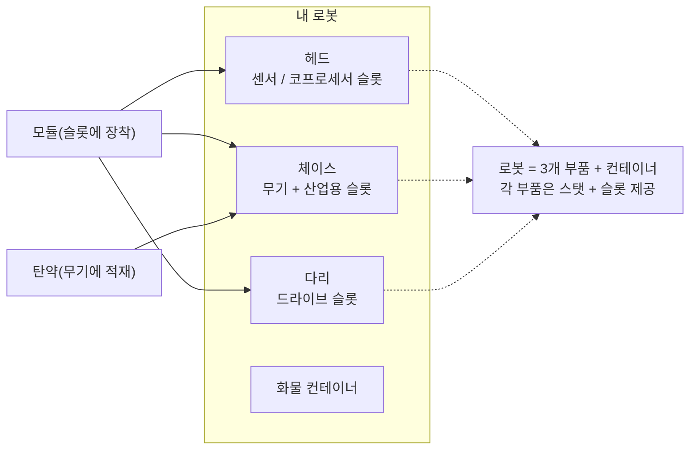

# 피팅

피팅은 로봇의 부품 슬롯에 **모듈**을, 무기에는 **탄약**을 장착하는 것을 의미합니다. 모든 피팅은 **도킹 전용**입니다 — 존에서는 피팅할 수 없습니다.

> UI 위치는 [클라이언트 UI 개요](/ko/features/ui/)를 따릅니다(상단 바의 **장착** 카테고리). 아래 메커니즘은 서버 기준으로 확인되었습니다.

## 모듈 장착

로봇에는 여러 **부품**(무기, 실드, 아머, 드라이브, 센서 등)이 있으며, 각 부품에는
**슬롯** 세트가 있습니다.

- **모듈 장착** — 컨테이너에서 모듈을 꺼내 특정 부품 슬롯에 장착합니다. 모듈 유형은
  해당 로봇 클래스의 해당 슬롯에서 유효해야 합니다. 슬롯이 이미 사용 중이면 기존
  모듈은 컨테이너로 반환됩니다.
- **모듈 교체** — 같은 부품의 두 슬롯 사이에서 모듈을 이동합니다.
- **모듈 제거** — 슬롯에서 모듈을 꺼내 컨테이너로 되돌립니다.

서버는 모든 변경 사항 이후 로봇의 스탯을 다시 계산합니다(모듈은 비도킹 상태 패널에
표시되는 값에 영향을 줍니다 — [전투](/ko/features/combat/) 참고).

## 탄약 장착

- **탄약 장착** — 호환되는 탄약 아이템을 활성(무기) 모듈에 적재합니다. 모듈은 해당
  **탄약 유형을 수락**해야 하며, 모듈의 **탄약 용량**까지 적재됩니다. 이전에 적재된
  탄약은 먼저 컨테이너로 반환됩니다.
- **탄약 변경** — 적재된 탄약을 다른 호환 유형으로 교체합니다.
- **탄약 해제** — 적재된 탄약을 컨테이너로 반환합니다.

## 피팅 프리셋

**프리셋**은 빠르게 다시 적용할 수 있는 저장된 피팅입니다:

- **저장** — 로봇의 현재 피팅을 이름으로 저장합니다.
- **목록** — 저장된 프리셋을 확인합니다.
- **적용** — 컨테이너에서 프리셋을 (다른) 로봇에 적용합니다.
- **삭제** — 저장된 프리셋을 삭제합니다.

프리셋은 전투 후 재장착하거나 역할 간 전환할 때 유용합니다.

## 실무 노트

- **존에서는 피팅할 수 없습니다** — 여기의 모든 작업은 도킹 상태가 필요합니다.
- **먼저 Enabler 확장** — 연구되지 않은 로봇 클래스는 선택하거나 조종할 수 없습니다.
- **탄약은 무기와 일치해야 합니다** — 호환되지 않는 탄약 정의는 거부됩니다.
- **재포장된 로봇은 사용할 수 없습니다** — 로봇을 선택하거나 피팅하기 전에 포장
  해제해야 합니다.
- **프리셋으로 빠르게 재장착** — 검증된 로드아웃을 저장한 뒤 손실 후 적용합니다.

## 슬롯 카테고리

로봇의 부품(헤드, 체이스, 다리)은 **슬롯**을 제공하며, 각 슬롯에는 카테고리 플래그
세트가 있습니다. 모듈은 모듈 자체의 플래그가 슬롯 플래그의 **부분 집합**일 때만 해당
슬롯에 장착됩니다. 플래그 카테고리는 다음과 같습니다:

`small`, `medium`, `large`, `turret`, `missile`, `melee`, `industrial`,
`ew_and_engineering`, `specialized`(전문 슬롯은 전문 모듈만 수락), 그리고 구조적인
`head` / `chassis` / `leg` 슬롯.

모듈은 특정 로봇으로 제한될 수도 있으며, 일부는 **unique** 플래그를 가져 해당 유형은
한 번에 하나만 장착할 수 있습니다. 모듈별 스탯 효과는 생성된 [로봇 표](/content/robots/)에 있습니다.