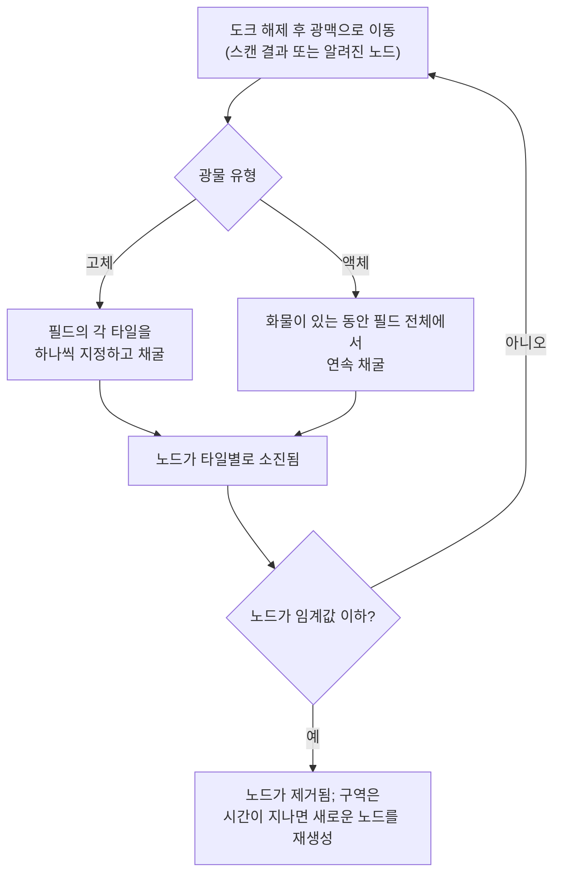
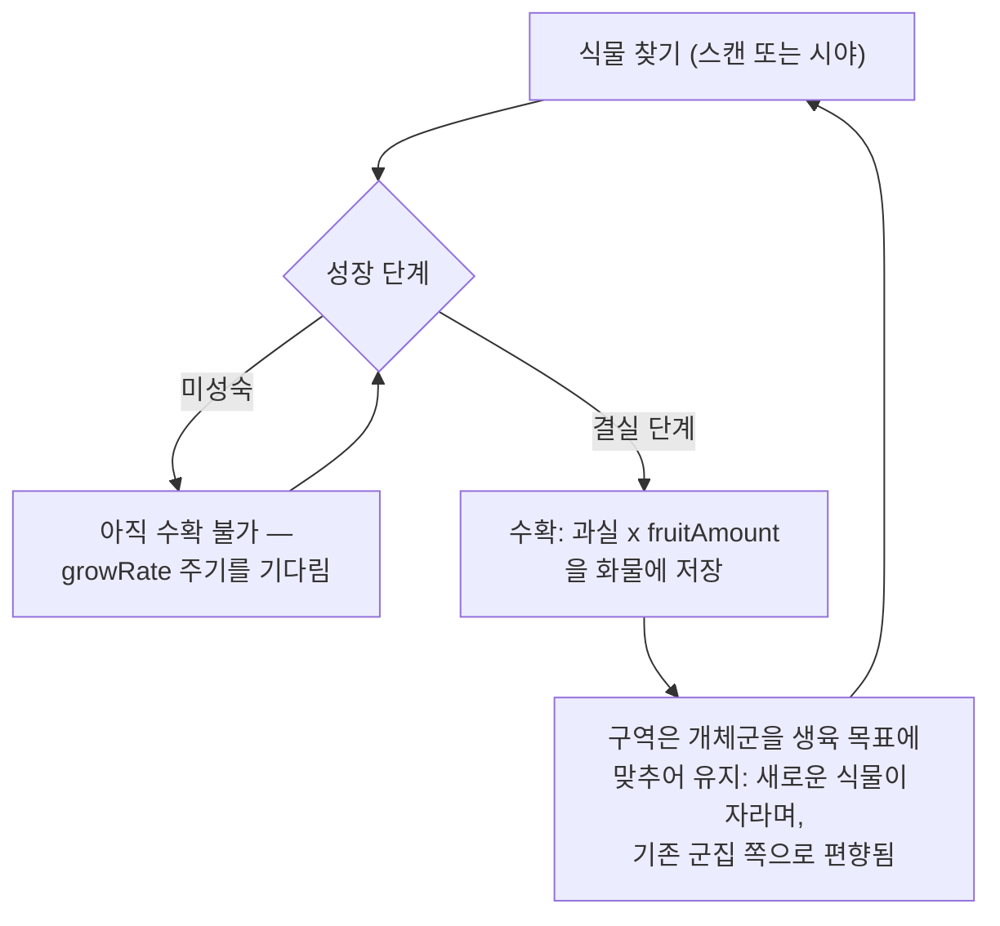
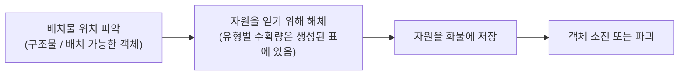

# 자원 수집 및 스캔

게임의 자원은 구역 내 세 가지 출처에서 나옵니다: **광물 광맥**, **식물**,
그리고 **배치물**. 이 페이지에서는 각각이 어떻게 작동하는지와 수집 루프가 어떻게 진행되는지 설명합니다.

> UI 위치는 [클라이언트 UI 개요](/ko/features/ui/)를 따릅니다: 스캔과 수확 액션은
> **도크 해제 액션** 목록에 있습니다(구역 내에서는 오른쪽 위). 자원 유형별 수확량 숫자는
> 생성된 표에 있습니다: [콘텐츠 → 광물](/content/ores/) 및
> [콘텐츠 → 식물](/content/plants/). 아래 메커니즘은 서버 구현과 대조하여 확인했습니다.

## 기본 루프

1. **도크 해제** 후 구역으로 이동합니다([이동](/ko/features/movement/) 참고).
2. 로봇의 스캐너 모듈로 해당 지역을 **스캔**합니다.
3. **수집** — 광물을 채굴하거나, 식물 과실을 따거나, 배치물을 해체합니다.
4. **도크**에 정박하여 화물을 기지 컨테이너에 전달합니다.

## 광물 광맥

- 광물은 구역 전체에 흩어져 있는 **광맥(노드)** 형태로 땅속에 존재합니다.
- 이를 찾아 기록하려면 활성 로봇에 **지질 스캐너 모듈**이 장착되어 있어야 합니다.
  스캔을 수행하면 **스캔 결과**가 생성되며, 이를 **업로드**하면 개인 광물 스캔 목록에 저장됩니다.
- 저장된 스캔 결과는 **목록 보기, 이동, 삭제, 또는 아이템으로 변환**할 수 있습니다
  (가공/생산에 사용되는 "광물 스캔" 아이템).

- 광맥은 **유한**합니다: 각 노드는 제한된 총량을 보유합니다. 노드가 임계값 이하로
  채굴되면 제거되고, 구역은 설정된 최대치까지 **시간이 지나면 새로운 노드를 재생성**합니다.
  노드가 어떻게 배치되고 식물 개체군이 어떻게 유지되는지 — 실제 구역을 예시로 — 는
  [구역 → 생성](/zones/generation/)에 있습니다.
- **고체 광물과 액체 광물.** 고체 광물은 타일별로 소진됩니다 — 필드의 각 타일을
  비어 있을 때까지 지정하고 채굴합니다. 액체 광물은 필드 전체에서 추출되므로,
  화물이 있는 동안 채굴기가 연속으로 작동할 수 있습니다. 이 용이함이 바로 액체 광물이
  가치가 낮은 경향이 있는 이유입니다: 채굴에 필요한 숙련도와 주의가 적습니다.

### 식물 및 광물 상태 한눈에 보기

광물과 식물의 행동은 유형별 규칙 데이터에 의해 결정됩니다. 플레이어에게 중요한 필드:

| 필드 | 게임 내 의미 |
|---|---|
| `fertility` | 해당 유형의 흔함 — 값이 높을수록 구역은 이를 더 많이 유지하려고 함 |
| `growRate` | 식물이 각 단계에서 다음 단계로 넘어가기 전에 거쳐야 하는 성장 주기 수 (높을수록 느림) |
| `spreading` | 해당 유형이 군집(그룹)으로 자라는지 흩어져 자라는지 여부 |
| `killDistance` | 같은 유형의 두 식물 사이의 최소 간격 |
| `slope` / `minSlope` | 식물이 자랄 수 있는 지면의 경사도 |
| `allowedAltitudeLow/High` | 식물이 자랄 수 있는 고도 범위 |
| `allowedWaterLevelLow/High` | 해안으로부터의 거리 범위 (해안 식생을 생성) |
| `fruitingState` | 식물이 생산(수확 가능)하기 전에 도달해야 하는 성장 단계 |
| `fruitDefinition` / `fruitAmount` | 식물이 생산하는 것과 기본 수량 |
| `maxAmount` | 처리 영역에서 이 유형의 존재 수 상한 |
| `health` | 성장 단계별 체력 (높은 단계가 더 튼튼할 수 있음) |
| `damageScale` | 식물의 피해 저항력 |
| `playerSeeded` | 식물이 플레이어의 심은 위치에에서만 존재 |
| `onlyOnUnprotectedZone` | 비보호(베타/감마 등급) 구역에서만 자람 |

필드별 전체 참조(유형, 기본값, 저장, 그리고 구역 틱이 이를 사용하는 방식)은
[형식 → 식물 필드](/ko/formats/plant-fields/)에 있습니다.

## 식물

- 식물은 일련의 단계를 거쳐 **시간이 지나면서 성장**합니다. 각 단계는 식물이 무작위로
  다음 단계로 넘어가기까지 성장 주기(`growRate`) 수만큼 걸립니다.
- 식물은 **결실 단계에 도달한 후에만 과실을 생산**합니다 — 미성숙한 식물은 수확할 수
  없습니다.
- 구역은 **생육 목표**에 맞춰 식물 개체군을 유지합니다: 특정 지면이 그 생육 수준에 비해
  식물이 부족하면 새로운 식물이 자랍니다. 선택되는 유형은 각 종의 `fertility`를
  가중하며, `spreading`은 새로운 성장이 기존 군집 쪽으로 향하도록 편향시킵니다.

- 일부 식물은 **플레이어 식재**입니다(플레이어 정원에서만 존재) 그리고 일부는
  **비보호 구역 전용**입니다.
- 식물은 **피해를 입고 죽을 수 있습니다**; `health`와 `damageScale`이 그것이 얼마나
  어려운지를 결정합니다.

## 배치물

배치물은 구역에 배치된 객체입니다(구조물 측면은 [전력 기지](/ko/features/pbs/) 참고).
일부는 자원을 얻기 위해 **해체**할 수 있습니다. 해체 규칙과 유형별 수확량은
생성된 표에 있습니다: [콘텐츠 → 광물](/content/ores/) 및 [콘텐츠 → 식물](/content/plants/).

## 키오스크

**키오스크**는 미션 관련 구조물입니다: 미션의 일부로 범위 내에서 **아이템을 제출**합니다.
그 자체로는 수집 출처가 아닙니다 — [미션](/ko/features/missions/) 참고.

## 실전 참고사항

- **스캔에는 모듈이 필요합니다** — 지질 스캐너가 장착되지 않으면 스캔 결과가 없습니다.
- **스캔 결과는 본인 것입니다** — 캐릭터별로 저장되며 공유되지 않습니다.
- **광물 노드는 다시 생성되지만 느립니다** — 지역이 비어 있으면 광맥이 사라진 것이지
  숨겨진 것이 아닙니다. 재생성은 노드 수를 회복시키지만 즉시 이루어지지 않습니다.
- **성숙한 것을 수확하세요** — 결실 단계의 식물은 전체 수확량을 주며, 어린 단계는
  아무것도 주지 않습니다.

<!-- TODO: 클라이언트 UI 플로우만 남아 있습니다(스캔 화면, 수확 인터랙션, 화물 UI) —
     실행 중인 클라이언트가 필요합니다. 유형별 광물 수확량은 /content/ores/에, 식물 과실
     정의는 /content/plants/에 있습니다(라이브 DB에서 생성).
     개발자 노트: Zone/ZoneUploadScanResult.cs (GeoScannerModule 필요);
     MineralScanResult*.cs (캐릭터별 저장소);
     Zones/Terrains/Materials/Plants/PlantRule.cs (모든 식물 규칙 필드);
     Zones/Terrains/NatureCube.cs (GrowPlants, fertility/spreading/killDistance 로직);
     Zones/Terrains/Materials/Minerals/MineralLayer.cs (광물 노드 수명 주기);
     Zone/UseItem.cs + UseItemVisitor.cs (IUsableItem 수확 경로);
     Zone/KioskSubmitItem.cs (미션 아이템 제출, 범위 제한). -->