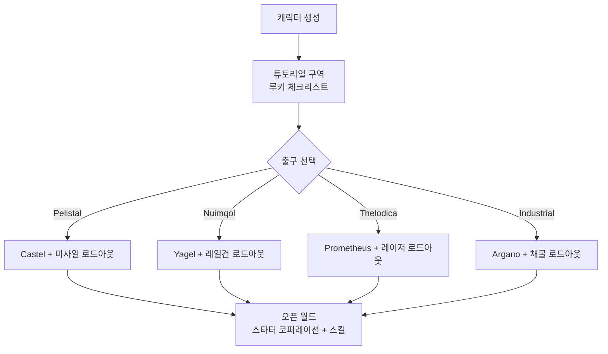

# 시작하기

이 페이지에서는 첫 단계를 다룹니다: 캐릭터 생성, 첫 로봇 수령,
그리고 초반에 자주 사용하는 캐릭터 단위 설정입니다.

> UI 위치는 [클라이언트 UI 개요](/ko/features/ui/)를 따릅니다. 아래 메커니즘은 서버 구현과
> 대조하여 확인했습니다.

## 게임 받기

Perpetuum은 [Steam](https://store.steampowered.com/app/223410/Perpetuum/)에서 무료로 제공됩니다.

  <a class="steam-card-link" href="https://store.steampowered.com/app/223410/Perpetuum/" target="_blank" rel="noopener">
    
    Steam의 Perpetuum — 무료 플레이
  </a>

## 먼저 보기

Open Perpetuum Project의 가이드입니다. 카드를 클릭하면 여기서 재생됩니다.

  

    
    &#9654;
    
Perpetuum Online 튜토리얼 워크스루. + 확장 조언 및 기타.

  

  

    
    &#9654;
    
Syndicate Careers Help — 아티팩팅

  

  

    
    &#9654;
    
Open Perpetuum 튜토리얼 — 여러 클라이언트 실행 방법

  

## 캐릭터 생성

- 생성 전에 **이름이 사용 가능한지 확인할 수 있습니다** (`characterCheckNick`).
- **캐릭터 생성** — 캐릭터는 계정에 연결됩니다. 계정에는 여러 캐릭터를
  둘 수 있으며, 한 번에 하나만 플레이할 수 있습니다.
- 플레이할 **캐릭터를 선택**합니다. 캐릭터를 전환하면 현재 캐릭터가 선택 해제됩니다.
- 나중에 캐릭터를 **이름 변경**할 수 있습니다(이름은 사용 가능해야 합니다).
- 더 이상 사용하지 않는 캐릭터를 **삭제**할 수 있습니다.

## 첫 로봇

- **베이스에 도킹**되어 있을 때, **스타터 로봇을 요청**할 수 있습니다(베이스 시설 —
  베이스 액션 위치는 [클라이언트 UI 개요](/ko/features/ui/) 참조).
  - 베이스에 스타터 로봇 재고가 남아 있어야 합니다 — 인기 있는 베이스에서는 재고가
    소진될 수 있으며, 이 경우 요청이 실패합니다.
  - 캐릭터당 스타터 로봇 요청 사이에 **5분 쿨다운**이 있습니다.
  - 새 로봇은 베이스의 공용 컨테이너로 전달됩니다.

- 도킹 중에는 **"무한 상자"**를 요청할 수도 있습니다: **5,000 크레딧 수수료**로
  인벤토리에 추가되는 특수 컨테이너입니다. 이것은 편의용 컨테이너이며, 무료
  리소스의 원천이 아닙니다.

## 캐릭터 설정

- **아바타** — 캐릭터의 외형.
- **무드 메시지** — 다른 플레이어에게 표시되는 짧은 문구.
- **비공개 메모** — 자신의 캐릭터 중 하나에서만 본인이 볼 수 있는 메모.
- **홈 베이스** — 홈 베이스를 설정하거나 해제합니다. 게임이 안전한 곳에
  캐릭터를 배치해야 할 때 기본 도킹 위치입니다.
- **설정** — 캐릭터별 환경 설정(조회/설정).
- **거래 차단** — 캐릭터의 거래를 켜거나 끕니다.
- **크레딧** — 자신의 캐릭터 간 크레딧을 전송하고, 거래
  내역을 확인합니다.
- **계정 레벨** — 세션 이메일/비밀번호를 변경하고, 계정 거래
  내역과 활동별 EP 내역을 확인합니다.

## 이탈 / 재진입

- **로그아웃**은 세션을 종료하고, **캐릭터 선택**은 다시 시작합니다.
- 서버가 강제로 끊는 경우(예: 베이스로 강제 이동)에는 도킹 상태로 다시 나타납니다 — [이동](/ko/features/movement/) 참조.

## 튜토리얼

새 캐릭터는 훈련 구역에서 **루키 체크리스트**와 함께 시작합니다 — 완료하세요:
기본 사항을 다루며, 모듈과 탄약을 갖춘 여러 로봇을 지급합니다. 건너뛸 수
있습니다(도킹을 해제하고 파벌 출구로 이동) 하지만 보상을 잃게 되며, 나중에
훈련 구역으로 돌아갈 수 없습니다. 네 가지 파벌 출구가 주는 것은
[FAQ](/ko/features/faq/)에 있습니다.

## 생존

Perpetuum은 위험과 보상의 샌드박스이며, 로봇이 죽으면 잃습니다 —
도킹 중이든 아니든, 플레이어든 NPC에게 죽든 — 그리고 [홈 베이스](#kaerigteo-seoljeong)에
다시 나타납니다(빈손으로 도착했다면 무료 스타터 로봇을 요청할 수 있습니다). 손실을
견딜 수 있게 해 주는 몇 가지 규칙:

- **대체할 수 있는 것만 투입하세요.** 도킹 해제는 베팅입니다: 로봇이
  격추되면, 장착된 모듈과 함께 사라집니다(또는 약탈당합니다). 발진 전에
  그 손실이 견딜 수 있는지 확인하세요.
- **구역을 알아야 합니다.** 보호(PvE) 섬은 플레이어로부터 안전하고,
  오픈 PvP 섬은 범죄/처벌 시스템 없이 자유로운 전투입니다.
  [zones](/zones/)에서 지도를 확인하세요.
- **NPC를 알아야 합니다.** 오렌지 마커는 도발할 때만 공격하고, 빨간 마커는
  접근 시 공격합니다. 도망쳐 시야를 끊어 적대감을 떨어뜨리세요.
  [NPCs & PVE 사냥](/ko/features/npcs/) 참조.
- **위험을 완화하세요, 단순히 받아들이지 마세요.** 최고의
  T4 장착 메크로 오픈 PvP 섬에 가는 것은 메크가 죽는 방법입니다. 몇 번의
  이동으로 회수되는 저렴하고 대체 가능한 장비가, 스무 번이 걸리는 비싼
  봇보다 낫습니다.
- **지속 가능한 루프를 만드세요.** 무엇을 하든 — 미션, 채집, 사냥,
  생산, 운송 — 누군가는 NIC을 지불합니다. 하루의 불운이 수입을
  제로로 만들지 않도록 예비 자산을 유지하세요.

## 다음에 할 일

1. 스타터 로봇을 선택하고 [격납고 & 피팅](/ko/features/robots/) 화면을 익히세요.
2. 도킹을 해제하고 구역으로 이동하세요 — [이동](/ko/features/movement/) 참조.
3. 지면을 스캔하고 리소스 수집을 시작하세요 — [채집](/ko/features/gathering/) 참조.
4. 첫 확장을 연구하세요 — [연구](/ko/features/research/) 참조.
5. 커리어를 선택하세요 — [FAQ](/ko/features/faq/)에 메뉴가 있습니다.

<!-- TODO(Phase 1): 클라이언트 UI 흐름 검증 (계정 생성 화면, 캐릭터 마법사).
     UI 모델: features/ui.md 참조 (EVE 스타일, 프로젝트 제공).
     개발자 노트: Perpetuum.RequestHandlers.Characters/* (CharacterCreate,
     CharacterSelect, CharacterRename, CharacterSetHomeBase, ...);
     RequestStarterRobot (5분 쿨다운, 베이스 재고), RequestInfiniteBox
     (5000 크레딧, 도킹 전용). -->