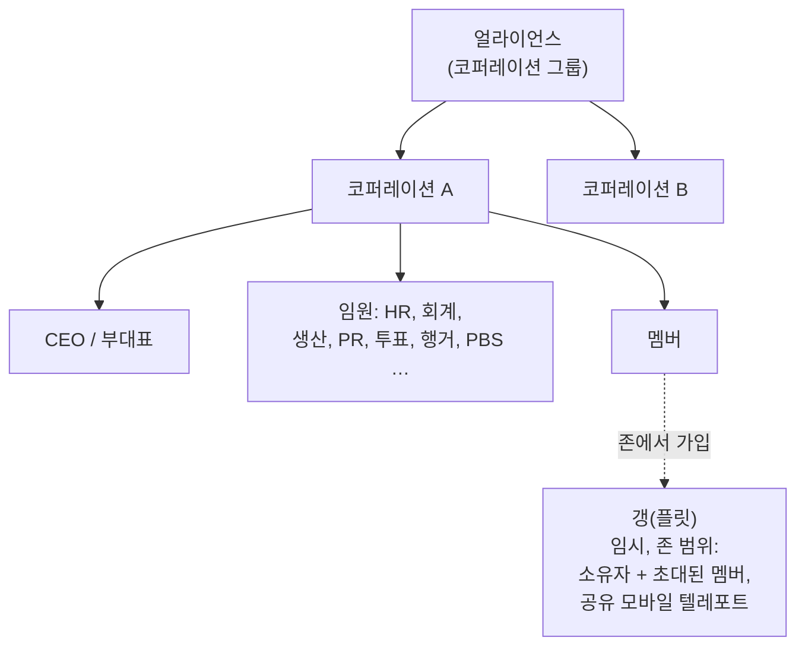

# 그룹

세 가지 그룹이 있습니다: **코퍼레이션**(주요 조직), **얼라이언스**(코퍼레이션 그룹), **갱**(존 플레이용 임시 플릿).

> UI 위치는 [클라이언트 UI 개요](/ko/features/ui/)를 따릅니다(좌측 상단의 **코퍼레이션** 버튼;
> **코퍼레이션 저장소** 카테고리; 갱은 자체 창을 가짐). 아래 메커니즘은
> 서버와 대조하여 확인했습니다.

## 코퍼레이션

### 가입 및 탈퇴
- **코퍼레이션 생성** — 기본 코퍼레이션 관리 확장(레벨 1)과 창립 비용 **250,000 NIC**이 필요합니다. 공식 이름, **단축 ID**(최대 6자, 지형에 표시되어 멤버를 식별), **세율**(멤버 수입, 특히 미션 보수에서 코퍼레이션 계좌로 자동 이체되는 비율)을 선택합니다.
- 코퍼레이션에 **지원**하거나, 캐릭터를 **초대**합니다.
- **지원 수락** / **지원 목록 보기**(임원).
- 받은 **초대에 응답**합니다.
- **탈퇴**하거나, 대기 중인 탈퇴를 **취소**합니다.
- **멤버 제거**, **멤버 역할 설정**, **자신의 역할 해제**, 또는 멤버를 중립으로 설정합니다.

### 역할
코퍼레이션에는 역할 위계가 있습니다. 역할은 수행 가능한 기능을 제한합니다. 예를 들어 코퍼레이션 기술 트리 노드 잠금 해제, 행거 관리, PBS 편집 등입니다([PBS](/ko/features/pbs/) 참고). 서버에서 정의된 역할(`CorporationRole`):

- **CEO** — 전체 제어.
- **부대표** — 2인자.
- **HR 매니저** — 멤버십(지원/초대/제거).
- **코퍼레이션 대리인** / **얼라이언스 대리인** — 조직을 대신하여 행동.
- **회계 담당** — 코퍼레이션 자금.
- **생산 매니저** — 코퍼레이션 생산.
- **투표 관리자** — 투표.
- **PR 매니저** — 홍보 / 게시판.
- **행거 접근(낮음 / 중간 / 높음 / 보안)** — 등급별 행거 권한, 해당하는 **행거 제거** 등급과 **행거 운영자** 역할 포함.
- **PBS 보기 / PBS 편집** — 코퍼레이션의 PBS 구조를 보거나 수정.
- **기술 트리 목록 / 잠금 해제** — 코퍼레이션의 기술 트리를 보거나 잠금 해제.

일반적인 권한 제한 몇 가지: 멤버십 작업(지원/초대/제거, 역할 설정)에는 **CEO / 부대표 / HR 매니저**가 필요합니다. 게시판과 PR에는 **CEO / 부대표 / PR 매니저**가 필요합니다. 코퍼레이션 자금과 시설 업그레이드에는 **CEO / 부대표 / 회계 담당**이 필요합니다(생산은 **생산 매니저**가 추가됩니다). PBS 배치에는 **CEO / 부대표 / PBS 편집**이 필요합니다.

자신과 멤버의 **역할 이력**을 확인할 수 있습니다. 행거 공간은 임대됩니다(기본 서버 설정: 7일 기간당 50,000 크레딧).

### 정보 및 검색
- **코퍼레이션 정보 / 내 정보** — 상세 정보와 내 멤버십.
- 코퍼레이션 **검색**.
- **관계 / 평판** — 내 코퍼레이션의 관계와 평판.
- **대리인** — 코퍼레이션 대신 행동하는 캐릭터.

### 자금
- 코퍼레이션 지갑에 **기부**.
- 지갑에서 **지급**.
- 지갑 간 **이체**.

### 외형 및 프로필
- **이름 변경**, **색상 설정**, **정보 설정**(공개 프로필).
- **로고** — 고정된 심볼 세트에서 최대 5개까지 사용할 수 있으며, 각각 편집 가능(크기, 투명도, 레이어링). 권한이 있는 멤버만 생성하거나 변경할 수 있습니다.
- **이름 이력** — 과거 이름.

### CEO
- **CEO 후보 등록**하거나, **CEO 인수 상태**를 확인합니다.
- **실제 인수 절차**: CEO가 **30일** 동안 오프라인 상태가 되면, 부대표가 인수를 시작할 수 있습니다. **48시간 카운트다운**이 시작되며 코퍼레이션 창에 공지됩니다. CEO 또는 다른 부대표는 즉시 **거부**할 수 있습니다(CEO가 여전히 로그인하지 않으면 거부해도 다음 시도는 중단되지 않습니다). 카운트다운이 0이 되면 부대표가 전체 권한을 가진 CEO가 됩니다.

### 투표
코퍼레이션은 투표를 진행할 수 있습니다:
- 투표를 **시작**하고, **주제 설정**, **투표 목록 보기**, **투표하기**, **투표 삭제**.

## 게시판
코퍼레이션이 운영하는 공지 게시판입니다:
- **시작**하기, **게시물 목록 보기**, **새 게시물 보기**, **게시물 등록**, **관리**(다른 사람의 게시물 편집/삭제), **상세 보기**.

## 코퍼레이션 행거(저장소)
기지 내 코퍼레이션 공용 저장 공간입니다:
- 행거 섹션을 **임대**하고, **임대료 지불**, **임대료 확인**, **닫기**.
- 내용물 **목록 보기**(전체 또는 특정 기지).
- **폴더** — 하위 폴더 생성/삭제.
- **접근 권한 설정**(사용 가능한 대상) 및 **이름 설정**.
- **로그** — 행거 접근 로그 보기, 설정, 삭제.

참고: 코퍼레이션 행거의 로봇을 활성 로봇으로 **선택할 수 없습니다**([로봇](/ko/features/robots/) 참고).

## 코퍼레이션 문서
코퍼레이션용 공용 버전 관리 텍스트 문서 시스템입니다. 문서 유형은 두 가지입니다:

- **PBS 계획** — 코퍼레이션 PBS 네트워크의 계획/블루프린트.
- **테라폼 프로젝트** — 지형 변경 프로젝트 기록.

작업: **생성**, **목록 보기**, **열기**, **본문 업데이트**(버전 관리), **삭제**, 소유권 **이전**, **임대**(유효 기간 연장), **모니터링** / **모니터링 해제**(변경 사항 알림), 그리고 문서 작업 권한을 제어하는 **등록 목록**(최대 25명).

## 얼라이언스

얼라이언스는 코퍼레이션을 그룹화합니다:
- **내 얼라이언스 정보**, **기본 얼라이언스**, **얼라이언스 역할 이력**.
- 관계는 얼라이언스를 대상으로 할 수 있습니다([사회](/ko/features/social/) 참고).

## 갱(플릿)

**갱**은 존 플레이를 위한 임시 그룹입니다(예: 모바일 텔레포트를 공유하거나 함께 전투):
- **생성**, **삭제**, **정보**.
- **초대**, 초대 **응답**, **추방**, **탈퇴**.
- **리더 설정**, **역할 설정**.

갱 멤버십은 **모바일 텔레포트**에 중요합니다 — 소유자 또는 갱 멤버만 사용할 수 있습니다([이동](/ko/features/movement/) 참고).

## 실무 참고

- **역할이 권한을 제한합니다** — 대부분의 임원 작업(지원, 행거, PBS, 투표)에는 적절한 역할이 필요합니다.
- **코퍼레이션 기술은 공유됩니다** — 코퍼레이션용 잠금 해제는 공유 포인트와 배율([연구](/ko/features/research/) 참고)을 사용합니다.
- **행거는 저장소이지 발사대가 아닙니다** — 행거에서 로봇으로 언독킹할 수 없습니다.
- **갱은 일시적입니다** — 영구 조직이 아니라 존 세션에 사용하세요.
- **관계는 코퍼레이션을 따릅니다** — 코퍼레이션의 관계는 우주에서 당신을 대하는 방식에 영향을 줍니다([사회](/ko/features/social/) 참고).

<!-- TODO: 코퍼레이션 UI만 남음(창 레이아웃, 역할 선택기).
     확인됨: CorporationRole enum (21개 역할, 행거 접근/제거 등급 low/medium/high/secure, viewPBS/editPBS, TechTreeList/TechTreeUnlock, 대리인 포함);
     핸들러에서 샘플링한 권한 게이트 (멤버십 CEO/Deputy/HRManager;
     게시판 CEO/Deputy/PRManager; 자금+시설 업그레이드 CEO/Deputy/Accountant;
     생산 +ProductionManager; PBS CEO/Deputy/editPBS); 문서 = pbsPlan(1) +
     terraformProject(2) (CorporationDocumentType.cs), 버전 관리, 임대는 유효 기간 연장,
     모니터링은 변경 알림, 등록 목록 최대 25명 (MAX_REGISTERED_MEMBERS).
     개발자 노트: Corporations/* (지원/초대/수락, 역할, 탈퇴, 정보, 자금,
     투표, 게시판, 행거, 문서, 이력, CEO); AllianceGetMyInfo.cs /
     AllianceGetDefaults.cs / AllianceRoleHistory.cs; Gangs/* (생성/초대/추방/탈퇴,
     리더/역할). SelectActiveRobot.cs는 코퍼레이션 행거 로봇을 금지합니다. -->