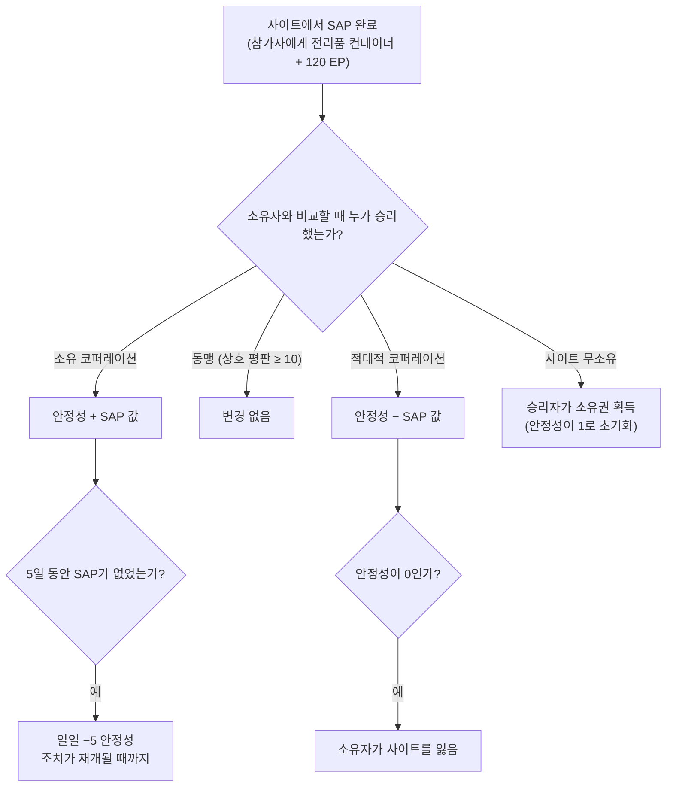

# 침입

**침입**은 **NPC 사이트**를 중심으로 한 모드입니다 — 플레이어가 운영하거나 경쟁할 수 있는 사이트로,
**안정성**, **방어**, **시설**을 갖추고 있습니다. 아이템을 투입하고 방어를 강화하며
시설을 업그레이드하여 사이트를 통제하고 이익을 얻습니다.

> "침입"의 클라이언트 내 명칭은 확인이 필요합니다. UI 위치는
> [클라이언트 UI 개요](/ko/features/ui/)를 따릅니다. 아래 메커니즘은 서버 기준으로 확인되었습니다.

## 사이트 및 안정성

- **사이트 정보** — 침입 사이트의 세부 정보.
- **안정성** — 사이트의 핵심 스탯으로, **0에서 150**까지의 값입니다. 새로운 소유자는
  **1**에서 시작합니다. 안정성이 모든 것을 좌우합니다:
  - **보너스 임계값** (콘텐츠, `intrusionsitestabilitythreshold`): 시설 보너스는
    안정성 **20 / 60 / 80**에서 해제됩니다. 오라 효과 스택(침입 코어,
    탐지, 지오스캔, 하베스터, 산업, 마스킹, 채굴, 수리, 신호 — 각각
    lvl1–3, 그리고 합산 lvl4 효과)은 **10, 20, 40, 50, 70, 80,
    100** 단계에서 해제됩니다. **도킹 권리**는 **50**에서 해제되며, 방어 노드 한도는 **40**에서 증가합니다.
  - **생산 포인트** = `stability / 10` (최대 15) — 시설 업그레이드에 사용되는
    화폐(레벨당 1포인트).
  - **감쇠**: **5일** 동안 성공적인 SAP가 없으면 사이트는 다시 조치가 취해질 때까지
    **일일 5 안정성**을 잃기 시작합니다.
  - **손실**: 안정성이 **0**이 되면 소유자가 사이트를 잃습니다(무소유
    상태가 됨).
- **안정성 로그** — 사이트의 안정성 변경 사항을 검토합니다.

### 안정성을 변화시키는 주체

안정성 변화는 완료된 **SAP**(아래)와 시스템 감쇠에서 비롯됩니다. 효과는
현재 소유자와 비교할 때 *누가* SAP를 승리하는지에 따라 달라집니다:

- **소유자 승리** → 안정성이 SAP의 값을 **획득**합니다.
- **동맹 승리** (상호 평판 ≥ 10) → **변경 없음**.
- **적대적 코퍼레이션 승리** → 안정성이 SAP의 값을 **상실**합니다.
- **무소유 사이트** → 첫 플레이어 코퍼레이션 승리자가 **소유권을 획득**합니다(안정성이
  1로 초기화).

## SAP(사이트 공격 포인트)

**SAP**는 사이트에 생성되는 일시적인 목표물입니다. 완료하면 SAP 위치에 **전리품
컨테이너**가 떨어지고, 안정성이 변경되며, 모든 참가 캐릭터에게 **120 EP**가
지급됩니다. **NPC 컬티스트도 SAP를 경쟁합니다** — 그들이 먼저 점수를
채우면 SAP는 우리 쪽에 불리하게 계산됩니다. SAP 유형은 4가지입니다:

| SAP | 완료 방법 | 안정성 값 |
|---|---|---|
| **능동 해킹** | SAP에 해킹 모듈 사용 (최대 120회 모듈 사용) | +15 |
| **수동 해킹** | SAP 범위 5 이내에 **8분** 동안 대기 | +10 |
| **파괴** | SAP를 파괴 (NPC 피해도 포함) | +15 |
| **표본 처리** | **5–6개의 SAP 표본** 제출 (2–3개씩 배치, 1.5분 쿨다운, 범위 7) | +15 |

- **SAP 아이템 제출** — 구역 내에서 표본 처리 SAP에 표본을 제출합니다.
- **SAP 아이템 정보** — SAP 아이템 데이터를 확인합니다(내 아이템과 일반).

SAP 표본은 이 모드의 소모품입니다. 또한 큰 코어 가치를 지니므로
[PBS 반응로 연료](/ko/features/pbs/)로도 사용됩니다.

## 방어 및 효과

- **방어 임계값 설정** — 사이트의 방어 임계값을 설정합니다(사이트의
  자동 방어가 작동하는 시점).
- **효과 보너스 설정** — 사이트의 오라/효과 보너스 구성을 설정합니다(안정성으로
  해제된 오라 세트에서).
- **시설 업그레이드** — 사이트 시설을 개선합니다: **1 생산 포인트**
  (즉, 10 안정성)가 소요되며, CEO / 부대표 / 회계 담당만 가능하고 최대 레벨로 제한됩니다.
- **사이트 메시지 설정** — 사이트의 공개 메시지를 설정합니다.

## 로그

- **내 침입 로그** — 내 침입 활동.
- **공개 로그** — 공개 침입 피드.
- **내 사이트 로그** — 내 사이트의 활동.
- **안정성 로그** — 안정성 변경 사항(위 참조).

## 실전 노트

- **안정성이 핵심 스탯입니다** — 보너스 단계를 제어하고, 업그레이드
  화폐를 생산하며, 적대적 SAP가 빼앗아 가는 대상입니다.
- **SAP는 경쟁 대상입니다** — NPC 컬티스트가 당신과 경쟁합니다. SAP를 잃으면 안정성을 잃습니다.
- **사이트를 방치하지 마세요** — 성공적인 SAP가 5일 없으면 일일
  감쇠가 시작됩니다.
- **로그가 상황을 보여줍니다** — 내/공개/안정성 로그를 사용해 내 사이트 전반에서 일어나는 일을
  추적하세요.

<!-- TODO: "침입"의 클라이언트 내 명칭과 UI만 남음.
     확인됨: 안정성 0-150, 시작 1 (Outpost.cs 상수); 보너스 임계값은
     intrusionsitestabilitythreshold (시설 20/60/80; 오라 효과 50-74는 단계
     10/20/40/50/70/80/100; 도킹 권리 50; 방어 노드 40); 생산 포인트 =
     stability/10, 시설 업그레이드 비용 1포인트, CEO/부대표/회계 담당; 5일 방치 후
     일일 -5 감쇠 (OutpostDecay.cs); 소유자 승리 +, 동맹 (standing>=10) 0,
     적대 -; 무소유 -> 승리자가 획득; 안정성 0 -> 소유권 상실; SAP 참가자당
     120 EP (EP_WINNER, EpForActivityType.Intrusion); SAP 유형 4가지: 능동
     해킹 (120 모듈 사용, +15), 수동 (범위 5에서 8분, +10), 파괴
     (파괴, +15), 표본 처리 (5-6 표본을 2-3 배치로, 1.5분 cd,
     범위 7, +15; siegeitems 테이블: def_specimen_sap_item 2-3); SAP 증가 값은
     entitydefaults #increase 옵션에서; NPC sap guard/invade 유닛이 SAP를 경쟁합니다.
     개발자 노트: Intrusion/IntrusionSAPSubmitItem.cs (SpecimenProcessingSAP,
     구역 제출), IntrusionSAPGetItemInfo.cs / IntrusionSapItemInfo.cs,
     IntrusionSetDefenseThreshold.cs, IntrusionSiteSetEffectBonus.cs,
     IntrusionUpgradeFacility.cs, SetIntrusionSiteMessage.cs; GetIntrusionSiteInfo.cs,
     GetIntrusionLog.cs / GetIntrusionPublicLog.cs / GetIntrusionMySitesLog.cs /
     GetIntrusionStabilityLog.cs, GetStabilityBonusThresholds.cs;
     EventProcessors/AffectOutpostStability.cs; Zones/Intrusion/Outpost.cs,
     OutpostDecay.cs, SAP.cs + *SAP.cs 서브클래스. -->