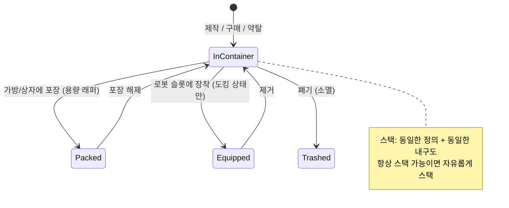

# 아이템 & 인벤토리

귀하의 **인벤토리**는 **컨테이너**들의 집합입니다(기지의 공용 컨테이너, 로봇의
컨테이너, 가방/상자 등). 이 페이지에서는 그 안의 아이템 조작 방법을 다룹니다.

> UI 위치는 [클라이언트 UI 개요](/ko/features/ui/)를 따릅니다. 아래 메커니즘은 서버 기준으로
> 확인되었습니다.

## 컨테이너

- **컨테이너 목록 보기** — 내용을 확인합니다.
- **아이템 이동** — 접근할 수 있는 컨테이너 사이에서 아이템을 이동합니다.

접근 규칙이 적용됩니다. 일부 컨테이너(코퍼레이션 격납고, 로봇 인벤토리, 시스템 컨테이너)는
제한되어 있습니다 — [로봇](/ko/features/robots/)과 [그룹](/ko/features/groups/)을 참고하세요.

## 포장 및 포장 해제

- **아이템 포장** — 아이템을 가방/상자("용량 래퍼" 컨테이너)에 넣어 압축적으로 휴대합니다.
- **아이템 포장 해제** — 가방/상자에서 아이템을 다시 꺼냅니다.

포장은 **로봇**을 저장/수송을 위해 압축하는 방식이기도 합니다. 서버는 로봇의
동적 상태와 구성 요소를 제거하고 *재포장* 상태로 표시합니다. 로봇은 **손상되지 않은**,
**선택되지 않은**, **보험이 가입되지 않은**, 그리고 **인벤토리가 비어 있는** 상태에서만
포장할 수 있습니다. 포장 해제는 로봇을 재구성하고 수리합니다. 콘텐츠에서 *재포장 가능*으로
표시된 아이템만 포장할 수 있으며, 재포장된 로봇은 포장 해제 전에는 선택하거나 장착할 수
없습니다([로봇](/ko/features/robots/) 참고).

## 스택

많은 아이템이 스택됩니다. 스택 작업:

- **아이템 스택** / **스택으로 이동** / **선택 스택** — 동일한 유형의 아이템을 하나의 스택으로
  결합합니다(또는 스택을 다른 스택 위로 이동합니다).
- **수량 스택 해제** — 스택에서 특정 수량을 분리합니다.

서버는 **동일한 정의와 동일한 내구도**를 가진 아이템만 병합합니다.
*항상 스택 가능*으로 표시된 아이템(광물, 탄약, 대부분의 원자재)은 자유롭게 스택되고,
*스택 불가*로 표시된 아이템은 절대 스택되지 않으며, 그 외 아이템은 **재포장(포장)
상태에서만** 스택할 수 있습니다 — 따라서 포장 해제된 손상된 장비는 개별 상태로 유지됩니다.

## 이름 변경 및 사용

- **아이템 이름 변경** — 아이템에 사용자 지정 이름을 부여합니다.
- **아이템 사용** — 사용 가능한 아이템을 활성화합니다(상황에 따라 다릅니다. 존에서는 존 객체와
  상호작용할 수도 있습니다 — [채집](/ko/features/gathering/) 참고).
- **로터리 아이템 사용** — 로터리 방식 아이템을 열거나 활성화합니다.

## 폐기 및 보상

- **아이템 폐기** — 아이템을 폐기합니다(삭제됩니다).
- **아이템 보상** — 스태프/관리자 보상 처리 흐름입니다: 아이템을 생성하여 캐릭터에게 지급하고,
  거래 로그에 기록합니다. 플레이어는 이 기능을 직접 호출하지 않습니다.

## 특수 아이템

- **교환권** — 교환 가능 아이템(코드/지급 항목)을 목록으로 보거나, **교환**하거나, **활성화**합니다.
- **굿즈 팩** — 굿즈 팩(아이템 묶음)을 목록으로 보고 **교환**합니다.
- **선물 열기** — 선물에는 서버 전체 약탈 풀에서 추출된 **무작위** 아이템 1개가 들어 있습니다
  (탄약, 원광물, 플라즈마, 연구 키트, 모듈, 캡슐, 페인트, 부스터 —
  가능한 정의 221개, 각각 고유한 수량 범위).

## 실무 참고

- **접근은 컨테이너별** — 소유하거나 권한이 부여된 컨테이너만 조작할 수 있습니다.
- **더 많이 휴대하려면 포장** — 가방/상자로 대량 아이템을 압축하여 이동할 수 있습니다.
- **스택은 공간을 절약** — 같은 아이템을 결합하고, 필요한 양만 정확히 꺼내기 위해 스택을 해제합니다.
- **폐기는 영구적** — 삭제된 아이템은 사라집니다.
- **교환권/굿즈 팩은 일회용** — 교환 시 코드/아이템이 소모됩니다.
- **포장된 로봇은 비활성** — 선택하거나 장착하기 전에 포장 해제를 수행하세요.
- **포장된 아이템만 스택** — 같은 아이템이 병합되지 않으면 먼저 포장(또는 수리)하세요.

<!-- TODO: 남은 것은 인벤토리 UI뿐입니다.
     확인됨: 스택 규칙 (Item.cs CanStackTo: 동일한 ED + 동일한 내구도; AttributeFlags
     alwaysStackable/nonStackable; 기타는 재포장 필요); 포장 규칙 (ItemPacker.cs:
     로봇은 손상되지 않아야 하고, 선택되지 않아야 하고, 보험이 가입되지 않아야 하고,
     인벤토리가 비어 있어야 함; repackable 플래그); 포장 해제는 재구성 + 수리 (ItemUnpacker.cs);
     선물 = giftloots에서 무작위 추출 (221개 정의: 탄약 x1500-2000, epriton/fluxore x600-1000,
     리액터 플라즈마 x10-20k, 연구 키트, 페인트, 캡슐, named3 모듈, 부스터, 리스펙 토큰);
     굿즈 팩은 캠페인 기반 (GoodiePackRedeem: campaignID + indy 선택);
     ReimburseItem = 관리자 도구 (opp_reimburselog). AttributeFlags 비트 위치:
     nonStackable=10, alwaysStackable=11, repackable, consumable=24, deployable=23.
     개발자 노트: ListContainer.cs; RelocateItems.cs; PackItems.cs / UnpackItems.cs;
     StackTo.cs / StackSelection.cs / UnstackAmount.cs; SetItemName.cs; UseItem.cs /
     UseLotteryItem.cs; TrashItems.cs; ReimburseItem.cs (PbsReimburseRequestHander.cs);
     RedeemableItemList.cs / RedeemableItemRedeem.cs / RedeemableItemActivate.cs;
     GoodiePackList.cs / GoodiePackRedeem.cs; GiftOpen.cs. 컨테이너 접근:
     ContainerAccess / ContainerAccessChecker.cs. -->