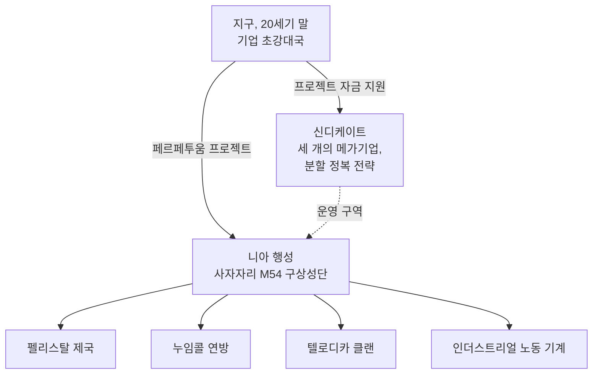

# 세계관

## 니아의 발견

지구의 20세기 말 기술 호황 — 인터넷, 의료 IT 융합, 우주
연구 — 은 오래된 물리적·정신적 경계를 무너뜨렸다. 통신과
무역은 더 빠르고 저렴해졌으며, 거대 기업들은 각 지역의 사실상
정부가 되었다.

그런 세계 속에서 **니아 행성**이 발견되었다. 이 행성은 사자자리의
M54 구상성단에 위치하며, 프로젝트 로고의 모티프이기도 하다. 니아는
쌍성 중 하나를 공전하는 그 쌍성계의 네 번째 행성으로, 지구와 놀라울
정도로 유사하다: 평균 표면 온도는 약 19 °C, 대기 밀도는 지구와
비슷하다. 두 가지 특이점이 있다. 그 바다들은 전기 구동체에 대해서는
통과할 수 없는 장벽이다 — 행성의 밀도 높은 핵과 빠른 자전이 바다에
전하가 유지되게 하기 때문이다 — 그리고 표면의 약 17%만 육지이며, 빠른
판 구조 운동이 이를 섬으로 쪼개고 있다. 그 육지에서는 생명이 번성한다.

## 니안족

니아의 거주민들은 "생물"의 통상적 의미를 뒤집는다: 형태는 우리의
로봇과 다르지 않은 합성 종이지만, 기술적으로 발전한 별개의
**사회**로 조직되어 있다 — 각각 독자적인 산업, 군사, 문화를 갖추고
있다. 에너지에 목말라한 지구에게 가장 중요한 성과는 그들의 **에너지
생산 기술**이다.

세 개의 외계 종족은 각자의 영토를 이루는 섬 사슬을 놓고 최종 승리를
위해 싸우고 있다 — **펠리스탈 제국**, **누임콜 연방**, **텔로디카
클랜** — 그 사이에는 산재한 **인더스트리얼** 노동 기계 인구가 있다
(이것은 [NPC](/ko/features/npcs/)로 만나는 네 개의 집단과 동일하다).

## 신디케이트

페르페투움 프로젝트의 주요 투자자는 **신디케이트**이다 — 지구에서
가장 강력한 세 개의 메가기업으로 이루어진 동맹으로, 각자는 지상에서
독자적인 운영 구역을 두고 있다:

| 기업 | 영역 |
|---|---|
| **트루홀드-마크슨** | 북미 소비재 산업 거대 기업; 쇠퇴하는 **펠리스탈** 영역으로 진출하고 있다. |
| **ICS — 기업 보안 연구소** | 유럽-러시아 연합; 반란 **누임콜** 영토 내부에서 활동하고 있다. |
| **아신텍** | 첨단 기술 이웃 기업들과 함께 아시아 산업 패권을 장악; **텔로디카 클랜**에 대한 전면 공세를 벌이고 있다. |

전략은 오래된 *분할 정복*이다: 세 개의 운영 구역을 서로 균형 있게
유지함으로써, 외계 세력들이 연합하는 대신 서로 싸우게 만든다. 인간
"에이전트"들은 지상에서 활동한다 — 니안족의 에너지 자원을 채취하고,
그들의 기술을 연구하며, 신디케이트가 원하는 평화를 단속한다.

여기가 바로 당신이 들어서는 지점이다.

<!--
개발자 노트: 2026년에 정통 설정을 바탕으로 독창적 산문으로 재작성됨.
이전 버전은 Open Perpetuum 커뮤니티 위키
(perpetuum.miraheze.org: Discovery of Nia, Nia, Syndicate)에서 개작되었으나, 해당 텍스트는
재사용되지 않고 완전히 대체되었다.
백엔드와의 일관성: 세 개의 외계 종족 + 인더스트리얼은 NPC
종족과 일치한다(참조 /features/npcs/); 기업 이름은 구역 약어와
일치한다(zone_ICS, zone_ASI, zone_TM — /zones/의 베타 티어 구역은 해당
메가기업 이름을 따서 명명됨).
-->