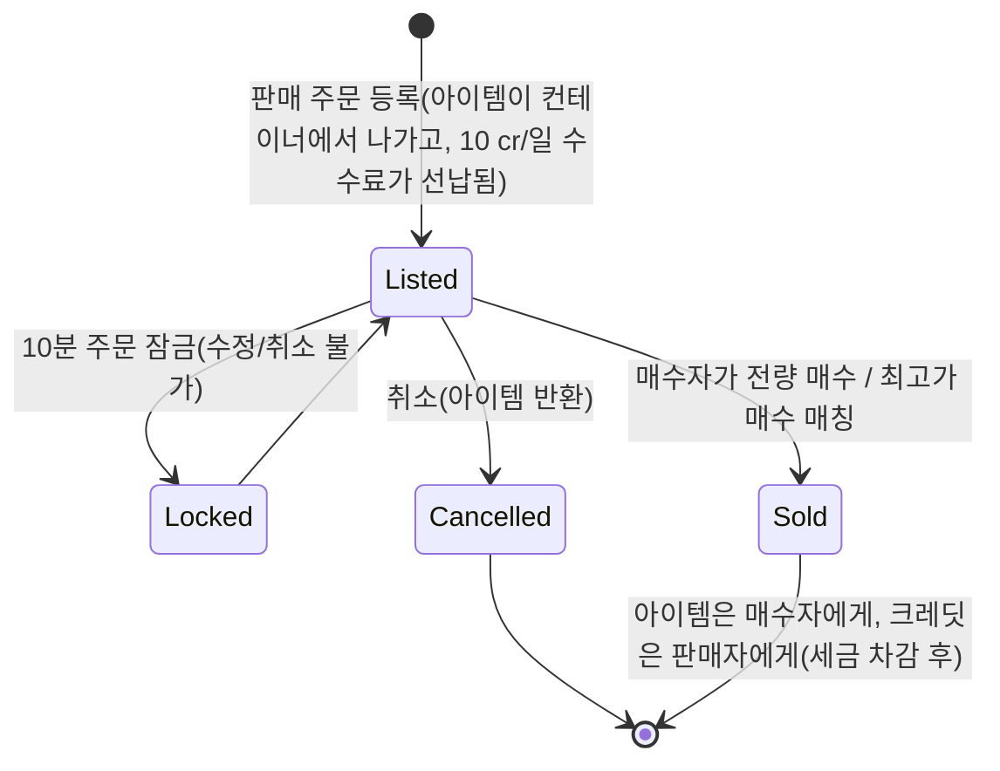

# 시장 및 거래

**시장**은 기지에서 아이템을 사고파는 곳입니다. 모든 시장 작업은
**도킹 전용**입니다(도킹한 기지에서 거래합니다).

> UI 위치는 [클라이언트 UI 개요](/ko/features/ui/)(상단 바의 **Market** 카테고리)를
> 따릅니다. 아래 메커니즘은 서버 기준으로 확인되었습니다.

## 시장 주문

현재 기지의 시장에서 두 가지 유형의 주문을 등록할 수 있습니다:

### 판매 주문
아이템을 판매 목록에 올립니다.
- **아이템**, **수량**, **개당 가격**, **기간**(일, 최소 1일)을 선택합니다.
- 아이템은 컨테이너에서 꺼내집니다(스택의 일부만 판매하는 경우 스택이 풀립니다).
- **등록 수수료** — `10 credits × 기간`을 선납합니다(*market transaction fee*
  확장으로 감면 가능). 수수료는 기지의 중앙 은행(존 이익 풀)에 납부됩니다.
- **가격 보호** — 활성화되면 가격은 아이템의 **14일 평균 가격**의 **±30%**
  범위 내에 있어야 하며, 범위를 벗어난 가격은 거부됩니다. *(이 보호 기능은
  현재 이 서버에서 **비활성화**되어 있습니다.)*
- **주문 잠금** — 주문 등록 후 **10분** 동안 수정 또는 취소할 수 없습니다.
- **주문 수** — 1 + (*market sellorder expert* 확장)개의 판매 주문을 유지할 수
  있습니다(매수 주문은 별도의 카운터를 사용합니다).
- **내 기업 전용** — 판매 주문을 자신의 기업 멤버로 제한할 수 있습니다(기본 기업이
  아닌 경우에만 가능).
- 상황에 따라 **개인** 또는 **기업** 지갑에서 결제합니다.

### 매수 주문
지정된 가격으로 아이템을 매수하기 위한 상시 주문을 등록합니다.
- 매칭되는 판매가 나타날 때 시장이 체결합니다.

### 주문 관리
- **주문 수정** — 가격/수량/기간을 변경합니다.
- **아이템/주문 취소** — 철회합니다(아이템이 컨테이너로 반환됩니다).
- **내 아이템** — 진행 중인 주문을 확인합니다.
- **최고가 매수 매칭** — 판매가 기존 매수 주문으로 연결될 수 있습니다.

## 직접 구매

- **아이템 구매** — 시장에 있는 아이템을 즉시 구매합니다(상시 주문 없이).

## 시장 탐색

- **아이템 목록 / 구매 가능한 아이템 / 범위 내 아이템** — 판매 중인 아이템을
  탐색합니다.
- **시장 정보** — 기지 시장에 대한 세부 정보.
- **평균 가격** — 시장 평균, 정의별 평균, **전체** 평균.
  가격 보호 기능은 이 값들을 기준으로 합니다.

## 시장 세금

- **시장 세금 변경** — 시장의 세율을 설정합니다. **PBS 기지 시장**만
  플레이어 관리가 가능하며, 그 외에는 고정 기본값이 적용됩니다.
- **세금 로그** — 세금 변경 내역을 확인합니다.

시장 판매에서 **판매자**가 받는 금액에서 세금이 차감됩니다. 기본 세율은
**12%**(판매자는 판매 가격의 88%를 수령)이며, *market transaction tax*
확장으로 세율을 낮출 수 있고, 플레이어 관리 시장에서는 PBS 소유자가 사용자
지정 세율을 설정할 수 있습니다.

## 플레이어 간 직접 거래

**거래**는 두 도킹된 캐릭터 간의 P2P 교환입니다:

- **거래 시작** — 다른 플레이어와 세션을 시작합니다.
- **제안 설정/철회** — 자신의 쪽에 아이템/크레딧을 넣습니다.
- **수락** — 양측 모두 수락하면 원자적으로 교환이 완료됩니다.
- **취소** — 거래를 중단합니다.
- **거래 완료/상태** — 완료 및 현재 상태.

캐릭터는 자신에 대한 **거래 차단**을 설정할 수 있습니다([시작하기](/ko/features/getting-started/) 참고).

## 아이템 상점

**아이템 상점**은 기지의 고정 가격 판매처입니다(플레이어 주도 아님). 전체
카탈로그(모든 아이템, 수량, 화폐별 가격, 스탠딩 요구 조건)는
[아이템 상점](/content/shop/)에서 생성됩니다.

- **목록** — 상점에서 판매하는 것을 확인합니다.
- **구매** — 크레딧으로 아이템을 구매합니다.

## 크레딧 전송

- 자신의 캐릭터 간 **크레딧 전송**([시작하기](/ko/features/getting-started/) 참고).

## 실무 참고

- **모든 작업은 도킹 전용** — 존에서는 거래할 수 없습니다.
- **12% 세금을 가격에 반영** — 기본적으로 판매자는 등록 가격의 88%를
  수령합니다(고세율 PBS 시장에서는 더 적음).
- **등록 수수료는 선납** — 1일 만에 판매되더라도 기간이 길수록 비용이 더 듭니다.
- **기업 전용 주문**은 공개 노출 없이 기업 내부에서 물품을 이동시키는 방법입니다.
- **거래는 원자적** — 양측 모두 수락해야 하며, 그렇지 않으면 아무것도
  이동하지 않습니다.
- **세금이 유효 비용을 변경** — 시장 세금을 가격에 반영하세요.

<!-- TODO: 클라이언트 UI만 남음(시장 및 거래 화면 플로우).
     확인됨: MarketInfoService(0.3, 10, false)가
     PerpetuumBootstrapper.cs에 등록됨 -> 14일 평균 대비 마진 +-30% (MARKET_AVERAGE_DAYSBACK
     14), 수수료 10 credits/일 (Market.MARKET_FEE), 이 서버에서 CheckAveragePrice=false;
     DEFAULT_MARKET_TAX = 0.12 (판매자는 88% 수령), 플레이어 관리 세금은 PBSDockingBase
     시장에서만 (MarketTaxHelper); 주문 수정/취소는 제출 후 10분 잠금
     (MARKET_CANCEL_TIME); 주문 수 = 1 + expert 확장 보너스;
     수수료는 기지 중앙 은행에 선납. -->
     개발자 노트: Markets/MarketCreateSellOrder.cs (도킹, 평균 가격 대비 가격 보호,
     기업 전용, 스택 해제, 기업 지갑), MarketCreateBuyOrder.cs,
     MarketModifyOrder.cs, MarketCancelItem.cs, MarketBuyItem.cs, MarketItemList.cs,
     MarketAvailableItems.cs, MarketItemsInRange.cs, MarketGetMyItems.cs,
     MarketGetAveragePrices.cs / MarketGetDefinitionAveragePrice.cs /
     MarketGlobalAveragePrices.cs, MarketTaxChange.cs / MarketTaxLogList.cs;
     Trade*.cs (시작/제안/수락/취소, 원자적); ItemShopList.cs / ItemShopBuy.cs;
     CharacterTransferCredit.cs. -->